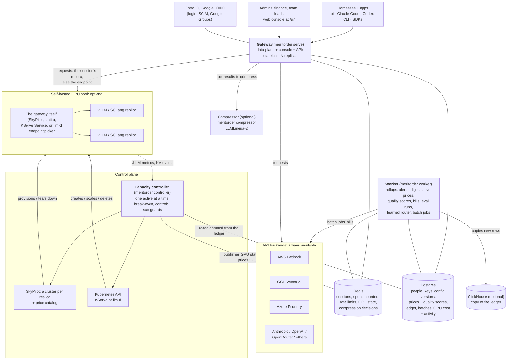
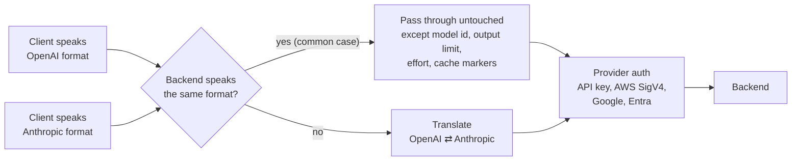

# 01 — Architecture

## The processes

Every process is the same `meritorder` command (and the same image, except the compressor's). The gateway, worker and
controller follow the stored configuration in Postgres, so a change saved on the console reaches all of them; the
compressor takes only its command-line flags.

| Process | Command | Needs | How many |
|---|---|---|---|
| Gateway | `meritorder serve` (port 8080; `MERITORDER_PORT`) | Nothing for a trial (in-memory storage); Postgres and Redis for anything shared | As many as you like; `--workers N` (or `MERITORDER_WORKERS`) for more processes on one machine, which needs Postgres and Redis |
| Migrations | `meritorder migrate` | Postgres | Once per upgrade (Compose's `migrate` service; the chart's migrate Job, `migrations.enabled`) |
| Worker | `meritorder worker` (a cycle every 60 s, `--interval`; `--metrics-port`, or `MERITORDER_WORKER_METRICS_PORT`, for its `/metrics`) | Postgres (it refuses to start without it), Redis | One or more: batch jobs and eval runs are claimed with a lease, so several share them |
| Capacity controller | `meritorder controller` (every 60 s; `--interval`) | Postgres (it refuses to start without it), Redis; SkyPilot or a Kubernetes cluster for the GPUs it runs | One active: the others wait on a Postgres advisory lock. Compose's `gpu` profile; the chart's `controller.enabled` |
| Compressor | `meritorder compressor` (port 8090) | The `compressor` extra (LLMLingua-2, torch); its own image | Optional. Compose's `compressor` profile, the chart's `compressor.enabled`; gateways call it at `MERITORDER_COMPRESSOR_URL` |

Without Postgres there's no worker. A gateway on in-memory storage then checks its own batches every 15 seconds and
deletes stored responses past their retention itself.

## Inside the gateway

Every request passes through the same pipeline (the code is `Gateway.handle` and `Gateway._handle` in `proxy.py`):

```mermaid
flowchart LR
    a["API surface<br/>OpenAI Chat + Responses,<br/>Anthropic Messages,<br/>embeddings"] --> b["Auth<br/>key or sign-in token"]
    b --> c["Admit<br/>budgets, rate limits,<br/>session cap, session state<br/>(one Redis round trip)"]
    c --> d["Level<br/>rules (+ learned<br/>router, opt-in)"]
    d --> e["Router<br/>marginal cost +<br/>switching cost"]
    e --> f["Per-request cost limit,<br/>response cache (opt-in),<br/>compression"]
    f --> g["Backend adapter<br/>translation, cache markers,<br/>effort, output limit"]
    g --> h["Send; on failure<br/>the next candidate"]
    h --> i["Metering<br/>usage + savings ledger<br/>(after the response)"]
```

A `/v1/responses` request is converted to Chat Completions first (in a team's stored mode, rebuilt from the stored
chain), so everything after the API surface sees one shape. [02: Request flow](02-request-flow.md) follows one request
through these steps.

## What each box owns

| Component | Owns | Does **not** own |
|---|---|---|
| **Harness** | The conversation, history, compaction (except Responses API clients in a team's stored mode) | Which backend serves it |
| **Gateway** | Auth, policy, routing decisions, prompt shaping, metering; splitting batches across the providers' batch APIs and running GPUs, and joining their results; in a team's opt-in stored mode, the Responses API conversations its clients chain, sealed, for the team's retention | Conversation content otherwise (never stored, except in the opt-in response cache, batch uploads until they're submitted, and batch work for GPUs until it runs and its results until retention ends, all sealed, in Postgres or the operator's bucket) |
| **Redis** | Session metadata, spend and rate-limit counters, published GPU state and controls, each gateway's in-flight counts, backend health, the live feed, compression decisions (by content hash), notes on which GPU replica holds a session's cache, people's Google groups as last read, opt-in response cache | Anything that must survive a flush (a missing spend counter is seeded again from the ledger) |
| **Postgres** | People, keys, SCIM groups, config versions, admin GPU controls, live prices and quality scores, token calibration per model, the ledger (partitioned by month) and hourly rollups, providers' bill lines, GPU cost per hour, GPU activity log, eval runs, the learned router's request features (hashed, no content) and models, batches (their provider jobs and one metadata row a request), stored responses and conversations of teams in the Responses API's stored mode (content sealed with AES-GCM) | Hot-path lookups (cached in-process / Redis) |
| **ClickHouse** (optional) | A copy of the ledger and its hourly rollup, for reports over long ranges and tag breakdowns at very large scale | The record: Postgres has every row first, and budgets read Postgres |
| **Worker** | Rollups for reports, monthly partitions, budget and spike alerts, weekly digests, price refreshes (every 15 min), quality-score refreshes (daily), providers' bills to check the ledger against (every 6 hours), eval runs started on the console, training the learned router (when asked or scheduled), the providers' batch jobs (polled until they end, then settled into the ledger), batch work on running GPUs (in their headroom, at low priority; its own `/metrics` for the batch requests it settles), stored responses past their team's retention (deleted every minute) and sealing them again after a key rotation, the ledger's copy in ClickHouse (every 30 s, when set up) | Requests |
| **Capacity controller** | "Should model X be running on GPUs right now, and how many replicas?", admin controls, GPU safeguards, GPU cost | Per-request routing |
| **Compressor** (optional) | Running LLMLingua-2 on the tool results a gateway sends it (`POST /v1/compress`) | Which results to compress, and remembering the cuts: the gateway decides and keeps them in Redis |
| **SkyPilot** | Launching one cluster per replica on any cloud, failing over across regions and clouds for capacity, setting the machine up (image, port, disk, labels), autostop, teardown, catalog prices | How many replicas run, which one gets a request, replica health, cost decisions |
| **KServe or llm-d** (on your cluster) | Running the vLLM pods Merit Order asks for, replacing failed ones | How many to run, prices (configured per node type) |
| **KServe's Service, or llm-d's endpoint picker** | Which replica gets a request when the gateways can't address pods (llm-d's: the one with the most of the prompt cached). SkyPilot replicas have none in front: the gateway picks | Which model |
| **Web console** | Watching and controlling everything (served by the gateway at `/ui/`) | Anything the APIs can't do: it's built only on them |
| **vLLM / SGLang** | Inference, continuous batching, prefix (KV) cache | Anything else |
| **API backends** | Inference + their own prompt caches; batch jobs and their results until they're deleted | Which of them gets a request |

## Why it's split this way

- **Gateway is stateless** so it scales horizontally behind any load balancer and can be restarted freely.
- **Controller is separate** because its decisions are slow (minutes) and the gateway's are fast (milliseconds).
  The controller only changes *what exists*; the router only chooses *among what exists*.
- **GPU pool is optional.** With no GPUs configured, the system is a cost-aware API gateway, and still useful.
  A vLLM/SGLang server you already run can be added without SkyPilot (`provisioner: static`), and a Kubernetes
  cluster with GPUs can run vLLM through KServe or llm-d (`provisioner: kubernetes`).

## Backend adapters: pass-through first

Merit Order has its own adapter layer instead of depending on LiteLLM (see
[09: Decisions](09-decisions.md), decision 2). It stays small because almost every backend speaks one of two formats:

| Format | Backends |
|---|---|
| **Anthropic Messages** | Anthropic, Claude on Bedrock (its Anthropic-compatible endpoint), Claude on Vertex, Claude on Foundry |
| **OpenAI-compatible** | OpenAI (through its Responses API: `api: responses`), Azure OpenAI, Gemini on Vertex AI (its OpenAI-compatible endpoint, or Gemini's native API: `api: gemini`), the Gemini API (native: `api: gemini`), OpenRouter, xAI, DeepSeek, Mistral, Moonshot, Z.ai, MiniMax, vLLM, SGLang, most others |
| Later, if needed | Bedrock Converse |

- **Pass-through keeps fidelity.** Fields we don't recognize (`cache_control`, thinking signatures,
  encrypted reasoning, provider extras) reach the backend exactly as the harness sent them. That is
  what keeps prompt caching working.
- **Translation is one pair of converters** (OpenAI Chat Completions ⇄ Anthropic Messages), unit-tested in
  both directions, streams included. The Responses API is converted to and from Chat Completions at the
  edges: for clients that call `/v1/responses`, and for OpenAI backends set to `api: responses`. Gemini's
  native API is converted the same way, at the backend, for backends set to `api: gemini` (below).
- **Provider auth uses official libraries:** `botocore` for AWS request signing, `google-auth` for
  Vertex, `azure-identity` for Entra ID (Foundry, Azure OpenAI).
- **Long tail:** any OpenAI-compatible endpoint is a valid backend. Anyone who needs a niche provider
  can run LiteLLM (or anything else) themselves and register it as a backend, out of process.

### Gemini's native API

Gemini also answers on OpenAI-compatible endpoints (Vertex AI's, OpenRouter's), but those drop or flatten
what Gemini's own API reports. A backend with `format: openai` and `api: gemini` calls `generateContent`
and `streamGenerateContent?alt=sse` instead, while the rest of the gateway keeps seeing Chat Completions
(`formats/gemini_upstream.py`, `GeminiBackend` in `backends/http.py`):

| Where | Config | Auth |
|---|---|---|
| The Gemini API | `base_url: https://generativelanguage.googleapis.com/v1beta` | `auth: {type: api_key, header: x-goog-api-key, value_env: GEMINI_API_KEY}` |
| Vertex AI | `flavor: vertex`, `project`, `region` (`global` by default) | `auth: {type: google}`, as for Claude on Vertex |

The shipped config has both: `gemini`, on once `GEMINI_API_KEY` is set, and `vertex-gemini-native`, off
until `MERITORDER_VERTEX_GEMINI_NATIVE=true` (on Vertex, the OpenAI-compatible `vertex-gemini` stays the
default for now). A route's model is Gemini's id (`gemini-4-carbon`); `google/…` and `models/…` work too.
Prices come from LiteLLM's list (`gemini/…` for the Gemini API, `vertex_ai/…` for Vertex), like any direct
provider API.

| Chat Completions | Gemini |
|---|---|
| `system` / `developer` messages | `systemInstruction` |
| `user` / `assistant` messages | `contents` with roles `user` / `model`; consecutive turns of one role merged |
| images, audio, files (`data:` URLs) | `inlineData`; image URLs become `fileData` |
| `tools`, `tool_choice` | `functionDeclarations` (the JSON Schema as `parametersJsonSchema`), `toolConfig.functionCallingConfig` (`AUTO`, `NONE`, `ANY`, allowed names) |
| assistant `tool_calls`, `tool` messages | `functionCall` and `functionResponse` parts, matched by id and named after the call they answer |
| `max_tokens`, `temperature`, `top_p`, `stop`, `seed`, penalties | `generationConfig` (`maxOutputTokens`, `temperature`, `topP`, `stopSequences`, …) |
| `response_format` (JSON schema or object) | `responseMimeType: application/json` and `responseJsonSchema` |
| `reasoning_effort` | `thinkingConfig.thinkingLevel`, fitted to the levels each model takes (Gemini 4 Hydrogen alone takes `xhigh`; Gemini 4 and 3.8 Flash have no `minimal`; Gemini 3 and 4 can't stop thinking). Gemini 2.5 gets a `thinkingBudget`. Thought summaries are always asked for (`includeThoughts`): they cost nothing extra. A model that only thinks when asked (Gemma, Gemini 2.0) gets a level only for an effort other than `none` |

Replies and streams come back as Chat Completions: text, function calls, thought summaries as
`reasoning_content`, and `usageMetadata` as usage (cached tokens from `cachedContentTokenCount`; thinking
counts as output, and is also shown as `reasoning_tokens`). Finish reasons:

| Gemini says | The gateway sees |
|---|---|
| `STOP` (`tool_calls` when the reply calls functions), `MAX_TOKENS` | `stop` / `tool_calls`, `length` |
| A blocked prompt (`promptFeedback.blockReason`), or `SAFETY`, `RECITATION`, `PROHIBITED_CONTENT`, `BLOCKLIST`, `SPII`, … | `content_filter` with a `refusal` saying why: a refusal, which `auto` retries on another model |
| `MALFORMED_FUNCTION_CALL`, `MALFORMED_RESPONSE` | An error (502): the request goes to the next source |
| `MISSING_THOUGHT_SIGNATURE` | An error (400), returned to the client |
| `PUP_LIMITED_DISABLED` (the Google account is restricted) | 403: the next backend |
| HTTP 429 (`RESOURCE_EXHAUSTED`) and 503 (`UNAVAILABLE`) | Capacity: the request moves on, and that model is skipped on that backend for a while (after a 429, for the `retryDelay` Google gives in the error's details) |

Gemini 3 and later return a **thought signature** with each step's first function call and reject a
request whose current-turn call comes back without one. The signature rides on the tool call as
`extra_content.google.thought_signature`, the convention of Google's own OpenAI-compatible endpoint, so
a client that sends messages back as it got them keeps Gemini's reasoning between tool calls (an
OpenRouter `reasoning_details` signature is used too). A call with none (a client that rebuilt its
history, a translated Anthropic request, a call another model made) is sent with Google's documented
bypass value, so the request still works; the model just reasons afresh.

## Building blocks

| Need | What we use | Later, maybe |
|---|---|---|
| API model prices, context windows and output limits | Live: OpenRouter's public catalog and the price list LiteLLM maintains, refreshed by the worker every 15 minutes (fetched as data; no code from either); costs checked against each provider's own cost data | |
| GPU prices | SkyPilot's catalog (per cloud, region, instance, spot/on-demand), checked against the AWS, Google Cloud and Azure bills by instance tag; on Kubernetes, a configured price per node type | Reconciling Kubernetes GPU time with the cloud bill |
| GPU provisioning + replica autoscaling | SkyPilot (plain clusters, one per replica, each with a dead-man lease; decision 56), in its own Python environment; KServe or llm-d on an existing cluster, over the Kubernetes API (plain HTTP, no client library) | |
| Inference engines | vLLM (prefix caching, priority scheduling) | SGLang |
| Replica routing | The gateway (replica affinity, by cost: SkyPilot, static servers, pods), KServe's Service, or llm-d's endpoint picker (prefix-cache aware) | LMCache |
| Task classifier | Rules; an opt-in learned router that corrects their level from outcomes, pure Python (decision 44), with opt-in judged labels per team: a sample replayed on a stronger model and graded by a judge (decision 52) | An embedding feature source behind an endpoint the operator runs |
| Model quality scores | Published benchmarks: Epoch AI by default, or the Artificial Analysis Intelligence Index, refreshed daily by the worker; `meritorder eval` checks them on your own work | |
| Compression | Deterministic rules; LLMLingua-2 (llmlingua 0.2.2) in its own `meritorder compressor` service, opt-in per team, with each result's cuts stored by content hash | |
| Web framework / telemetry / UI | FastAPI, Prometheus, OpenTelemetry; React + Mantine | |
