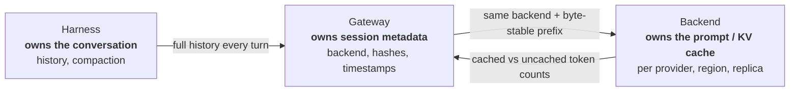
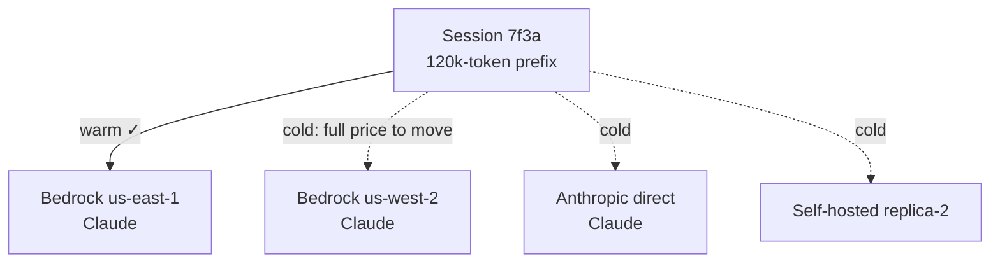
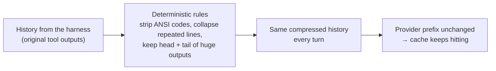
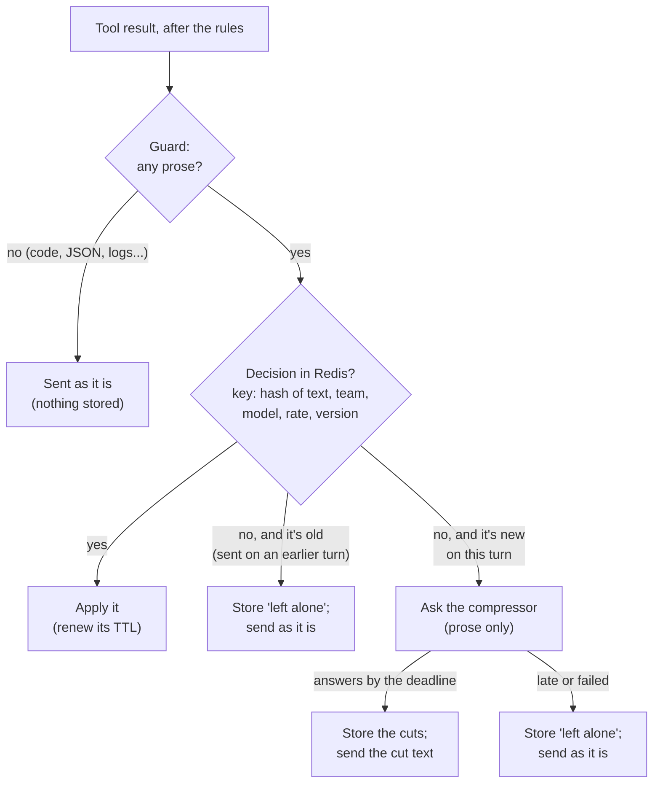

# 04 — Caching & sessions

## Who owns what



LLM APIs are stateless: pi resends the whole conversation every turn. Caching happens **on the
backend**, which recognizes a prefix it processed recently and bills it at a discount. The gateway's
job is to make cache hits *likely*, not to hold the conversation. The one place it does is a team's
opt-in stored mode for OpenAI's Responses API, for clients that send only their new input
([below](#stateful-apis)).

## Caches are per backend



Each provider, region, account, and replica has its own cache. That's why sessions are sticky and
why the router prices moves (see [03](03-routing.md)).

| Backend | How caching works | What the gateway does |
|---|---|---|
| Anthropic / Bedrock / Vertex / Foundry (Claude) | Explicit `cache_control` breakpoints, 5 min or 1 h TTL | Turns on automatic caching (top-level `cache_control`) if the client set no breakpoints. On a backend set to an hour (`cache_ttl_seconds: 3600`, the shipped config for all four), a session's first turn gets 5 minutes and later turns an hour ([below](#how-long-claude-keeps-a-cache)) |
| Claude through OpenRouter | Cached only when asked, with `cache_control` on message parts or at the top level | Keeps a client's own breakpoints on the parts they were on, with the client's lifetimes, when an Anthropic request is translated (an OpenAI-format client's pass through). Turns on automatic caching only when the forwarded request has no breakpoints. Counted as a Merit Order saving only if the client hadn't asked for caching |
| OpenAI / Azure | Automatic above ~1k tokens | On backends with `supports_prompt_cache_key` (OpenAI's API in the shipped config), sets `prompt_cache_key` to the conversation's thread ID (the session, or a subagent or side requests within it) |
| Gemini (Gemini API, Vertex AI, OpenRouter) | Implicit caching + explicit context caches | Keeps prefix stable; reads cached tokens from `cachedContentTokenCount` on the native API (`api: gemini`); explicit caches later |
| vLLM / SGLang | Automatic prefix caching per replica | Keeps the session on the same deployment and, where replicas can be addressed, on the replica that holds its cache ([below](#gpu-replicas-which-one-holds-the-cache)); tells vLLM the session (`X-Session-ID`). LMCache and sharing caches between replicas are not built |

## How long Claude keeps a cache

Claude caches for 5 minutes, or an hour when a marker says `"ttl": "1h"`. Each read starts the lifetime again, so a
session working steadily keeps its cache either way; the hour matters when a person steps away or a tool runs long. It
costs more to write: 2x the input price instead of 1.25x (reads cost the same). Anthropic, Bedrock, Vertex AI and
Foundry all offer it (Anthropic's prompt-caching docs and Google's Claude-on-Vertex docs, November 2026).

- **When the gateway adds the marker** (the client set none), a backend with `cache_ttl_seconds` of 3600 or more gets
  an hour from the session's second turn. The first turn gets 5 minutes: a one-off request never reads its cache back,
  and an hour would double its write premium for nothing. The second turn reads what the first wrote and writes the rest
  for an hour. The shipped config sets the four Claude backends to an hour; 300 keeps them at 5 minutes.
- **When the client sets its own markers** (Claude Code puts an hour on its system prompt and 5 minutes on the
  conversation), they go as they are, whatever the backend's setting.
- **Pricing:** Claude's usage splits cache writes by lifetime (`cache_creation.ephemeral_1h_input_tokens`), and 1-hour
  writes cost the route's `cache_write_1h` (LiteLLM's `cache_creation_input_token_cost_above_1hr`, or 2x input when no
  list has it). Where a platform doesn't split them and every marker in the request asked for an hour, they're all
  priced as 1-hour writes; otherwise as 5-minute ones.
- **Warmth for routing:** a session counts as warm on a backend for as long as its last marker asked: that marker covers
  most of the conversation. Claude Code's sessions stay at 5 minutes on a backend set to an hour.
- **Costing a route:** the router prices new tokens on a backend set to an hour at the 1-hour write price.

Whether the hour pays: each turn's new tokens cost 0.75x input more to write, and each return after 5 to 60 minutes
saves rewriting the whole prefix (1.25x input instead of a read). For a 100,000-token conversation that adds 2,000 tokens
a turn, that's about 1,500 tokens' worth more per turn against about 115,000 saved per pause: worth it if more than about
one turn in 75 follows a pause like that, as in interactive work. An agent that runs without pauses pays more per turn
for nothing: about 12% where reads cost a tenth of input, 20% for Opus and Sonnet 5.5 (reads at 0.05x), 30% for Fable
(0.025x). Its harness can set its own 5-minute markers, as the eval runner does.

## Keeping the prefix byte-stable

Any change early in the prompt invalidates everything after it. The gateway:

- Adds nothing to the system prompt or messages: cache markers and keys, output limits and effort
  are top-level request fields. The one exception is a forced tool choice from an OpenAI client on a Claude model
  that refuses one: it becomes a line at the end of the system prompt, the same on every turn that asks for it
  ([02](02-request-flow.md#translating-between-api-formats)).
- Serializes tool definitions deterministically (stable key order).
- Never injects timestamps, request IDs, or per-request text into the prompt.
- Passes Anthropic thinking blocks (with their signatures) through untouched when client and backend
  both speak Anthropic Messages, also when failover moves the session to another Claude platform (signatures work
  across Anthropic's API, Bedrock and Vertex AI; what the new one can't read, the API drops without an error,
  [02](02-request-flow.md#translating-between-api-formats)). Translating to the other format drops them, and OpenAI reasoning
  items aren't carried between turns, except when OpenAI continues its own stored response (a team's
  stored mode on a backend with `responses_store`, [below](#stateful-apis)).

## The session table (Redis)

Metadata only. No conversation content.

| Field | Used for |
|---|---|
| `id` | The session id: from `X-Session-Id`, `X-MeritOrder-Session`, Claude Code's `x-claude-code-session-id` or Codex CLI's `session-id`, else Claude Code's session in request metadata, else a hash of user + system prompt + first user message |
| `thread` | Which conversation in the session this is (below); empty for the main one |
| `model`, `backend` | Stickiness |
| `floor`, `floor_reason` | The level a mid-task turn keeps, and an outgrown session is re-routed at; why the task got it (shown on every request of the task) |
| `effort` | The reasoning effort chosen for the session, kept so the cache stays valid |
| `msg_count`, `prefix_hash`, `prefix_tokens` | Detect compaction / divergence (hash mismatch ⇒ cache is dead ⇒ free re-route); estimate new tokens per turn |
| `warm_until{backend}` | Which backends still hold a warm cache: after each turn, now + the lifetime the request's last cache marker asked for (a client's own or the gateway's), or the backend's `cache_ttl_seconds` where nothing was marked |
| `placement{backend}` | GPU deployments only: the replica that served the last turn there, when, the prefix size, and that replica's KV-cache counters at the time (for the eviction estimate below) |
| `turns`, `last_seen` | Estimate remaining turns |
| `learn_row` | The learned router only: the id of the request that started the task, so what the client does next (the same request again, a higher `X-Route-Floor`) is counted against it |

Entries are keyed by user, so another caller sending the same session id can't read or change them,
and expire 6 hours after the last turn. The per-session spend cap (`max_session_usd`) uses a separate
spend counter for the session.

### Several conversations in one session

A coding agent can run several conversations under one session id. Claude Code sends its subagents'
turns (with `x-claude-code-agent-id`) and its side requests (titles, summaries, permission checks; with
`x-claude-code-request-class: auxiliary`) with the main session's id, but each has its own history and its own cache. If they
shared routing state, every subagent turn would overwrite the main conversation's model, prefix hash
and warm caches, so the next main turn would look compacted, re-route, and pay to rebuild its cache.

So the routing state above is kept per **thread**: the session id, plus `/agent:<id>` for a subagent and
`/aux` for side requests. Spend limits (`max_session_usd`), the ledger's `session_id` and reports still
use the session id, so a session's cost includes its subagents.

## GPU replicas: which one holds the cache

A GPU deployment's replicas each have their own prefix cache, and vLLM keeps a prefix until it needs the
space, not for a fixed time. So for every session the gateway tracks two things: **which replica** served its
last turn (its placement), and **how much of its prefix that replica probably still holds** (its warm share,
0 to 1). The router sends the next turn back to that replica unless another is cheaper once its load is
counted ([03](03-routing.md#which-replica-of-a-gpu-deployment)), and prices the rebuild of whatever share is
gone.

The warm share comes from the best source available, in this order:

| Source | When | How |
|---|---|---|
| **KV events** | `serve.kv_events: true`, vLLM 0.30 or later, and the controller can reach each replica's events port | Below |
| **Estimate from KV-cache metrics** | The replica's `/metrics` report its cache size and token counters (vLLM does) | Below; labelled *estimate* everywhere |
| **Cache TTL** | Neither is available | Warm for `cache_ttl_seconds` after the turn, as for an API |

**KV events.** vLLM publishes a stream of cache events on a ZeroMQ socket (`--kv-events-config`, which the
SkyPilot and Kubernetes provisioners add when `kv_events` is on; for a static server you add it yourself): `BlockStored` with the block hashes, the parent block and
the session the request came with, `BlockRemoved`, and `AllBlocksCleared`. The gateway sends each
conversation's id to vLLM as `X-Session-ID` (a hash of the user-scoped thread key, so the server never sees
who the user is), and vLLM puts it on the blocks that conversation stores. The controller follows every
ready replica's stream and keeps each session's chain of blocks per replica. What counts as held is the
chain up to its first missing block, which is what a prefix lookup would find. When that changes, it
publishes a note for the session (`kv:<id>` in Redis: replica, tokens held, tokens in the chain, when),
which the gateway reads with the session in the same round trip. A note older than the session's last turn
is ignored (that turn rebuilt the cache). Lost events (a gap in the sequence numbers), a replica that goes
away, or a reader that stops drop what was known for that replica, and its sessions fall back to the
estimate. Only blocks on the GPU count, and only the first KV-cache group of hybrid models.

The events carry token ids, which are the prompts' content, so the events port must be reachable only from
the controller: a private network, a VPC with internal IPs, or Kubernetes. SkyPilot opens the port it lists
to anyone who can reach the replica, like the API port. The controller needs the `kv-events` extra
(pyzmq, msgpack; in the default image).

**Estimate from KV-cache metrics.** vLLM evicts the least recently freed blocks first, and a finished
request's blocks join the back of that queue, its last block first. So everything that was free when the
session's turn ended is reused before its blocks are, and then its blocks go from the end of the
conversation backwards. The controller samples every replica's `/metrics` each cycle: the cache's size
(`vllm:cache_config_info`: blocks × block size), the share held by running requests
(`vllm:kv_cache_usage_perc`), and how many tokens it has written into the cache (prompt tokens that missed
the prefix cache plus generated tokens, from `vllm:prompt_tokens`, `vllm:prefix_cache_hits` and
`vllm:generation_tokens`), and from two samples, how fast. At each turn the gateway records the replica's
counter (the last sample's, carried forward at that rate to the end of the turn) and free space; later:

```
share still cached = clamp((free space at the turn + prefix − tokens written since) / prefix, 0, 1)
```

An idle replica keeps a session warm for hours; a busy one can push it out in a minute. A replica whose
counter is below the sample the turn saw, or whose process start time changed, restarted with an empty cache. One whose
counter is only below the carried-forward guess (it wrote less after a burst ended) didn't restart: it counts as having
written nothing since the turn. The estimate ignores blocks that other requests re-use (which keeps them in the cache
longer) and preemptions, and the prefix size is the gateway's estimate of about 4 characters a token.

**Behind a load balancer** (affinity off, or replicas the gateway can't address), a turn reaches the
replica that holds the cache about one time in N, so the warm share is divided by the number of replicas.
With KV events, the note still says which replica the session is on.

**llm-d.** On Kubernetes, llm-d's inference scheduler routes by the same KV events with its KV-cache
indexer (a Go library inside the scheduler, with no API of its own to ask). A deployment the controller runs
behind llm-d (`provisioner: kubernetes` with `api: llm-d`, [05](05-gpu-autoscaling.md#kubernetes)) has
`replica_affinity` off unless you set it, so the scheduler picks the replica, with better information than
the gateway has. For an llm-d you run yourself, point a static deployment's `static_url` at its Gateway and
set `replica_affinity: false`.

**Checking it.** vLLM's replies say how many prompt tokens came from the cache (the SkyPilot and Kubernetes
provisioners start it with `--enable-prompt-tokens-details`; start a static server with it too). Each GPU turn is counted in
`meritorder_gpu_cache_turns_total{backend, expected, result}`: expected warm or cold, and a hit when at
least half the prompt came from the cache. The console's GPUs page shows, per replica, how many sessions
sit there and how many are probably warm, and per session its replica, last turn, context size, and the
share probably cached now, with its source.

## Compressing tool results

Problem: if we compress a big tool output on turn 5, the harness resends the **original** on turn 6.
If we compress it differently, the prefix changes and the cache misses. So every way of compressing
must turn the same tool output into the same bytes on every later turn, on every gateway.

Two methods, both off by default and turned on per team. Both touch **tool results only**, never what
people or models wrote, and run on requests to any backend, GPU deployments included.

| | Rules | Model-based (LLMLingua-2) |
|---|---|---|
| What it does | Strips terminal codes and trailing spaces, collapses repeated lines, keeps head and tail of huge outputs | Drops the least useful words from prose (web pages, docs, long explanations) |
| Same bytes every turn because | It's deterministic | Each result is decided once and the decision is stored (below) |
| Stores | Nothing | Where each result was cut (character ranges), never the text |
| Needs | Nothing | The `meritorder compressor` service ([07](07-deployment.md#containers)) |
| Turn on | `compression: {enabled: true}` | `compression: {model: {enabled: true}}`, and `compressor.url` |

When both are on, the rules run first and the model gets what they leave.

### The rules



- Only tool results of at least `min_chars` (4,000) characters.
- Terminal color codes and trailing spaces go. Three or more blank lines become one. Three or more identical lines
  in a row become one line and `[previous line repeated N more times]`.
- Beyond `max_chars` (24,000), the first 60% (`head_fraction`) and the last 40% are kept, with a line saying how many
  lines and characters were left out.
- Changing the settings mid-session changes the history once (one cache miss).
- Each process keeps what the rules made of each long result (up to 16 million characters in and out,
  the oldest dropped first), so a history resent every turn isn't worked through again.

### Model-based (LLMLingua-2)

[LLMLingua-2](https://arxiv.org/abs/2403.12968) is a token classifier (XLM-RoBERTa large or multilingual
BERT, fine-tuned by Microsoft) that labels each word keep or drop. It's much cheaper than an LLM and
keeps the words in order, but it isn't deterministic across model versions, library versions or
hardware: borderline words can flip. So the gateway never runs it twice on the same result.



- **Decided once.** The first gateway to see a new tool result asks the service, by the team's
  `deadline_ms` (1,000). The answer is stored in Redis under a hash of the text plus the team, the
  compressor's model, the rate and the guard's version, with a TTL of `compressor.ttl_seconds` (6 hours,
  at least as long as a session stays sticky), renewed each time a turn uses it. Every later turn, on
  any gateway, applies the stored decision to the original text the harness resends, so the bytes are
  the same.
- **Late means never.** A result the service doesn't finish by the deadline (or can't compress: it's
  down, or runs another model) is sent as it is, and that choice is stored too, so later turns send it
  as it is as well. A service that fails isn't called again for 30 seconds.
- **Only new results.** A result already sent on an earlier turn without a decision (compression was
  just turned on, its decision expired, or Redis was emptied) went upstream as it is, so it's stored as
  left alone. Turning model-based compression on mid-session costs no cache miss; changing its rate or
  model changes the history once, like the rules.
- **First writer wins.** Two gateways that see the same new result at once both ask; each stores its
  answer only if none is there yet (`SET NX` in one transaction with the read-back) and uses whatever
  is stored. Both send the winner's cuts.
- **No content in Redis.** The decision is a list of character ranges to drop, or "left alone". The
  text comes from the harness every turn, as it does without compression. (Only the response cache and
  the Responses API's stored mode keep content, both opt-in, and batch files are held sealed until a
  provider or GPU takes them.)
- **Redis down:** results are sent as they are; nothing is stored.

**The guard.** Only prose goes to the model, and some words in it are never cut:

| Kept as it is | How it's recognized |
|---|---|
| JSON | The whole result parses as JSON, or starts like JSON and nests deeper than the parser goes |
| Code | Fenced blocks, indented lines, lines starting with `def`, `class`, `import`, `function`, `SELECT` and similar, lines ending in `{`, `}` or `;`, lines with many brackets or operators |
| Errors | Lines with error, exception, traceback, fail, fatal, panic, warn, denied, refused, not found, no such, errno, exit code, out of memory, unauthorized, forbidden, undefined, timeout, invalid, cannot, unable and similar anywhere in them, in any case (`TypeError`, `FAILED`); stack frames (`at …`, `File "…"`, `#3 …`) |
| File listings | Lines starting with a line number (`cat -n`, Claude Code's Read) |
| Search results, test ids | Lines whose first word holds a path or a place in a file: `grep -n` and ripgrep (`docs/03-routing.md:141:…`, Claude Code's Grep), pytest ids (`tests/test_x.py::test_y[…] PASSED`), compiler and linter output (`src/x.c:12:5: …`) |
| Diffs | The lines of a unified diff's hunks (after `@@ -1,6 +1,6 @@`): context, added and removed lines alike; in a result with a diff in it, every line that starts like one (the rules may have cut a huge diff's middle) |
| Data | Tables (`|`), log lines starting with a timestamp, `key: value` and `key=value` lines, headings, quotes, lines that are mostly not letters |
| Short runs | Prose runs under 300 characters, and lines under 20 characters or 5 words |
| Tools | Results of `skip_tools` (default: read, read_file, view and other file readers), since an agent edits from what it read |
| Words inside prose | Anything with a digit, `/` or `\`, `_`, `::`, `->`, a hyphen inside it (`claude-code`, `X-Session-Id`, and `opt-in` too), brackets inside a word (`configure()`), operators, `a.b`, camelCase, CAPITALS, command-line flags (`--device`, `-d`); text in quotes of any kind (`"…"`, `'…'`, `“…”`, `‘…’`) or `` `backticks` ``; names (a capitalized word that doesn't start a sentence or a list item: Redis, Zürich, both words of Merit Order); negations (not, no, never, without, unless, …n't) and words that say how much or which (only, all, every, each, always, any, most, some, few, many, more, less, least, both, either, first, last, same) |

**What it may drop:** ordinary words in sentences (articles, most adjectives and adverbs, repeated
phrasing), commas, parentheses around prose, and whole sentences' worth of words when the rate is
low. Line breaks and sentence ends (`.`, `?`, `!`) are kept, so line numbers still point at the same
lines. The text reads like notes. Meaning can still shift (a dropped adjective or verb: "a small team"
becomes "team"), and quoting a compressed sentence back won't match the original: leave it off for teams
whose agents quote web or document text exactly, or edit prose files read with a shell command (a file
reader in `skip_tools`, or one that prints line numbers, is safe). Names in scripts without capital
letters (東京) aren't recognized as names, and the models drop them often.

```yaml
compressor:
  url: http://compressor:8090      # ${MERITORDER_COMPRESSOR_URL:-} in the shipped config
  model: microsoft/llmlingua-2-xlm-roberta-large-meetingbank
  ttl_seconds: 21600
  api_key_env: MERITORDER_COMPRESSOR_KEY   # optional shared secret
teams:
  docs-team:
    compression:
      enabled: true                # the rules
      model:
        enabled: true
        rate: 0.5                  # keep about half of the prose's tokens (llmlingua's default)
        min_chars: 4000            # shorter results aren't sent to the model
        deadline_ms: 1000          # not done by then: sent as it is, for good
        skip_tools: [read, read_file, view]
```

The console has the same settings in Config → Teams, with the service's status.

**The service.** `meritorder compressor` (the `compressor` extra: llmlingua 0.2.2, torch,
transformers; its own image, never the default one) loads the model and answers
`POST /v1/compress` with the character ranges to drop in each text it gets. It calls llmlingua's
`PromptCompressor(..., use_llmlingua2=True).compress_prompt(..., return_word_label=True)` and
matches the labelled words back to the original text, allowing for what the tokenizer normalized
(case, accents, ligatures, full-width forms) and skipped (characters it doesn't know). llmlingua's own
`compressed_prompt` isn't used: it's rebuilt from tokenizer pieces, so it puts spaces into `1.2.3`
and `x.so` and loses characters like accents and emoji. llmlingua's `<llmlingua, compress=False>`
spans (`structured_compress_prompt`) only apply to the original LLMLingua, so the gateway keeps
protected text out of the request instead. It forces line breaks and sentence ends
(`force_tokens`) and words with digits (`force_reserve_digit`). A request's texts (each prose range of
each new result) go through the model together, up to `--batch-size` (50) 512-token chunks at a time,
following the steps `compress_prompt` takes for one text; the labels are the same as one text at a time,
and it's 1.7 times faster on a CPU. On a CPU it uses as many threads as the container's CPU limit allows
(`--threads` or `MERITORDER_COMPRESSOR_THREADS` to choose; torch alone would start one per core of the
machine and be throttled). Each process compresses one request at a time; run more replicas for more
gateways. Any server that speaks the same API can stand in:

```
POST /v1/compress  {"model": "...", "rate": 0.5, "force_tokens": ["\n", ".", "?", "!"], "force_digits": true, "texts": ["..."]}
                -> {"model": "...", "version": "...", "results": [{"drop": [[start, end], ...]}, ...]}
GET  /healthz   -> {"ok": true, "model": "...", "version": "...", "device": "cuda"}
```

Offsets are code points into each text. A request for another model gets 409.

**Savings** are counted per request the same way for both methods: removed tokens in tool results new
on this turn (after the last assistant message) at the input price, removed tokens in older results at
the cache-read price. Each method is its own cause, so what the rules cut is never counted as the
model's: the ledger's `savings_compression` is the rules', `savings_compression_model` what the model
took out of what the rules left. Reports, the CSV and the ledger export (JSONL, CSV, Parquet) carry
both, as does Prometheus' `meritorder_savings_usd_total{cause="compression"}` and
`{cause="compression_model"}`. Each compressed request is also tagged `compression: rules` or
`compression: model` (the model cut something), to filter by: Reports → Breakdown → Tag `compression`.
`meritorder_compression_model_results_total{result}` counts what happened to each result (compressed,
kept, reused, old, late, failed, no_prose, store_error), and `meritorder_compressor_duration_seconds`
how long the service took. The service's own GPU or CPU time isn't charged to requests.

### Measured on the published models

Measured on 13 November 2026 with `scripts/bench_compressor.py` on one laptop: Apple M4 Max (12
performance and 4 efficiency cores, 64 GB), macOS 26.6, llmlingua 0.2.2, transformers 5.22.1, torch
2.15.0, the models at their Hugging Face revisions `ebaba9b` (XLM-RoBERTa large) and `5f0c827`
(multilingual BERT). The service ran on the CPU with 12 threads (torch's choice here), with 2 threads (as in
a pod limited to 2 CPUs), and on the laptop's GPU (MPS). No NVIDIA GPU was measured. The laptop was running other
work as well: a second CPU run hours later, at a load average of 15 to 30, gave times within about a fifth
of these.

The tool outputs come from this repository and the machine, with the repository's path, the home
directory and commit authors replaced: `pytest -v` output, `git log --stat` and a diff, Python and
Markdown files read with `cat`, `ls -R` and `find` listings, JSON responses (the tests' provider
replies and the price list), the HTML docs as a fetch tool returns them, web-search-style results,
`git grep` results, the docs as long prose, stack traces (pytest, Python, Node), and prose written to hold
everything the guard must keep. Each was measured at 4,000, 16,000 and 48,000 characters.

**How much comes out.** Tokens removed from the whole tool result at rates 0.33 / 0.5 (the default) / 0.7,
and the share of the text the guard sends to the model, over the three sizes:

| Tool output | Sent to the model | XLM-RoBERTa large | Multilingual BERT |
|---|---|---|---|
| pytest output, `git log`, diffs, Python files, listings, JSON, `git grep`, stack traces | 0–1% | 0% | 0% |
| Markdown file read with `cat` | 6% | 2% / 2% / 1% | 3% / 2% / 1% |
| Web page as text | 20% | 9% / 6% / 4% | 9% / 6% / 4% |
| Web search results | 21% | 9% / 6% / 4% | 8% / 5% / 3% |
| Long prose (the docs) | 38% | 19% / 13% / 7% | 17% / 11% / 6% |
| Prose written for the guard check | 48% | 25% / 18% / 11% | 27% / 21% / 13% |

Of the prose it's sent, the model removes about a third of the tokens at 0.5 (28–38%), half at 0.33 and
a fifth at 0.7: line breaks, sentence ends and protected words stay whatever the rate. Most tool output
an agent sees isn't prose, so the savings come from web pages, docs and search snippets, 5–13% of such a
result at the default rate. The guard as it is now keeps about one point more than it did before these
measurements (web pages 6.2% instead of 6.9% with XLM-RoBERTa) and no longer cuts search results,
test ids and diffs, which it used to take for prose.

**How long it takes.** The service's time for one tool result (the request a gateway makes for a new
result: all its prose ranges at once), p50 / p95, and the share done within the default 1-second
deadline. "Prose only" is the worst case: text that is all prose, so every character goes to the model.

| Service | 4k characters | 16k | 48k | 4k, prose only | 16k, prose only | 48k, prose only |
|---|---|---|---|---|---|---|
| XLM-RoBERTa large, CPU, 12 threads | 0.8 / 1.6 s (66%) | 2.5 / 6.7 s (17%) | 6.6 / 10.9 s | 1.1 / 1.5 s | 3.0 / 3.4 s | 9.0 / 9.9 s |
| XLM-RoBERTa large, CPU, 2 threads | 1.0 / 2.5 s (50%) | 2.9 / 5.9 s (13%) | 6.6 / 12.0 s | 1.3 / 1.5 s | 3.3 / 3.6 s | 7.4 / 7.7 s |
| XLM-RoBERTa large, Apple GPU (MPS) | 0.2 / 0.5 s (100%) | 0.7 / 1.7 s (71%) | 2.2 / 4.0 s | 0.3 / 0.3 s | 0.8 / 1.0 s | 3.1 / 3.3 s |
| Multilingual BERT, CPU, 12 threads | 0.3 / 0.6 s (100%) | 0.8 / 1.9 s (69%) | 2.2 / 4.0 s | 0.3 / 0.4 s | 0.9 / 1.1 s | 2.4 / 2.5 s |
| Multilingual BERT, CPU, 2 threads | 0.2 / 0.6 s (100%) | 1.0 / 1.7 s (47%) | 2.3 / 5.3 s | 0.3 / 0.3 s | 1.1 / 1.2 s | 2.8 / 2.9 s |
| Multilingual BERT, Apple GPU (MPS) | 0.1 / 0.2 s (100%) | 0.2 / 0.6 s (100%) | 0.7 / 1.4 s | 0.1 / 0.1 s | 0.3 / 0.3 s | 1.2 / 1.3 s |

Time follows the number of 512-token chunks the model reads, and every prose range is at least one
(llmlingua pads each to 512 tokens), so a result with many short prose ranges costs about as much as one
with a few long ones. A chunk takes about 0.54 s with XLM-RoBERTa large on this CPU and 0.16 s with
multilingual BERT, 0.13 s and 0.04 s on the Apple GPU. Two threads were nearly as fast as twelve on this
laptop, whose cores share one unit for matrix work; on an x86 server more cores should help more, and
a 2-CPU pod there will be slower than these rows (not measured). The gateway's own part is small: finding
the prose in a 48k result takes about 1 ms (up to 3 ms), once per result per process, and applying stored
cuts on later turns well under 1 ms.

**Memory.** At most 4.7 GiB resident for XLM-RoBERTa large and 3.7 GiB for multilingual BERT on the CPU,
with the largest request (60 prose ranges, about 50 chunks in one batch, which took 19 s and 6 s); most of
it is the batch, so a lower `--batch-size` uses less. The Helm chart's 4–6 GiB fits either. On the Apple
GPU the process held 6.0 and 3.3 GiB, GPU memory included.

**The guard, checked.** The script finds every path, URL, number, identifier, command-line flag,
hyphenated word, quoted string and error line in each input with patterns of its own (not the guard's),
about 36,000 of them, and checks at each rate that no cut touches any and that each comes through byte
for byte.
With the guard as it was, both models cut command-line flags (`--device`, `--config-dir`, `-d`; 55 times
with XLM-RoBERTa, 164 with BERT), hyphenated names (`claude-code` became `claude code`, `x-meritorder-model`,
`gpt-oss`, `llm-d`; 114 and 445 times) and a word in typographic quotes (“deadline”), and shortened lines
of `git grep` results, pytest ids and diffs, which an agent quotes back. The guard now keeps all of
these (the table above), and nothing is cut on any kind of output, at any rate, with either model.

**Do the facts survive? A proxy only.** What a question about a result would ask for (names, numbers,
paths), in the prose that went to the model, at the default rate: numbers and paths all survived;
names (a capitalized word inside a sentence) 95–96%, the rest being names in a script without capitals
(東京); words that say how much or which (only, all, every, same...) all, now that the guard keeps them
(the models dropped 74–78% of them before). This checks words, not understanding. It doesn't show that
agents still succeed on compressed results: that needs real runs on real tasks, which cost money and
haven't been done.

**The deadline.** The default stays 1 second. It bounds what a new tool result can add to its turn, and
a later turn never waits. What it lets through depends on the hardware:

- **CPU, XLM-RoBERTa large (the default model):** a chunk takes half a second, so only small results
  make it (half to three quarters at 4k characters, under a quarter at 16k), and a result that misses it has made
  its turn wait a second for nothing. Don't run the default model on a CPU.
- **CPU, multilingual BERT:** every 4k result and half to five in six 16k ones within a second. On a
  CPU, use this model (`MERITORDER_COMPRESSOR_MODEL` and `compressor.model`, the same on both sides).
- **A GPU:** on the Apple GPU, XLM-RoBERTa large does every 4k result and most 16k ones within the
  deadline, and BERT every 16k one. A data-center NVIDIA GPU has several times this laptop GPU's
  throughput (the models run in full precision on either, as published), so 48k results should fit too;
  that hasn't been measured. A GPU is the way to compress large results.
- Raising `deadline_ms` compresses larger results on slow hardware at the price of that wait on the turn
  that brings them: worth it for teams whose agents read long pages and can wait, and set per team.

## Stateful APIs

OpenAI's Responses API can keep a conversation on the server: a client sends `previous_response_id` (or a
`conversation`) and only its new input, and reads responses back later. **This is where Merit Order holds
conversation content, and only for teams that turn it on.** Without it, the gateway is stateless: requests
with `store: false`, or that send the whole conversation, work as always; `previous_response_id`,
`conversation`, `background` and `item_reference` get a 400 saying the team's stored mode is off; and the
response object says `store: false`. Decision 51 has the reasoning. One exception holds nothing past a connection:
over the [WebSocket transport](#the-websocket-transport), a turn can chain from the latest response on its own
connection, kept in memory while the connection is open (decision 54).

### Stored mode (opt-in per team)

```yaml
teams:
  research:
    stored_responses:
      enabled: true
      retention_days: 30          # required: there is no default
      readers: []                 # roles that may also read and continue others' responses (team_lead, admin, ...)
response_store:
  key_env: MERITORDER_RESPONSES_KEY        # or key_file: a mounted secret, re-read when it changes
  old_keys_env: MERITORDER_RESPONSES_OLD_KEYS   # while rotating: old keys still read, comma-separated
```

Config → Teams has the same settings, with what each team holds now (counts and sizes, never content); the
Teams page shows it too. In a team with stored mode on, a `/v1/responses` request is stored unless it says
`store: false`, which is OpenAI's default.

**Who holds the conversation: the gateway, not the provider.** Each turn that chains is rebuilt from what the
gateway stored: every earlier turn's input and output, oldest first (or the conversation's items), then the new
input. The rest of the pipeline sees only that rebuilt request, so everything works as for a client that sends
the whole conversation each turn:

- **Routing.** `auto` may send turn 2 to another model or provider than turn 1, and a failover mid-chain sends the
  next route the whole conversation. Instructions are never carried over from an earlier turn (as at OpenAI).
- **Sessions and caching.** A chain without a session header stays in the session its first turn got (a
  conversation in its own), so stickiness, warm caches and prompt-cache keys follow the rebuilt prefix.
- **Compression.** The client's input is stored as it was sent, before compression. Rebuilding gives the same
  history every turn, so the rules cut it the same way and model-based compression finds the decisions it stored
  for those tool results.
- **Spend and the learned router.** Each turn is one ledger row, checked against budgets and limits, and the
  learned router sees the rebuilt request (a resent turn counts as a retry).

**When OpenAI continues its own response.** A backend with `api: responses` and `responses_store: true` stores
stored-mode turns at the provider too (`store: true`) and records the provider's response id. A next turn that
lands on that same backend and model, and chains from that turn with `previous_response_id`, is sent as the
provider's own `previous_response_id` plus only the new input and the turn's instructions, which keeps OpenAI's
reasoning items and its cache. Every other case gets the whole conversation from the gateway: another provider or
model, a turn in a `conversation`, a backend without `responses_store`, or a provider that no longer has the
turn (it answers 400, and the gateway sends everything on the same route). With `responses_store` the provider
holds the content as well, for its own retention (OpenAI: at least 30 days); deleting a response at the gateway
deletes the provider's copy. Its prompt counts then include context the gateway didn't send (reasoning items), so
they don't calibrate the gateway's token estimate. Off by default.

**What's kept, sealed.** Each response's object as the client got it and the input sent with it, and each
conversation's metadata and items, sealed one by one with AES-256-GCM. The key is any string, the same on every
gateway and the worker (`MERITORDER_RESPONSES_KEY` or `response_store.key_file`); without one, a gateway on
Postgres refuses requests that would be stored (503). Each sealed value names its key by a public id, and is bound
to its row and owner: copied into another row, it doesn't open. Owner, chain, status, where it ran and sizes are
in the clear, like the ledger. In-memory storage (development) uses a random key for the life of the process.

**Rotating the key.** Put the new key in `MERITORDER_RESPONSES_KEY` and the old one in
`MERITORDER_RESPONSES_OLD_KEYS` on every gateway and the worker. New values are sealed with the new key, old ones
still open, and the worker seals everything again with the new key, 500 values a minute. Config → Teams says how
many values still need an old key, and when none do; then remove it. A value sealed with a key that's on neither
list (dropped too soon, or a typo) can't be opened: the worker leaves it out of resealing, so it doesn't hold up the
values behind it, and raises one critical alert per such key id. Put the key back in the old keys to read and move
those values; otherwise they stay unreadable until their retention deletes them.

**Retention.** A chain is kept `retention_days` after its last turn, all of it (continuing a chain renews its
earlier turns too, since every turn is rebuilt from them), and a conversation `retention_days` after it last
changed. Past that it's unreadable at once and the worker deletes it within a minute (a gateway on in-memory
storage does it itself). Shortening the retention applies at the next pass; turning stored mode off for a team
deletes everything it kept at the next pass, the providers' copies too. Teams that aren't in the configuration
follow the `default` team's settings. A background response sent with `store: false` is kept only 10 minutes after it ends
(`response_store.background_unstored_seconds`), to be polled, and can't be chained from.

**Who can read it.** A response or conversation belongs to the person and team whose key made it. Nobody else
can read, list or chain from it (404), admins included, unless the team lists their role in `readers`: admins
then from any team, the other roles on the same team. Only the owner deletes. Someone moved to another team leaves
their stored responses with the old team. Disabling someone on the People page, or deactivating or deleting them
through SCIM, deletes everything they stored, and the providers' copies.

### The API

As OpenAI's reference defines it (read on 13 November 2026, openai-python 3.42 to 3.50); the official SDK works
unchanged.

| Endpoint | What it does here |
|---|---|
| `POST /v1/responses` | `store` (default true in stored mode), `previous_response_id`, `conversation` (an id or `{id}`; not with `previous_response_id`), `background`, `item_reference` items (resolved from the chain, the conversation, or anything else the person stored: the Vercel AI SDK sends earlier turns this way) |
| `GET /v1/responses/{id}` | The response, with its status. `stream=true` (resuming a background stream with `starting_after`) isn't built: background responses don't stream here (decision 51) |
| `DELETE /v1/responses/{id}` | Deletes it, its content, and the provider's copy. A later turn chaining from anything after it in the chain gets 404 |
| `POST /v1/responses/{id}/cancel` | Background responses only: stops one that's queued or running. Cancelling one that ended returns it as it is |
| `wss://…/v1/responses` | The [WebSocket transport](#the-websocket-transport): `response.create` events, each turn through the same pipeline; chains on the connection with or without stored mode |
| `POST /v1/responses/compact` | [Compaction](#compaction), written by the gateway with a model the router picks, readable on every backend. Any team; `previous_response_id` in stored mode |
| `POST /v1/responses/input_tokens` | The input's size in the model's tokens: the gateway's estimate, calibrated per model by providers' counts. Any team; `previous_response_id` and `conversation` in stored mode |
| `GET /v1/responses/{id}/input_items` | What the response was made from: the earlier turns of its chain (or the conversation's items before it), then its own input; `after`, `limit` (1 to 100, default 20), `order` (default `desc`) |
| `POST /v1/conversations` | A conversation, with starting `items` and `metadata` (16 pairs) |
| `GET`, `POST`, `DELETE /v1/conversations/{id}` | Read it, change its metadata, delete it. Deleting deletes its items too (OpenAI keeps them); its responses stay |
| `GET`, `POST /v1/conversations/{id}/items` | List its items (`after`, `limit`, `order`), add items |
| `GET`, `DELETE /v1/conversations/{id}/items/{item_id}` | One item; deleting returns the conversation |

A response created with `conversation` builds on the conversation's items and adds its input and output to them
when it's done (with `store: false` too). **Background responses** (`background: true`) are kept as `queued` and
run in the gateway that took them; clients poll `GET`. While it works on one, the gateway touches its row once a minute (four
times per timeout when `response_store.background_timeout_seconds` is under four minutes), so one that runs for hours
is never given up on. A gateway that stops leaves them running; once nothing has touched one for
`response_store.background_timeout_seconds` (an hour) the worker marks it failed. With `store: false`, the time it's
kept for polling counts from when it ends, however long it ran. A background response can't
also stream here, so resuming one with `starting_after` isn't built: it would mean keeping every event of a response,
content included, where any gateway could replay it, for what polling already covers.

`meritorder_stored_responses_total{event}` counts turns rebuilt from stored history, kept, sent as the provider's
continuation, and ones that couldn't be kept.

### The WebSocket transport

As OpenAI's WebSocket mode guide and event reference have it (read 15 November 2026, openai-python 3.42 to 3.51), and
as Codex CLI uses it. A client opens `wss://<gateway>/v1/responses` with its key in the `Authorization` header (a bad
key is refused at the handshake, 401) and sends `{"type": "response.create", ...}`: the body of `POST /v1/responses`,
flat. The events come back one per message, the same as the SSE stream's. Each turn runs through the same pipeline as
the HTTP endpoint: the key is checked again (a revoked key stops at the next turn), budgets and caps, routing, the
session, compression, translation to any backend, one ledger row, and stored mode when the team has it.

**Chaining on the connection, without stored mode.** For each stream of the connection, the gateway keeps its latest
response's whole conversation (the input it was made from and its output) in memory, and nowhere else, until the
connection closes. A turn that sends `previous_response_id` with only its new input is rebuilt from it, so the rest of
the pipeline sees what a client resending its conversation sends: `auto` routes each turn on its own, and the prompt
cache and compression treat it the same. This is what OpenAI keeps for `store: false`, and what Codex CLI counts on: it
sends `store: false` and, from its second turn, only the new items. Chaining from anything else (an older response, one
from another connection) gets `previous_response_not_found`, and Codex then sends the whole conversation. In a team
with stored mode, turns it stored chain as over HTTP, from any connection; `store: false` turns chain on the connection.

**Upstream is HTTP.** The connection ends at the gateway; each turn goes to the backend chosen for it the way that
backend takes requests, OpenAI's included (its HTTP Responses API, continuing its own stored response with
`responses_store`). Decision 54 says why.

**The rest of the protocol.** `generate: false` prepares a turn without a model call (Codex warms up with it): no
backend, no cost, no ledger row, kept on the connection only. `stream_id` names a stream; a stream's responses run one
at a time, in order, streams side by side, up to 32 named ones (OpenAI's limit). Up to 64 `response.create` messages
wait on one stream (`MAX_QUEUED`); one past that gets an `error` event (429, `websocket_queue_full`) instead of being
held. `background` is refused, as at OpenAI.
Codex's `response.interrupt` stops the running response it names (recorded as a disconnect, 499), as does closing the
connection. Steering (`response.steer`) isn't supported. A connection has no time limit (OpenAI's is 60 minutes). A
message can be as large as an HTTP body (`MERITORDER_MAX_BODY_MB`, 32 MB); the handshake says so in
`x-codex-websocket-max-message-bytes`, and Codex sends anything larger over HTTP. A proxy in front of the gateway
must pass WebSocket upgrades through. `meritorder_responses_websocket_total{event}` counts connections, turns, turns
rebuilt from a connection's memory, and warm-ups.

`meritorder setup codex` points Codex CLI at the gateway with the WebSocket transport on
([00](00-how-it-all-works.md#11-setting-up-claude-code-and-pi)).

**Codex's tools on any model.** Whatever backend a turn lands on, Codex's tools work: its custom (freeform) tools such
as `apply_patch` become function tools with one string argument and come back as `custom_tool_call` items, its
namespaced tools (sub-agents, MCP servers) come back with their namespace, and `tool_search` and `local_shell` calls
keep their own item types ([02](02-request-flow.md#responses-api-tools-on-any-backend), decision 57). History converts to
the same bytes each turn, so a session that stays on one model reads its cache every turn. Codex sends `apply_patch` only for the models
its own catalog knows (OpenAI's); on `auto` and any other name it edits files through its shell (`exec_command`), which
works everywhere. Web search: Codex's default is OpenAI's cached index (`web_search = "cached"`), which only OpenAI
has, so on other models the turn goes without it (`x-meritorder-dropped-tools: web_search`, and a log line). With
`web_search = "live"` Claude searches with its own server tool, at $10 per 1,000 searches on the ledger.

### Compaction

`POST /v1/responses/compact` takes a conversation (`input`, or `previous_response_id` in stored mode) and returns, as
OpenAI does, its user messages followed by one `compaction` item; the client sends that window as the start of its next
turn. OpenAI's compaction item is encrypted for OpenAI alone, so behind `auto` a next turn on any other provider
couldn't read it. The gateway writes the summary itself instead: the conversation goes through the pipeline with a
prompt to summarize it, routed like Claude Code's compaction requests (`auto` caps its level at
`routing.request_class_levels.compaction`, 3 by default; a named model is that model), admitted against budgets, and
metered as one ledger row tagged `compaction: responses`. The item's `encrypted_content` holds the summary, encoded,
not encrypted (it's the client's own conversation). A later turn carrying it is read as a user message with the
summary, wherever it goes. A compaction item from OpenAI itself is refused (400) rather than dropped, and so is
`compaction_trigger` (OpenAI's compaction inside a turn); Codex CLI compacts by summarizing on its own for a custom
provider, which works through the gateway like any turn.

### Batches

Batches are the one place requests outlive the call that sent them, and the same rule holds: content
passes through, and stays where it has to, for as long as the operator says. An OpenAI-style upload is
held encrypted (AES-GCM, `MERITORDER_BATCH_KEY`) only until its batch is handed on; Anthropic-style
requests to providers aren't held at all. Results stay with the providers (or, for Bedrock and Vertex
AI, in the operator's bucket) and are read again whenever the client asks, until `batches.retention_days`
after the batch ends, when the worker deletes them there. Batch work for your own GPUs has no provider to
hold it, so the gateway does, sealed the same way: each request until it runs (or is handed to a
provider), its result until the retention period ends. All of it can live in the operator's bucket
(`batches.storage.bucket`) instead of Postgres, and the key can be rotated while it waits. The gateway
keeps only each request's routing metadata besides. Details:
[02, Request flow](02-request-flow.md#what-the-gateway-holds-and-for-how-long).

## Response caching

Exact-match response caching rarely hits for agent traffic (every turn is unique), but helps
chatbots, RAG, evals, and repeated pipeline calls.

- **Opt-in:** per team (`response_cache: {enabled: true, ttl_seconds: 3600}`) or per request with
  `X-MeritOrder-Cache: on`. `off` always bypasses it.
- **Scoped:** cache keys include the team (or the user, with `scope: user`), so answers never cross
  that boundary.
- **One of the two exceptions to "no stored content"** (the other is the Responses API's stored mode,
  [above](#stateful-apis)): entries hold the response in Redis until the TTL expires. See
  [decision 13](09-decisions.md#13-opt-in-response-cache-may-store-responses).
- Hits cost $0 and are recorded with the original cost as `savings_response_cache`. Streaming
  requests can be served from the cache (replayed as a stream); only non-streaming responses are
  written to it. `/v1/responses` requests don't use it.
