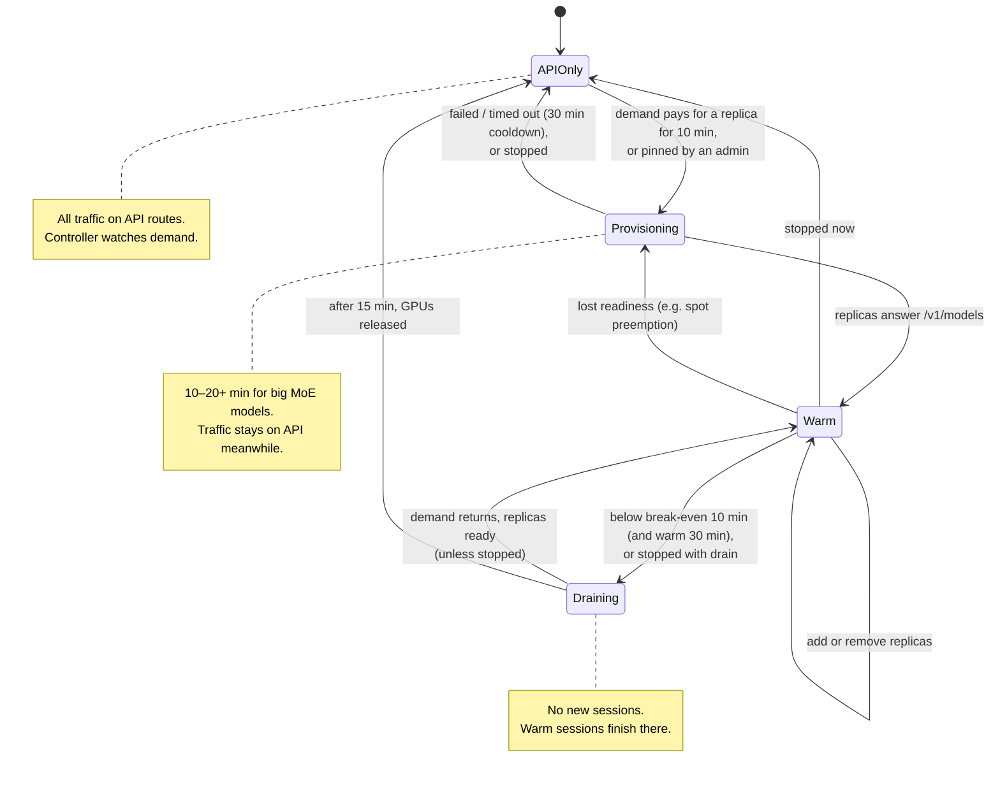
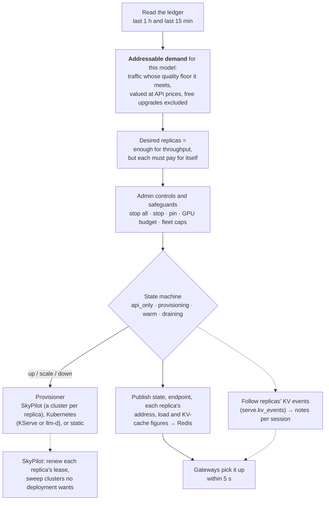
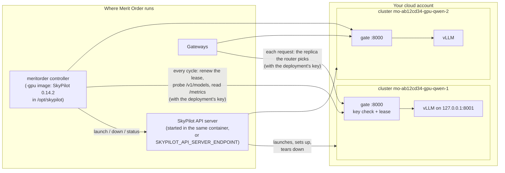
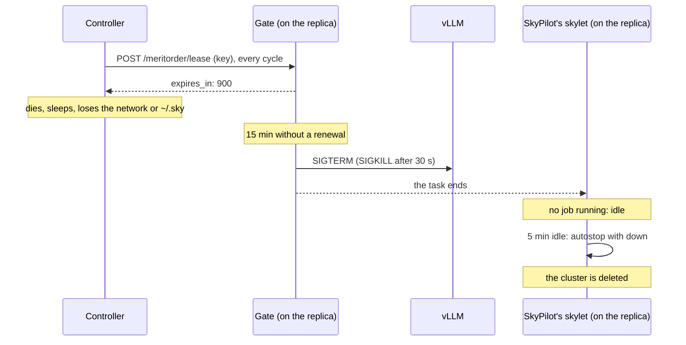
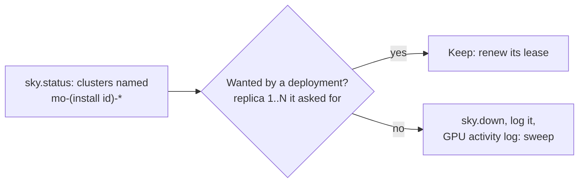
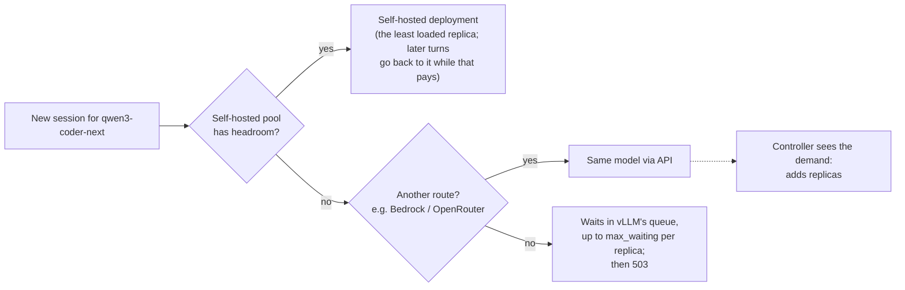

# 05 — GPU autoscaling

Only open-weight models (Qwen, DeepSeek, Kimi, GLM, Llama, …) can be self-hosted. Every
self-hostable model should also have **at least one API route serving the same weights**
(OpenRouter, the vendor, Bedrock, …). APIs are the floor; GPUs are an optimization. The console
warns about models without one before anyone stops their GPUs.

Three provisioners run the GPUs: **SkyPilot** (one cloud VM per replica, each of which deletes itself if the
controller stops renewing its lease), **Kubernetes** (KServe or llm-d on your cluster), and **static** (a vLLM server
you already run, which Merit Order only routes to). The capacity controller (`meritorder controller`) decides when
each deployment starts, scales and stops. The gateways only route to what it publishes.

**What has been run for real.** The decision logic, the state machine and every provisioner are tested in CI
against stand-ins. The Kubernetes provisioner has also run on a local kind cluster with a stand-in vLLM
([Checked on kind](#checked-on-kind)). The SkyPilot provisioner has started **one replica on a real cloud**: one A10
on Lambda, serving gpt-oss-20b on real vLLM. That start found the driver and image problems below and gave the cold
start its numbers ([Cold starts](#cold-starts)). Nothing else has run on a real cloud yet: no cluster has been scaled,
preempted or drained through Merit Order, no lease has run out on a real machine, and no GPU cost has been compared
with a bill. The replica gate and its lease have also run on a laptop, against a stand-in vLLM
(`tests/test_skypilot.py`). `scripts/skypilot_check.py` is the full check to run next
([Checking it on a real cloud](#checking-it-on-a-real-cloud)).

The full decision logic, with every rule and default, is in [10: How it decides](10-how-it-decides.md#when-gpus-start-scale-and-stop).

## Lifecycle of a self-hosted model



## Controller loop (every 60 s, `--interval`)



Only one controller acts at a time: each takes a Postgres advisory lock, and extra copies stand by. The active one
checks every cycle that it still holds the lock (a dropped Postgres connection releases it, and a standby may then take
it). When it can't confirm that, it stops acting until it holds the lock again. A Redis error while it waits for the
next cycle or writes its heartbeat is logged; the controller goes on. It needs
Postgres (`MERITORDER_DATABASE_URL`) and Redis, and picks up config versions saved from the console without a
restart. An admin's GPU control wakes it at once instead of at the next cycle.

Each cycle the controller reads every ready replica's `/metrics` directly (when their addresses are known)
rather than the load balancer's, which would answer for one replica only: its load, and its KV cache's size,
use and token counters, which gateways estimate warm caches from
([04](04-caching-and-sessions.md#gpu-replicas-which-one-holds-the-cache)). The deployment's utilization is
the replicas' average.

A self-hosted model therefore needs a quality score: one the live quality source doesn't cover counts
no `auto` demand (only requests that name it) until it gets a `quality_override`.

Why *addressable* demand: if the controller only counted traffic already sent to a model, a model
that isn't running would never look worth starting, because `auto` routes its traffic elsewhere.
So it counts what you currently pay for all traffic this model *could* serve (its quality meets the
request's floor), at API-equivalent prices. That value doesn't drop when the GPUs start serving,
so the controller doesn't flap.

## The break-even test

```
demand_per_hour   = addressable API-equivalent spend per hour (max of the 1 h and 4 × 15 min windows)
throughput        = addressable tokens per second (same windows)

by_load           = ceil(throughput / (capacity_tokens_per_second × target_utilization))
keep              = replica_price × (1 + margin)                    what a running replica must cover
start             = keep × (cold_start + hold_minutes) / hold_minutes   what one more replica must cover
kept              = min(running, floor(demand_per_hour / keep))
affordable        = kept + floor((demand_per_hour − kept × keep) / start)   (just kept, if kept < running)
replica_price     = cheapest SkyPilot catalog offer in the allowed clouds/regions,
                    or on Kubernetes the node type's configured price, else gpu_cost_per_hour
desired_replicas  = clamp(min(by_load ≥ 1, affordable), min_replicas, max_replicas)
                    (min_replicas alone when there's no demand at all, whatever the price)
```

**A GPU with no price never starts.** On SkyPilot and Kubernetes, a replica whose price is 0 or unknown (SkyPilot's
catalog gave none and `gpu_cost_per_hour` is 0) isn't started, pinned or not: no GPU budget or fleet cap could hold it,
and nothing it cost would be counted. The deployment's note says so. A Kubernetes deployment with neither a priced node
type nor `gpu_cost_per_hour` is refused when the configuration is loaded. A `static` server (your own hardware) may
have no price: it has no cloud bill, and it runs while there is demand for it (or `min_replicas`).

`running` is the replicas the deployment has now (starting, warm or draining). `cold_start` is the expected time
from the launch request to a ready replica: the average of the deployment's last 10 starts, or
`serve.cold_start_minutes` (12) until one has been measured; 0 for a server you run yourself (`static`).

**Why the cold start counts.** A replica bills from its launch, and during the cold start it serves nothing. Once warm,
the controller keeps it at least `hold_minutes`. So a start is worth it only if the demand pays for the cold start as
well, over that hold. With the defaults (a 12 minute cold start, a 30 minute hold, a 20% margin), a replica that isn't
running needs demand of 1.2 × 42/30 = 1.68 × its price per hour to start, and a running one needs 1.2 × to stay. A burst
that would pay for a GPU once it's warm, but not for 12 paid idle minutes on top, leaves its traffic on the APIs. The
gap between the two thresholds is also hysteresis: a replica that just started isn't stopped by the same small dip that
would have kept it from starting. Each deployment's record shows what a start needs now (`start_needs`: the dollars an
hour, the cold start used and whether it was measured), and the GPUs page shows it under "A start needs".

Defaults, per deployment under `serve:`: `margin` 0.2 (demand must pay 1.2 × the replica price),
`target_utilization` 0.7, `scale_up_after_minutes` 10, `hold_minutes` 30, `drain_minutes` 15,
`provision_timeout_minutes` 45, `cold_start_minutes` 12.

State machine (`src/meritorder/gpu.py`, pure and unit-tested):

| From | To | When |
|---|---|---|
| api_only | provisioning | `desired ≥ 1` continuously for `scale_up_after_minutes` (or `min_replicas > 0`) |
| provisioning | warm | replicas answer `/v1/models` |
| provisioning | api_only | failed or `provision_timeout_minutes` passed; 30-minute cooldown |
| warm | warm | replica count follows `desired` |
| warm | draining | `desired = 0` for `scale_up_after_minutes`, and warm for at least `hold_minutes` |
| warm | provisioning | replicas stop answering (e.g. spot preemption); traffic goes to APIs until they're back |
| draining | warm | demand returns and the replicas are ready |
| draining | api_only | after `drain_minutes`; GPUs released |
| provisioning | api_only | the start call fails (SkyPilot can't be run, a region it can't place, the Kubernetes API refuses): whatever it made is torn down first; 30-minute cooldown |
| provisioning | provisioning | the start fails and so does the teardown: still tracked (and billed) as starting, and stopped every cycle until that works; then api_only with the cooldown |
| warm | warm | a scale call fails: the replicas that ran stay (and are billed), and the scale is tried again next cycle |
| any | unchanged | a stop fails: the deployment stays marked as running, and the stop is tried again every cycle |
| any | api_only / draining | an admin stops it, Stop all GPUs, or the GPU budget runs out (see [Controls](#controls-and-safeguards)) |
| api_only | provisioning | an admin pins replicas: at once, skipping the wait and any cooldown (a start that fails while pinned ends the pin and cools down like any other; pinning it again retries at once) |

Key details:

- **Free upgrades don't count.** Traffic running above its floor because a GPU had headroom is
  excluded, so idle capacity can't keep itself alive by attracting traffic.
- **Batch work doesn't count either.** Requests of a batch use a running deployment's headroom, at
  low priority, up to the shadow price's knee ([02](02-request-flow.md#batch-work-on-your-gpus)), but
  they're never part of the demand GPUs are started or kept for: they come in bursts a provider's batch
  API does at half price within hours, and the ledger sees them only once they're done. When live
  demand stops paying for a deployment it drains as usual, and its waiting batch work goes to the
  providers (decision 49).
- **Measured capacity, not benchmarks.** `capacity_tokens_per_second` should be what one replica
  sustains at your latency target on real agent traffic (prefill-heavy).
- **Hysteresis everywhere.** Margins, minimum hold time, the scale-up delay and the cold start a new replica must pay
  back stop flapping. A 20-minute cold start is expensive to waste.
- **Spot where it's safe.** The controller launches a preempted SkyPilot replica again (on a spot node
  pool, the Kubernetes Deployment replaces it); overflow to the API covers the gap.

## Will a GPU ever pay? (Models → GPU break-even)

Before configuring a deployment, the console's **GPU break-even** tab (Models page; also
`GET /v1/reports/gpu/breakeven`, team leads and up) shows how much traffic one replica needs to pay
for itself by the rule above, next to your traffic. Every open-weight model gets a replica **sized to
it** and **priced from SkyPilot's catalog**:

- **Size.** The model's weights as published, from Hugging Face: the size of its safetensors files
  (one copy, where a repository ships two formats, as Mistral's do), and from their metadata, how many
  parameters are in 16 bits, 8 bits or packed 4 bits. gpt-oss and Kimi ship MXFP4 and DeepSeek's
  experts are FP4, stored as bytes; the files' size tells them apart from real 8-bit weights. Kimi K3.1
  is 1.56 TB, not the 2.8 TB its parameter count at a byte each would suggest. For a mixture-of-experts
  model, the parameters each token uses come from its name ("A3B") or are worked out from its config's
  layer sizes (gpt-oss-120b: 5.1B; Qwen3 Coder Next: 2.9B). A model with files but no metadata is
  sized from its files and the parameter count in its name; a gated one from its name at 16 bits, or
  not at all.
- **Weights:** *As published*, *FP8* or *4-bit*. FP8 serves a 16-bit checkpoint in FP8, as vLLM's
  `--quantization fp8` does (a checkpoint published already quantized is served as published). 4-bit
  serves every weight above 4 bits in 4, as a 4-bit checkpoint made from the published one would
  (AWQ, GPTQ, NVFP4): about 4.25 bits a weight with its scales. Quantizing changes what fits and how
  fast the GPUs compute; it doesn't change the quality scores, which are for the weights as published.
  The tab warns that a quantized model may score lower (coding usually suffers first), so measure it
  with an [eval](11-evals.md) before routing on it.
- **Machine.** Every machine whose GPUs hold the weights in 70% of their memory (the rest is the KV
  cache), on 1, 2, 4 or 8 GPUs (how vLLM splits a model), among the data-center GPUs the sizing knows:
  A10, A10G, L4, L40S, A100 (40 and 80 GB), H100 (and H100 NVL), GH200, H200, B200, B300 and MI300X. Of those, the one that **pays from the least traffic**: the cheapest per hour whose
  replica, when full, costs less per token than the API work it takes (plus the margin). The cheapest
  machine isn't always it: four-bit weights fit on old A100s that can't serve enough to pay, where a
  Blackwell machine can. When none can pay, the cheapest per token shows (or a cheaper machine within
  10% of it), so *never* means never on any machine on offer. A model that needs more than one machine
  says so.
- **Price.** SkyPilot's catalog, through SkyPilot itself: on-demand or **spot** prices (a switch on the
  tab) for every cloud it covers (AWS, GCP, Azure, Lambda, RunPod and Nebius by default, plus your
  deployments' clouds; the tab can narrow them), with the region and instance. These are prices only:
  launching on a cloud needs SkyPilot's support for it where the controller runs ([Which clouds](#which-clouds)). When a report finds the
  prices over 6 hours old (or the model sizes over a week old), it shows the stored ones at once and fetches
  new ones in the background; the tab says so and updates when they're in (a lookup takes about a minute,
  two with downloads). **Get latest prices** has SkyPilot download its catalogs again now. A gateway runs
  one refresh at a time: a report or button press while one runs waits for it rather than starting
  another, since lookups at once slow each other down and starve the gateway. A lookup that fails says
  why (SkyPilot's last error line, or that it ran past 10 minutes), the tab shows that with the age of
  the prices it still uses, and reports try again after 5 minutes. Lookups never use cloud credentials:
  prices don't need them.
- **Throughput** is an estimate: a share of the GPUs' peak dense compute (10% by default, adjustable)
  at two operations per active parameter per token, with input read from the prompt cache not
  computed again. The peak is at the precision the GPUs compute the weights in: FP8 weights at the
  FP8 rate on GPUs that have it (L4, L40S, H100 and later, MI300X); 4-bit weights at the FP8 rate on
  Blackwell (B200, B300), whose 4-bit kernels take 8-bit activations, and at 16 bits elsewhere
  (Hopper's 4-bit kernels dequantize the weights); everything else at 16 bits. A deployment's
  `capacity_tokens_per_second` (measure it) replaces the estimate, and its own GPUs, clouds and spot
  setting replace the sizing (a Kubernetes deployment uses its node type's price, a server you run its
  configured price).

What the tab shows:

- **Best level you can host**, per task type: the open model with the highest score that fits on a
  machine on offer, its machine and price, and any better one that doesn't fit.
- **By quality level.** A replica takes traffic that `auto` would otherwise send to the cheapest API
  model good enough for its level, so that model's price is the one to beat. For each level: that
  model and its price; the open model that qualifies and pays from the least traffic (or, if none
  can, comes closest), on its machine; the tokens per minute (and about how many requests an hour)
  that replica needs; and your average and busiest hour at that level. A level where no open model
  qualifies, or none fits on one machine, says so.
- **By open-weight model.** Its size and replica, what the traffic it could serve actually cost per
  million tokens over the window (the controller's own measure), its own API price, what it needs, and
  a verdict: pays now, pays from a given traffic, or never.
- **Never** means one replica can't get there at any traffic, on any machine on offer: at full load
  (its target utilization) the GPU costs more per token than the API, plus the margin, so more
  replicas wouldn't help either.

On 11 November 2026, with spot prices:

- Level 1 paid with gpt-oss-20b on one L4 ($0.12 an hour on AWS), from about 72,000 tokens a minute.
- At level 2, the closest was DeepSeek V4.1 Flash on eight B200s ($13.92 an hour on GCP) at $0.054 per
  million tokens against $0.065 on APIs. That's cheaper, but not by the 20% margin, so it never pays.
- The best open coder was Kimi K3.1 (coding 2.7). It's published in 4 bits (1.56 TB) and fits on
  eight B300s ($20.08 an hour on AWS). Level 3 starts at Claude Haiku's 3.0, and no open model reached
  it, as published or quantized: the strongest open models already ship in 4 bits, so quantizing
  doesn't let a better one fit.
- Qwen3 Coder, Qwen3 Coder Next, Devstral 2 and Qwen3 Coder 30B had no published score, so they
  don't count until they're measured.

Prices are blended for the traffic's mix of input, cached input, cache writes and output (a level or
model with at least 20 requests uses its own, otherwise everyone's; with no traffic, an assumed
agent-like mix). Free tiers don't count as the price to beat: they're rate-limited and can't take
sustained traffic.

**Where SkyPilot runs for prices.** The gateway asks SkyPilot directly when it has it. The compose stack
builds the gateway, worker and migrate images with SkyPilot in its own environment (`SKYPILOT_VERSION`, 0.14.2
by default; empty leaves it out), and the controller's image always has it. For `meritorder` run on a laptop,
`uv tool install "skypilot[aws,gcp,kubernetes,lambda]==0.14.2"` puts it on the path. Without it (the Helm chart's
gateways run the plain image; only the controller runs the `-gpu` one), the GPU controller publishes the prices
every 6 hours and when someone asks for the latest, and the tab says if no controller is running.

## Configuring a self-hosted model

```yaml
backends:
  gpu-qwen-coder:
    kind: self_hosted
    format: openai
    gpu_cost_per_hour: 16.0          # one replica (here 4× H100)
    capacity_tokens_per_second: 4000
    serve:
      provisioner: skypilot          # or `kubernetes` (your cluster, below), or `static` for a server you already run
      model: qwen3-coder-next        # its hf_id is what vLLM serves
      accelerators: "H100:4"
      use_spot: true
      clouds: [aws, gcp, lambda]
      image: vllm/vllm-openai:v0.32.0-cu129
      vllm_args: "--max-model-len 262144"
      max_replicas: 4
```

The model also needs a route to the deployment with a `price:` at the API-equivalent rate: `auto`
skips unpriced routes, and the router scales that price down while the GPUs have room
([Overflow](#overflow)). Keep the API route for the same weights next to it:

```yaml
models:
  qwen3-coder-next:
    hf_id: Qwen/Qwen3-Coder-Next
    routes:
      - {backend: gpu-qwen-coder, model: Qwen/Qwen3-Coder-Next, price: {input: 0.12, output: 0.80, cache_read: 0.07}}
      - {backend: openrouter, model: qwen/qwen3-coder-next}
```

The SkyPilot provisioner turns this into one SkyPilot cluster per replica ([below](#how-skypilot-runs-a-deployment)).
It needs SkyPilot and cloud credentials where the controller runs (`sky check`). Set `HF_TOKEN` there for gated
models: it goes to the machines as a SkyPilot secret. Under `serve:`, `lease_minutes` (15) and `autostop_minutes` (5)
bound how long a replica outlives its controller ([The lease](#the-lease)), `port` (8000) is the one port each replica
opens, and `ssh_tunnel` (`auto`) says when to reach it through the controller instead. `vllm_args` is a list of
arguments, read the way a shell splits words (`shlex.split`: quote a value with spaces), never a shell fragment: each
token reaches vLLM as written, quoted in SkyPilot's run script and passed as a list on Kubernetes, so `;` or `$(...)` is
text, not a command. It can't turn on vLLM's request logging (`--enable-log-requests`, `--enable-log-outputs`, also
spelled with underscores or shortened as vLLM's parser allows): it would write prompts to the replica's log. The
check runs on the tokens, so quoting can't hide the flag.
`cold_start_minutes`, `load_format` and `weights_cache` are about starts: [Cold starts](#cold-starts).

**The image and the NVIDIA driver.** The default image is `vllm/vllm-openai:v0.32.0-cu129`, vLLM 0.32.0 built for
CUDA 12.9.1. vLLM's plain tags (`v0.32.0`, `v0.33.0`) are CUDA 13.0.2 builds, and v0.33.0 has no CUDA 12.9 build
(Docker Hub, November 2026). **CUDA 13 images need NVIDIA driver 580 or newer** (580.65.06). An older driver runs the
CUDA 12 runtime through minor version compatibility, but not everything built against a newer 12.x toolkit: on
Lambda's A10, driver 570.148.08 (CUDA 12.8 at most), the CUDA 12.9.1 image failed at startup to load torchcodec's
library (checked live, 15 November 2026). So when `nvidia-smi` reports an older CUDA than the image's, minor versions
included, the replica's gate starts vLLM with **NVIDIA's forward-compatibility libraries**: the image's
`/usr/local/cuda/compat` (vLLM's images install `cuda-compat`) first on `LD_LIBRARY_PATH`, and
`VLLM_ENABLE_CUDA_COMPATIBILITY=1`. Forward compatibility works on data-center GPUs (A10, A100, H100, L4 and the like),
not GeForce cards. Cloud GPU images often ship a 535, 550 or 570 driver. The gate logs the driver, the image's CUDA and
whether it used the compat libraries; when the driver is too old even so, it says so plainly in the replica's failure
reason ([When a replica fails](#when-a-replica-fails)).

**A broken optional package in the image.** vLLM v0.32.0-cu129 (torch 2.13.0+cu129) bundles torchcodec 0.17.0
built for CUDA 13: it links `libcudart.so.13`, which the image doesn't have, so importing it raises an `OSError`.
vLLM's guarded import catches `ImportError` and `RuntimeError` only, so vLLM died at startup on every machine (found
on Lambda and reproduced in the image on a laptop, 15 November 2026). Before it starts vLLM, the gate imports each
optional package vLLM can do without (`OPTIONAL_PACKAGES` in `replica_gate.py`: torchcodec, for audio input) and
uninstalls one that fails with an `OSError`, and says so in the replica's log. vLLM then runs without audio input.

**Keeping sessions on their replica.** Each replica has its own KV cache, so gateways send a session's turns
to the replica that served its last one, while it's ready, has room, and isn't so busy that rebuilding the
cache on an idle replica costs less ([03](03-routing.md#which-replica-of-a-gpu-deployment)). SkyPilot replicas have
no load balancer in front, so the gateway picks one for every request (the cheapest by the same formula: the least
loaded, or the one holding the session's cache), and `replica_affinity` can't be turned off there. Their addresses come
from SkyPilot (each cluster's head IP and `port`); the gateways must be able to reach them, or go through the
controller's SSH tunnel ([Reaching the replicas](#reaching-the-replicas)). For a server you run, list each replica:

```yaml
    serve:
      provisioner: static
      model: qwen3-coder-next
      static_url: http://vllm-lb.internal:8000/v1           # optional: used when no replica answers directly
      static_urls: [http://gpu-a.internal:8000/v1, http://gpu-b.internal:8000/v1]
      replica_affinity: true                                 # default; false lets the load balancer pick
      kv_events: true                                        # follow vLLM's KV events (default false)
      kv_events_port: 5557
```

With `kv_events: true` the controller follows each replica's KV-cache events and knows when a session's
cached blocks are evicted; SkyPilot and Kubernetes deployments get vLLM's `--kv-events-config`, and SkyPilot opens
the port. Set it only where that port is on a private network: the events carry token ids, the gate doesn't cover them,
and SkyPilot opens a port to anyone who can reach the VM (on Lambda, to the whole account). For a static server, start vLLM
with `--kv-events-config '{"enable_kv_cache_events":true,"publisher":"zmq","endpoint":"tcp://*:5557"}'`
(vLLM 0.30 or later tags events with the session) and `--enable-prompt-tokens-details`. Without events, eviction
is estimated from each replica's metrics. Details: [04](04-caching-and-sessions.md#gpu-replicas-which-one-holds-the-cache).

## How SkyPilot runs a deployment

**Not run on a real cloud yet.** Everything in this section is what the code does, checked in CI against a stand-in
SkyPilot package and a stand-in vLLM (`tests/test_skypilot.py`). What SkyPilot itself does is from its source and docs,
version 0.14.2, read in November 2026. `scripts/skypilot_check.py` runs the whole cycle on a real cloud
([below](#checking-it-on-a-real-cloud)); until someone has run it, treat this as unverified.

Merit Order runs **one plain SkyPilot cluster per replica** and does the rest itself (decision 56): the controller
decides how many replicas run, the gateways send each request to a replica directly, and the controller probes them.
SkyPilot does what it's good at: finding capacity across the allowed clouds and regions (and failing over between
them), setting the machine up (the vLLM image, the port, the disk, the labels), its price catalog, autostop and
teardown. There's no SkyServe controller VM: nothing runs that isn't a replica, so nothing runs that isn't priced.



**Names.** Replica *n* of deployment `<backend>` is the cluster `mo-<install id>-<backend>-<n>` (the backend name
lowercased, other characters turned into `-`, at most 24, with 4 characters of its hash when that changed it). The
install id is 8 random characters made once and kept in Postgres (`gpu_install_id`; `MERITORDER_INSTALL_ID` sets it),
so two Merit Order installs on one cloud account never see, let alone tear down, each other's clusters. Every instance
also carries the labels `meritorder-deployment: <backend>` (for matching bills, [What GPUs cost](#what-gpus-cost)) and
`meritorder-install: <install id>`, on the clouds that take labels (AWS tags, GCP labels; not Lambda).

**Calls.** SkyPilot runs in its own Python, so the controller runs a small script there (or in-process when SkyPilot
is importable where the controller runs) that calls the SDK's `sky.launch`, `sky.down` and `sky.status` and answers in
JSON. Launches run in the background, so a cycle never waits for one.

| When | What the controller does |
|---|---|
| Start, or more replicas | `sky.launch` for each missing cluster, with `idle_minutes_to_autostop=autostop_minutes`, `down=True`, `wait_for=jobs` (and the same in the task's `resources.autostop`) |
| Fewer replicas | `sky.down` of the highest-numbered clusters |
| Stop | `sky.down` of every cluster of the deployment, waited for; a cluster that's already gone counts as stopped |
| Every cycle | `sky.status` (refreshed from the clouds) of this install's clusters, once for all deployments; then for each wanted cluster that's `UP`: renew its lease, probe `/v1/models`, read `/metrics` |
| A cluster is on Kubernetes or RunPod | `sky.endpoints` once, for the address its port is mapped to ([Reaching the replicas](#reaching-the-replicas)) |
| A wanted cluster is `UP` without autodown (a launch cut short before SkyPilot set it, someone's `sky autostop`) | `sky.autostop` with `down=True`, `wait_for=jobs` again, at most every 10 minutes |
| A cluster is `STOPPED` (a spot machine preempted on Azure or Nebius, someone's `sky stop`) | `sky.down`: a stopped machine bills for its disk and can't delete itself |
| A wanted cluster is missing or stuck in `INIT` with no launch under way (the controller restarted mid-launch, a spot preemption) | Launch it again |
| A launch fails (no capacity in any allowed place) | Read `sky logs --tail` for why, tear down whatever it made, show why, try that replica again after 10 minutes. If every wanted replica failed, the start has failed: 30-minute cooldown |
| vLLM exits before it was ever ready (it crashed, the driver is too old for the image) | Read why from the gate, tear the cluster down at once, and wait as after a failed launch before launching it again, so a crash loop doesn't keep paying for machines |
| vLLM exits after it was ready (out of memory under load, a GPU fault) | Read why from the gate (its last 40 lines go to the log), tear the cluster down at once rather than leave it idle until autostop, and launch it again. A second such crash within an hour waits 10 minutes, as after a failed launch |
| A wanted cluster goes away while the deployment drains | Not launched again: the deployment is on its way down |
| A cluster goes away before vLLM was ever ready (the image wouldn't start, the gate exited unseen) | The same wait before launching it again |

A replica is `PROVISIONING` while SkyPilot launches it, `STARTING` until its gate answers and vLLM answers
`/v1/models`, then `READY`. Its address is `http://<head IP>:<port>/v1`. When the controller restarts, it takes the
replica count from the deployment's last published record, so it wants the same clusters it wanted before; after a
config change, each deployment's new provisioner takes over its old one's launches and waits.

**The task.** What each field comes from:

| Field | Value |
|---|---|
| `resources.accelerators` | `serve.accelerators` (default `H100:8`) |
| `resources.use_spot` | `serve.use_spot` (default false) |
| `resources.any_of` | With `serve.regions`: one `infra: <cloud>/<region>` for each pair SkyPilot's catalog has these GPUs in (at the spot or on-demand price, per `use_spot`), among `serve.clouds` if set. So a region goes only with its own cloud, and the launch goes exactly where the expected price came from. Without regions: one `infra: <cloud>` per cloud in `serve.clouds`. With neither: left out, and SkyPilot picks the cheapest offer among the clouds `sky check` enables that can run it (Docker images, autodown and ports: it skips the others) |
| `resources.image_id` | `docker:<serve.image>` (default `vllm/vllm-openai:v0.32.0-cu129`; pin one you have tested) |
| `resources.disk_size` | `serve.disk_size_gb` (default 1000; Lambda's disks are fixed by instance type) |
| `resources.ports` | `serve.port` (8000), the gate; plus `kv_events_port` when `kv_events` is on. Nothing else. Given with each `any_of` entry, and left out for clouds where SkyPilot can't open ports (Vast, Mithril, Slurm): asking for them there would rule the cloud out, and those replicas are reached over SSH |
| `resources.labels` | `meritorder-deployment: <backend>`, `meritorder-install: <install id>` |
| `resources.autostop` | `{idle_minutes: autostop_minutes, down: true, wait_for: jobs}`, always |
| `envs` | `MERITORDER_KEY_SHA256` (the key's hash, not the key), `MERITORDER_LEASE_SECONDS`, `MERITORDER_PORT`, `MERITORDER_UPSTREAM_PORT` |
| secrets | `HF_TOKEN`, from the controller's environment when it's set (a SkyPilot secret: not in the task file) |
| `run` | Writes the gate (`replica_gate.py`) to `/tmp` and runs `python3 /tmp/meritorder_gate.py -- vllm serve <hf_id> --host 127.0.0.1 --port 8001` with the flags in [Inside the GPU pool](#inside-the-gpu-pool), then `vllm_args`, each token shell-quoted |

### The key

Every replica lets in only callers with its deployment's key. The key is an HMAC of this install's secret and the
deployment's name, which the controller and every gateway work out for themselves; the secret is made once and kept in
Postgres (`gpu_replica_secret`; `MERITORDER_GPU_KEY` sets it, the same on every process), like the learned router's
hashing key. Gateways send it as `Authorization: Bearer` to the replicas of every SkyPilot deployment (a backend's own
`auth` doesn't apply there).

The machine never gets the key itself, only its SHA-256. The reason is SkyPilot's API server: it keeps every launch
request, the task's environment and secrets included, in its database (`~/.sky/api_server/requests.db` in 0.14.2). So
vLLM doesn't get `--api-key` either: it listens on the loopback address only, behind the **gate**, a small
standard-library Python program that is the only thing on the open port. The gate checks the key on each connection's
first request, on every path (vLLM's own `--api-key` covers only paths under `/v1`, leaving `/metrics`, `/tokenize`
and `/invocations` open), answers 401 without it, and then passes the connection to vLLM byte for byte. A connection
has 5 seconds to send that first request, and at most 256 may be waiting to show the key at once (`MAX_UNVERIFIED`);
past that a new connection is closed straight away, so a scan or a flood of idle connections can't use up the replica's
sockets. Connections that showed the key aren't counted. Rotating the secret changes every key; replicas started before then refuse the new one, so stop them first.

Traffic to the replicas is plain HTTP, as before: the key and the prompts cross the network unencrypted. Keep the
gateways and the GPUs on a network you trust, or reach them through the SSH tunnel below.

### The lease

The gate also holds a **lease**. The controller renews it every cycle (`POST /meritorder/lease` with the key) for each
cluster it wants. When it isn't renewed for `lease_minutes` (15 by default; at least 3), the gate stops vLLM (SIGTERM,
then SIGKILL after 30 s) and exits. That ends the task, the cluster has nothing running, and SkyPilot's autostop, set
with `down: true` at launch, deletes it `autostop_minutes` (5) later. The lease starts when the gate does, so a replica
whose controller never comes back stops too.



How SkyPilot 0.14.2 decides a cluster is idle (`sky/skylet/events.py`, `StopEvent`): every 60 seconds the skylet
on the head node counts the cluster's jobs that aren't finished (`job_lib.is_cluster_idle`) and, with the default
`wait_for: jobs_and_ssh`, open SSH sessions. Merit Order sets `wait_for: jobs`, so an SSH session (the tunnel below, or
someone logged in) doesn't keep a machine alive. When nothing has run for `idle_minutes`, it tears the cluster down
from the machine itself, with the cloud credentials SkyPilot put there at launch. The chain is lease runs out → the
gate exits → the job ends → idle → down: all of it on the machine, so it holds when the controller is dead, its
laptop sleeps, the network drops, or `~/.sky` is lost. A replica therefore costs at most about `lease_minutes +
autostop_minutes + 2` minutes after the controller last renewed it (22 by default). The same holds when vLLM exits by
itself: the gate exits with it, after the controller has read why or 2 minutes have passed
([When a replica fails](#when-a-replica-fails)).

The controller warns at startup when its cycle (`--interval`, 60 s) is so long that three missed cycles outlast the
shortest lease.

**Leases while things fail.** The leases are renewed first thing in each cycle, before the controller reads the ledger,
the controls or its own settings, each deployment on its own: a Postgres outage, or one deployment's error, doesn't cut
them. When Redis can't say what runs either, the replicas this process already asked for are renewed. Listing the
clusters (`sky.status`) and asking for a replica's address give up after 60 s (`STATUS_TIMEOUT`); launches and
teardowns keep their longer timeouts. When SkyPilot can't be asked (its API server hung or down), the last list it gave
stands in for up to an hour (`STALE_SECONDS`, counted to when the failed call was made), so leases are still renewed
meanwhile; after that, each replica stops when its lease runs out.

**What the lease doesn't cover.** SkyPilot sets autostop after the machine is up and set up (`execution.py`, the
`PRE_EXEC` stage, after provisioning and the image pull), the same way on every cloud. A launch interrupted before then
(the controller's container killed mid-launch, with its local API server) can leave a machine without autostop or a
gate. When the controller comes back with its `~/.sky`, it launches a wanted one again (which sets autostop), sets
autodown again on an `UP` one that shows none, and the sweep tears down the rest; without `~/.sky` too, SkyPilot no
longer knows the machine, and you'd find it by its name, `mo-<install id>-...`, in the cloud's console. Keep `~/.sky` on
a volume. Two more gaps, per cloud ([Which clouds](#which-clouds)): a spot machine preempted on Azure or Nebius is
stopped rather than deleted, and a stopped machine runs no skylet, so only the controller deletes it; and on the clouds
Merit Order refuses, there's no autodown at all.

### When a replica fails

A failed replica's machine is deleted, and vLLM's output with it, so the controller reads why first.

- **The gate keeps vLLM's last output.** vLLM's stdout and stderr go to the task's log as before (`sky logs`), and
  the gate also keeps the last 200 lines in memory. It runs `nvidia-smi` once at start for the driver version, the
  newest CUDA that driver runs and the GPUs, and reads the image's CUDA version (`CUDA_VERSION`, else
  `/usr/local/cuda/version.json`). `GET /meritorder/status`, with the deployment's key like the lease, returns all of
  it with vLLM's state, exit status and uptime. Anything in a line that looks like a key or token (a bearer token, a
  value named like a key, token, secret or password, `hf_`/`sk-`/AWS key ids, a run of 32 or more letters and digits)
  is replaced by `[redacted]`. A line from vLLM's request logger, which would hold a prompt, is left out (request
  logging is off, and `vllm_args` can't turn it on).
- **The gate stays to say why.** When vLLM exits by itself, the gate keeps answering until the controller has read
  `/meritorder/status`, for at most 2 minutes (`MERITORDER_LINGER_SECONDS`) or until the lease runs out. Then it exits
  as before. When the lease runs out or the gate is asked to stop, it exits at once.
- **The controller reads it.** Each cycle the lease renewal says whether vLLM is still running. When it has exited,
  the controller reads the gate's status once, and tears the replica down at once. A replica that was never ready
  waits 10 minutes before it's launched again; one that was ready is launched again at once, unless it's the second
  crash within an hour, which waits the same 10 minutes. Before a failed launch is torn down, and before the controller stops a
  deployment with failed replicas, it reads the same, or `sky logs --tail 40` (`sky.tail_logs`) when the gate doesn't
  answer. Reading never holds a teardown up by more than 25 seconds.
- **Where it shows.** The failure reason (for example "vLLM exited with status 1 before it was ready: the NVIDIA driver
  535.129.03 (CUDA 12.2 at most) is too old for this image's CUDA 13.0.2: CUDA 13 images need driver 580.65.06 or
  newer") is on the replica and the deployment. The controller's log has it with the driver and CUDA versions and the
  last 40 lines. The GPU activity log has a `replica_failed` entry with the same: the console shows the reason and
  versions, and the lines under *Last 40 lines of output*. `scripts/skypilot_check.py` prints them when a start fails.

### The sweep

Every controller cycle, and on the first one after it starts, the controller lists every SkyPilot cluster whose name
starts with this install's prefix (`mo-<install id>-`) and tears down each one no deployment wants now: one of a backend
that was renamed, removed or switched off, a teardown that failed, a launch that finished after its deployment was
stopped, or a scale cut short by a crash. Each is logged, and recorded in the GPU activity log (`sweep`, with the
cluster, its status and where it ran; a teardown that fails is an `error`, tried again next cycle). Clusters of other
installs and anything else on the account are never touched. It runs while a SkyPilot deployment is configured or the
last sweep found leftovers, and once at startup either way.



Kubernetes has a sweep of its own ([Kubernetes](#kubernetes)).

### Reaching the replicas

Gateways and the controller reach each replica's gate on its open port. Where that isn't possible, the controller
opens an **SSH tunnel** to the gate, `ssh -N -L` with the SSH config SkyPilot writes for each cluster
(`~/.sky/generated/ssh/<cluster>`), and publishes the tunnel's address as the replica's: `MERITORDER_TUNNEL_HOST`
(default `127.0.0.1`; in Compose, `controller`) on a port of its own. `serve.ssh_tunnel` decides:

| `ssh_tunnel` | When a replica goes through a tunnel |
|---|---|
| `auto` (default) | Where SkyPilot can't open the port (Vast, Mithril and Slurm, always; Lambda's `us-south-1`, which has no firewall rules), and when connections to the port time out from the controller for 3 cycles in a row (a firewall that drops them) |
| `always` | Every replica |
| `never` | None. A deployment that may launch on Vast, Mithril or Slurm is refused with `never` |

Where the address comes from, without a tunnel: the cluster's head IP and `port` on most clouds. On Kubernetes (a
LoadBalancer service by default, or an ingress) and RunPod (a public port mapped at launch), the port is published
somewhere else, so the controller asks SkyPilot (`sky.endpoints`) once per cluster.

KV events aren't tunneled: follow them only on a private network. A tunnel carries all of the replica's traffic
through the controller's host, so it's a fallback, not the way to run a busy fleet.

### Which clouds

- **`serve.clouds`** limits where a deployment may launch, and **`serve.regions`** where in them. Each region is paired
  only with the clouds that have these GPUs in it, from SkyPilot's catalog, and the expected price is looked up in exactly
  those places, so the launch and the price agree. `regions` without `clouds` pairs each region with every cloud that has
  it. A region SkyPilot's catalog can't place (or no catalog at all) fails the start with that reason. Empty `clouds`:
  any cloud SkyPilot has credentials for (`sky check`) and can run a replica on.
- **What the images support.** The `-gpu` image installs SkyPilot 0.14.2 with the extra of every cloud a replica can
  run on (the `SKYPILOT_EXTRAS` build argument, below), plus the ssh and rsync clients SkyPilot sets machines up with.
  Credentials for each: [07](07-deployment.md#skypilot-gpus).
- **Prices cover more clouds than launches.** Catalog prices need no credentials, so the break-even tab can show a
  cloud you can't launch on yet.
- The shipped config's `gpu-qwen-coder` example uses `clouds: [aws, gcp, lambda]` with spot H100s (so AWS and GCP only:
  Lambda has no spot), and is off until `MERITORDER_SKYPILOT=true`. `gpu-small` (gpt-oss-20b on one A10 on Lambda) is
  off until `MERITORDER_SKYPILOT_SMALL=true`.

A replica works the same on every cloud only if three things hold there: SkyPilot runs the vLLM image (`image_id:
docker:`), the machine deletes itself when its task ends (autostop with `down`, "autodown"), and the controller can reach
the gate. The table is what SkyPilot 0.14.2 does on each cloud it supports, read from its source in November 2026
(paths are under `sky/` in the installed package; the numbers point to the sources below the table). Nothing here has
been run on a real cloud yet.

**Where a replica can run.** On AWS, GCP, Azure, Lambda, RunPod, Nebius, Kubernetes (CoreWeave included), Vast,
Fluidstack, Paperspace, DigitalOcean, Mithril, Seeweb, and Slurm with Pyxis. SkyPilot can't run a Docker image on OCI,
Cudo, Shadeform, SCP, vSphere or IBM, and can't make a machine delete itself on Hyperbolic, PrimeIntellect, Verda or
Yotta: a deployment that names one of these in `serve.clouds` is refused when the config loads, with the reason. With
`clouds` empty, SkyPilot skips them by itself, because the launch asks for Docker and autodown and it fails over past
clouds that lack a feature it asks for [31].

| Cloud (pip extra) | How the machine deletes itself, and what credential it holds | Ports | Stop, and what bills after one | Docker image | Spot |
|---|---|---|---|---|---|
| AWS (`aws`) | The skylet terminates it with the `skypilot-v1` IAM instance role SkyPilot attaches: AmazonEC2FullAccess and AmazonS3FullAccess on the account [1]. It drops any AWS keys from its own environment first, so the role is what it uses [2]. With static keys in the controller's `~/.aws/credentials`, SkyPilot still copies that file to the machine [3] | A security group per cluster, the port open to 0.0.0.0/0; deleted at teardown, or after autodown at the controller's next status refresh [4] | Supported for on-demand; EBS volumes bill while stopped | Yes | Yes. Terminated when interrupted |
| GCP (`gcp`) | The skylet deletes it with Google's default credentials, which are your copied gcloud files (`~/.config/gcloud`, with `application_default_credentials.json`) when there are any [5]. The machine also has the `skypilot-v1` service account (compute.admin, storage.admin, iam.serviceAccountUser on the project) [6], used when nothing is copied | A firewall rule per cluster, by network tag; deleted at teardown [7] | Supported; the persistent disk bills while stopped | Yes | Yes. `instanceTerminationAction: DELETE`: a preempted machine is deleted [8] |
| Azure (`azure`) | The skylet deletes the cluster's resource group with the Azure CLI credential, the only one SkyPilot's Azure client uses [9]: your copied `~/.azure`, the `az login` token cache, good for every tenant and subscription that login reaches. The machine also gets a managed identity, Contributor on its own resource group [10], which 0.14.2 never uses, so keeping the CLI cache off the machine (`remote_identity: SERVICE_ACCOUNT` or `NO_UPLOAD`) would leave it unable to delete itself | A rule in the cluster's own network security group, deleted with its resource group | Supported (deallocate); managed disks bill while deallocated | Yes | Yes, but the eviction policy is Azure's default, Deallocate: a preempted machine is stopped, its disk billing, until the controller tears it down [11] |
| Lambda (`lambda`) | The skylet terminates it with the copied `~/.lambda_cloud/lambda_keys`: an API key for the whole account [12] | One firewall rule for the whole account, the port open to 0.0.0.0/0 for every instance, never removed (other clusters may use it). None in `us-south-1`, which has no firewall rules: tunneled [13] | No stop | Yes (Lambda has no custom machine images, but Docker images are a separate feature) | No |
| RunPod (`runpod`) | The copied `~/.runpod/config.toml`, a RunPod API key | Mapped at launch to a public port on another number; Merit Order asks SkyPilot for it [14] | No stop | Yes: the pod runs the image itself | Yes (interruptible pods) |
| Nebius (`nebius`) | The copied `~/.nebius/credentials.json`, a service-account key (scope it with Nebius IAM), and the tenant id | A security group per cluster. Autodown can't delete it (the machine is gone first): SkyPilot does at the controller's next status refresh [15] | Supported; disks bill while stopped | Yes | Yes, with the preemption policy STOP: a preempted machine is stopped, its disk billing [16] |
| Kubernetes (`kubernetes`); CoreWeave through it | The pod deletes itself, and its services, with SkyPilot's service account, which may do anything in its namespace [17]. Your kubeconfig isn't copied: `remote_identity` defaults to `SERVICE_ACCOUNT` there [18] | A LoadBalancer service by default (or an ingress, or the pod IP), deleted with the pod [19]; Merit Order asks SkyPilot for the address | No stop | Yes: the pod's image | Only on clusters whose nodes carry a spot label |
| Vast (`vast`) | The copied `~/.config/vastai/vast_api_key` | None: 0.14.2 doesn't pass ports when it creates the instance, and forwards only 8080 through Vast's gateway [20]. SSH tunnel, always | Supported; storage bills while stopped | Yes | Yes (interruptible) |
| Fluidstack (`fluidstack`) | The copied `~/.fluidstack/api_key` | Every port is open by default [21] | No stop | Yes | No |
| Paperspace (`paperspace`) | The copied `~/.paperspace/config.json` | SkyPilot does nothing [22]: reachable if the machine's network allows; `ssh_tunnel: auto` tunnels after 3 timeouts | Supported; storage bills while stopped | Yes | No |
| DigitalOcean (`do`) | The copied `~/.config/doctl/config.yaml`, an API token (DigitalOcean's custom scopes can limit it to droplets) | Every port is open by default [23] | Supported; a powered-off droplet bills in full | Yes | No |
| Mithril (`mithril`) | The copied `~/.config/mithril/config.yaml` | SkyPilot can't open ports there [24]: SSH tunnel, always | Supported by SkyPilot | Yes | Yes |
| Seeweb (`seeweb`) | The copied `~/.seeweb_cloud/seeweb_keys` | Every port is open by default [25] | Supported | Yes | No |
| Slurm (`slurm`) | No cloud credential: down cancels the job. Autodown only for container jobs, on clusters with Pyxis [26] | None: SSH tunnel, always | Only with Pyxis | Only with Pyxis | No |
| OCI (`oci`), Cudo (`cudo`), Shadeform (`shadeform`), SCP (`scp`), vSphere (`vsphere`), IBM (`ibm`) | Refused: no Docker images there in 0.14.2 [27] | | | No | |
| Hyperbolic (`hyperbolic`), PrimeIntellect (`primeintellect`), Verda (`verda`), Yotta (`yotta`) | Refused: no autodown there in 0.14.2, so a replica whose controller is gone would bill until someone deleted it [28] | | No stop | | |

The same on every cloud:

- **Autostop is set after setup.** SkyPilot sets it in the `PRE_EXEC` stage, after provisioning, the image pull and
  setup, through the skylet, for every cloud alike (Kubernetes also gets it as pod annotations) [30]. That's the gap
  [The lease](#the-lease) describes.
- **Down always means delete.** The skylet's autostop with `down` calls the cloud's `terminate_instances`, never
  `stop_instances` [32]; Merit Order launches with `down=True`, puts `down: true` in the task, tears down with
  `sky.down` (which deletes), sets autodown again on a cluster that shows none, and tears down any cluster it finds
  `STOPPED`.
- **Every cloud's credentials go to every machine.** SkyPilot copies the credential files of every cloud it finds where
  the controller runs to every cluster it launches, whichever cloud that is [29]: a Lambda replica gets your AWS keys
  too, if they're there. The exceptions are the cloud a cluster runs on, when its `remote_identity` isn't
  `LOCAL_CREDENTIALS`, and any cloud whose `remote_identity` is `NO_UPLOAD`, both in `~/.sky/config.yaml` (for AWS and
  GCP only there: a task can't set them [33]).

So where self-deletion is safe depends on the cloud. On AWS, and on GCP with `remote_identity: SERVICE_ACCOUNT`, the
machine deletes itself with an identity of its own, nothing to steal but what that role may do (broad: all of EC2 and
S3, or compute and storage admin on the project). On every other cloud it deletes itself with a long-lived key that is
copied onto it: an account-wide API key on Lambda, RunPod, Vast, Fluidstack, Paperspace, DigitalOcean, Mithril and
Seeweb, a service-account key on Nebius, and on Azure your own `az login`. Anyone who gets onto a replica (vLLM runs in
the same container as the gate) can read it. So:

- **Give SkyPilot keys of their own**, made for it alone, that you can revoke: a separate Lambda, RunPod or Vast API
  key; a Nebius service account limited to the project; a DigitalOcean token with only droplet scopes; for Azure, log
  the controller in with a service principal that is Contributor on one subscription (`az login --service-principal`),
  not your own account. The controller warns when the config loads, for each key it finds that SkyPilot will copy.
- **Keep other clouds' keys off the machines**: mount only the credentials of the clouds you launch on, and set
  `remote_identity` in SkyPilot's config:

```yaml
# ~/.sky/config.yaml where the controller runs (or the file SKYPILOT_GLOBAL_CONFIG names)
aws:
  remote_identity: NO_UPLOAD        # AWS machines delete themselves with the skypilot-v1 role; no keys copied anywhere
gcp:
  remote_identity: SERVICE_ACCOUNT  # GCP machines use the skypilot-v1 service account; your gcloud files stay here
# and for a cloud whose credentials are here but you don't launch on, e.g.:
# lambda:
#   remote_identity: NO_UPLOAD
```

Don't set `NO_UPLOAD` or `SERVICE_ACCOUNT` for Azure, Lambda, RunPod, Nebius, Vast, Fluidstack, Paperspace,
DigitalOcean, Mithril or Seeweb if you launch there: their machines need the key to delete themselves.

**Image size.** All the extras above make SkyPilot's environment in the `-gpu` image about 2.0 GB, up from about
0.8 GB with only `aws,gcp,kubernetes,lambda` (installed for Linux x86-64 and Python 3.12, measured in November 2026).
Azure's CLI and SDKs are about 1 GB of it. `--build-arg SKYPILOT_EXTRAS=aws,gcp,kubernetes,lambda` (or any list)
builds a smaller one. OCI's SDK would add about 0.5 GB for a cloud Merit Order can't use, so it isn't in the default.

Sources (SkyPilot 0.14.2, paths under `sky/`):
[1] `provision/aws/config.py`, `_configure_iam_role`. [2] `skylet/events.py`, `_stop_cluster_with_new_provisioner`.
[3] `clouds/aws.py`, `get_credential_file_mounts`. [4] `provision/aws/instance.py`, `open_ports`, `cleanup_ports`.
[5] `clouds/gcp.py`, `get_credential_file_mounts`. [6] `provision/gcp/config.py`, `_configure_iam_role`;
`provision/gcp/constants.py`, `DEFAULT_SERVICE_ACCOUNT_ROLES`. [7] `provision/gcp/instance.py`, `open_ports`,
`cleanup_ports`. [8] `templates/gcp-ray.yml.j2`, `scheduling`. [9] `adaptors/azure.py`, `get_client`
(`AzureCliCredential`). [10] `provision/azure/azure-config-template.json`. [11] `templates/azure-ray.yml.j2`
(`priority: Spot`, no eviction policy). [12] `clouds/lambda_cloud.py`, `get_credential_file_mounts`.
[13] `provision/lambda_cloud/instance.py`, `open_ports`, `cleanup_ports`. [14] `provision/runpod/instance.py`,
`query_ports`. [15] `provision/nebius/instance.py`, `cleanup_ports`. [16] `provision/nebius/utils.py`,
`PreemptionPolicy.STOP`. [17] `templates/kubernetes-ray.yml.j2`, `autoscaler_role`. [18] `utils/schemas.py`,
`get_default_remote_identity`. [19] `provision/kubernetes/network.py`; `provision/kubernetes/instance.py`,
`terminate_instances`. [20] `provision/vast/utils.py`, `launch`; `provision/vast/instance.py`, `query_ports`.
[21] `provision/fluidstack/instance.py`, `open_ports`. [22] `provision/paperspace/instance.py`, `open_ports`.
[23] `provision/do/instance.py`, `open_ports`. [24] `clouds/mithril.py`, `OPEN_PORTS`. [25] `provision/seeweb/instance.py`,
`open_ports`. [26] `clouds/slurm.py`, `_unsupported_features_for_resources`. [27] `clouds/oci.py`, `cudo.py`,
`shadeform.py`, `scp.py`, `vsphere.py`, `ibm.py`: `DOCKER_IMAGE` unsupported. [28] `clouds/hyperbolic.py`,
`primeintellect.py`, `verda.py`, `yotta.py`: `AUTODOWN` unsupported. [29] `check.py`,
`get_cloud_credential_file_mounts`; `backends/backend_utils.py`, `write_cluster_config` (`remote_identity`).
[30] `execution.py`, `Stage.PRE_EXEC`; `backends/cloud_vm_ray_backend.py`, `set_autostop`.
[31] `execution.py` (autodown and the task's features requested); `backends/cloud_vm_ray_backend.py`,
`check_features_are_supported` in the failover loop. [32] `skylet/events.py`, `StopEvent`.
[33] `skylet/constants.py`, `OVERRIDEABLE_CONFIG_KEYS_IN_TASK`.

### Checking it on a real cloud

`scripts/skypilot_check.py` runs a full cycle against a running gateway and controller, through Merit Order's API, on
any cloud a replica can run on (`--cloud`, Lambda by default). It picks the cheapest GPU on that cloud that holds the
model (`gpu-small`'s gpt-oss-20b: its size from Hugging Face, the price from SkyPilot's catalog as the controller sees
it, as the break-even tab sizes replicas; one A10 on Lambda), prints what one replica costs an hour and what the run
should cost, and says how to set the deployment to that GPU and cloud if it isn't. Then it starts one replica and waits
until it's warm, sends a few requests pinned to it, checks that the replica answers 401 without the key, with a wrong
key and on `/metrics`, scales to zero and checks the cluster is gone, then starts one again, stops the controller, and
checks that the machine deletes itself within the lease plus autostop. "Gone" is checked twice: in SkyPilot's list, and
in the cloud's own list of instances (`sky.provision.query_instances` for that cloud, with what SkyPilot recorded about
the cluster while it ran; this needs SkyPilot's state where the script asks, so not with a remote API server, and says
so). It prints the time and the estimated cost at each step, needs `--yes-spend`, and always unpins, restarts the
controller and tears down anything left in a `finally`. It asks SkyPilot about the clusters as the controller sees them:
in the Compose controller's container by default (`--sky local` for a controller on the same machine). Usually 45 to 75
minutes of one machine (about $1 to $1.60 on a Lambda A10). When the controller gives up on a start (the deployment goes back to API only, or gets a failure cooldown), the script stops at once: it prints why each replica failed, with the driver and CUDA versions and vLLM's last 40 lines from the GPU activity log, unpins in the `finally`, and exits with status 1. It has run once, on Lambda: with the CUDA 13 image, vLLM stopped before it was ready, and the cause was lost with the machine.

### SkyPilot's state

SkyPilot keeps its state in `~/.sky` of the user the controller runs as (its local API server, the SSH keys and per-cluster
SSH configs it makes, and its record of the clusters it launched) and reads cloud credentials from the usual places
(`~/.lambda_cloud`, `~/.aws`, `~/.config/gcloud`, and so on). Losing `~/.sky` doesn't leave a GPU running for long:
each replica stops when its lease runs out. But a controller that keeps it sees and stops its clusters at once, so keep
it on a volume.

- **Compose:** mount `~/.sky` (a named volume, `sky-state`) and the credentials into the `controller` service (the
  lines are commented out in `compose.yaml`; [07](07-deployment.md#skypilot-gpus)).
- **Helm:** `controller.skypilot` gives the controller a writable home (a claim the chart makes, one of yours, or an
  emptyDir) and mounts credential Secrets inside it ([07](07-deployment.md#skypilot-gpus)).

## Cold starts

The first real start on Lambda (one A10, gpt-oss-20b, `vllm/vllm-openai:v0.32.0-cu129`, November 2026) took about
11 minutes from the launch to a warm replica: about 8 for the machine to boot, SkyPilot to set it up and Docker to pull
the ~10 GB image, and about 3 to download ~13 GB of weights from Hugging Face and load them. Those 11 minutes bill
without serving, which is why the break-even counts them ([The break-even test](#the-break-even-test)).

### What a start is made of

Every SkyPilot replica's start is timed in phases. The controller marks when it asked SkyPilot for the launch and when
SkyPilot's launch returned; the replica's gate marks the rest on the machine (`startup` in the gate's
`/meritorder/status` and in every lease reply):

| Phase | From | To | What happens |
|---|---|---|---|
| machine boots | launch requested (controller) | machine booted (`/proc/uptime`) | the cloud finds capacity and boots the VM |
| image pull | machine booted | container started (PID 1 in `/proc`) | SkyPilot sets up Docker's GPU runtime, pulls the image, starts the container |
| SkyPilot setup | container started | SkyPilot's launch returned (controller) | SkyPilot's runtime in the container, the task submitted |
| task start | launch returned | gate started | usually zero: the task starts as the launch returns |
| GPU check | gate started | vLLM started | `nvidia-smi`, the broken-package check |
| weights download | vLLM started | vLLM logs `Time spent downloading weights` | Hugging Face download (vLLM prints it only when it took over 0.5 s) |
| weights load | download | vLLM logs `Model loading took … seconds` (or `Loading weights took`) | the weights into GPU memory |
| engine start | weights loaded | vLLM's port takes a connection | memory profiling, torch.compile, CUDA graphs, the KV cache |
| first ready probe | listening | the controller's probe of `/v1/models` answers | up to one controller cycle (60 s) |

A mark that isn't known (no download line on a warm cache, an older gate) merges its phase into the next one
("weights download + weights load"). The controller's marks and the machine's are on two clocks, both normally kept by
NTP, so a phase across them is clamped at zero; the phases add up to the total. Only a launch the controller made
itself, in this process, is timed: after a restart, when it was asked for isn't known, and nothing is made up.

When a replica is first ready, the controller logs its phases, writes a `replica_ready` entry to the GPU activity log
(the phases, the total, and vLLM's own download and load seconds), and adds the total to the deployment's rolling
average (`cold_start` in its record: the last 10 starts, their average and the last one's phases). The break-even uses
that average. On Kubernetes the start is timed as a whole, from the controller's start to the first ready replica. The
GPUs page shows each replica's start under its status ("started in 11.2 min", the phases on hover), the last start and
what a start needs in the deployment's cost column, and the `replica_ready` entries in the activity log.
`scripts/skypilot_check.py` prints the phases each time the replica is warm.

### Faster starts

What each change saves is an estimate for the Lambda A10 run above, not measured yet.

| Change | On by default | Expected saving | Trade-off |
|---|---|---|---|
| Xet high-performance downloads (`HF_XET_HIGH_PERFORMANCE=1`) | yes, every replica | none over vLLM 0.32's own default (it sets this itself when unset); it keeps the fast path with other images | uses every core and the whole link while it downloads |
| `serve.load_format` (`runai_streamer`, `fastsafetensors`) | no (`auto`) | perhaps 10 to 60 s of the load for a 13 GB model; more for large models | not checked with every model (gpt-oss's MXFP4 weights are unconfirmed); a model that fails to load shows in its `replica_failed` entry |
| `serve.weights_cache: volume` | no | most of the ~3 minute download after the first start, plus part of the engine start (vLLM's compile cache is on the volume too) | only on Kubernetes and RunPod; bills every month; see below |
| A copy of the image near the GPUs (`SKYPILOT_DOCKER_*`) | no | part of the ~10 GB pull; depends on the registry and the cloud | you keep the copy up to date |
| Pre-baked machine images | not built | the whole image pull, and the download if the weights are baked in too | see below |

**Hugging Face downloads.** The Hub now serves files through Xet, and huggingface_hub 1.x (vLLM 0.32 needs 1.31 or
later) ignores `HF_HUB_ENABLE_HF_TRANSFER`: `hf_transfer` "can't be used anymore", and the vLLM image doesn't ship it.
Xet's high-performance mode is its successor. vLLM 0.32 turns it on itself when the variable isn't set
(`model_executor/model_loader/weight_utils.py`, `enable_xet_high_performance`); the task sets it anyway so it holds
for other images. Nothing is installed at boot.

**Load formats.** `serve.load_format` is passed to vLLM as `--load-format` (every provisioner); `auto` (the default) is
vLLM's own loader, which every model works with. vLLM v0.32.0's image includes `runai-model-streamer` (with its S3,
GCS and Azure extras) and `fastsafetensors` (a CUDA requirement), so both work without installing anything. Both read
safetensors faster than the default, but both download a Hugging Face repo first and then read the local copy, so they
don't shorten the download. `runai_streamer` takes `--model-loader-extra-config '{"concurrency":16}'` (or
`memory_limit`) in `vllm_args`. `fastsafetensors` runs without GPUDirect Storage (it falls back by itself, and turns
it off for tensor parallel). Neither is confirmed with every quantization; try one on the model with
`scripts/skypilot_check.py` before you leave it on. vLLM's source at tag v0.32.0: `vllm/config/load.py`,
`model_loader/runai_streamer_loader.py`, `model_loader/weight_utils.py`.

**The image pull.** SkyPilot 0.14.2 has no setting that makes the pull itself faster: it runs a plain `docker pull`
before it starts the container (`sky/provision/docker_utils.py`), on every launch. What it does offer is a registry login:
with `SKYPILOT_DOCKER_USERNAME`, `SKYPILOT_DOCKER_PASSWORD` and `SKYPILOT_DOCKER_SERVER` all set where the controller
runs, each launch takes them as SkyPilot secrets and the machine logs in before it pulls. Copy the vLLM image to ECR or
Artifact Registry in the region the GPUs run in and point `serve.image` at the copy, and the pull stays inside that
cloud. For ECR the password may be empty: the machine logs in with its IAM role. This helps on AWS and GCP; on Lambda
and other GPU clouds there's no registry next to the GPUs, and Docker Hub is as close as any.

### The weights cache volume

`serve.weights_cache: volume` (default `none`) keeps the Hugging Face cache on a SkyPilot volume where the GPUs run.
The first start fills it; later starts find the weights there and skip the download. vLLM's compile cache
(`VLLM_CACHE_ROOT`) goes on it as well, so a later start can load compiled graphs instead of compiling them.

```yaml
    serve:
      provisioner: skypilot
      clouds: [runpod]
      regions: [CA]                            # optional; must be the volume's region if set
      weights_cache: volume
      weights_cache_infra: runpod/CA/CA-MTL-1  # runpod/<region>/<data center>, or kubernetes[/<context>]
      weights_cache_gb: 50                     # the weights and some room: you pay for every GB a month
      weights_cache_usd_per_gb_month: null     # null: RunPod's published price; set it for a Kubernetes PVC
```

**Where it works.** SkyPilot 0.14.2 has volumes on two clouds only (`sky/utils/volume.py`, `VolumeType`):

- **Kubernetes:** a PersistentVolumeClaim (`k8s-pvc`). With `max_replicas` above 1 it's asked for as `ReadWriteMany`,
  so every replica can mount it at once, and your storage class must allow that; with one replica, `ReadWriteOnce`.
- **RunPod:** a network volume in one data center (`runpod-network-volume`, at least 10 GB).

**Not on Lambda, AWS, GCP, Azure or the other clouds.** AWS, GCP and Azure have only the disks a machine is launched
with (`resources.volumes`), which go with the machine. Lambda has persistent filesystems, but SkyPilot 0.14.2 doesn't
attach them (its Lambda launch sends none: `sky/provision/lambda_cloud/instance.py`). A config that asks for a volume
anywhere else is refused when it loads, and so is one whose `clouds` or `regions` would let a replica run away from its
volume (SkyPilot refuses such a task too: `Task.resolve_and_validate_volumes`).

**How it's made.** The volume is `mo-<install id>-<deployment>-hf`. Before a deployment's first launch in a controller
process, the controller makes it with `sky.volumes.apply` if SkyPilot doesn't list it; the launch then mounts it at
`/mnt/meritorder-cache` with `HF_HOME` and `VLLM_CACHE_ROOT` under it. A volume that can't be made fails the launch like
any other (a `replica_failed` entry, the usual retry after 10 minutes). Several replicas writing the same cache at once
rely on huggingface_hub's file locks, which work on most shared filesystems.

**What it costs.** A volume bills every hour it exists, GPUs running or not. RunPod's network volumes cost $0.07 a GB a
month for the first TB and $0.05 beyond (docs.runpod.io, November 2026); 50 GB is about $3.50 a month. A PVC costs what
your storage class does, which Merit Order doesn't know unless `weights_cache_usd_per_gb_month` says. The config load
logs the monthly estimate. The controller records each volume it makes (the `gpu_volumes` setting, and a `volume` entry
in the GPU activity log), and every cycle adds its price for the time since the last cycle to the deployment's GPU
spend (730 hours a month), so it counts against the GPU budget and shows in "GPU spend this month". It isn't part of
the burn rate or the fleet's dollars-an-hour limit, which are about machines. A volume without a known price isn't
counted. The GPUs page lists the volumes and their monthly cost under "GPU cost by deployment".

**Cleaning up.** Nothing deletes a volume by itself: not the sweep (it lists and tears down clusters only), not a
teardown, not switching `weights_cache` back to `none`, not removing the deployment. It bills until you delete it, where
the controller runs (SkyPilot and the database):

```
meritorder gpu volumes                                  # this install's volumes, what they cost, what uses them
meritorder gpu volumes delete mo-ab12cd34-gpu-small-hf --yes
```

Deleting is refused while a replica uses the volume. It's recorded in the GPU activity log (`volume_deleted`), and the
volume stops counting in GPU spend. If the deployment still asks for a volume, its next start makes a new, empty one.

### Pre-baked images (not built)

On AWS, GCP and Azure a launch can start from your own machine image (`image_id` with an AMI, a GCP image or an Azure
image instead of `docker:`). SkyPilot takes one or the other, so the image would hold vLLM itself (its Python
environment, the CUDA libraries the driver needs) and the model's weights in its Hugging Face cache, and the task would
run vLLM on the machine rather than in a container. That skips both the image pull and the download: on the run above,
most of the 11 minutes but the boot. It isn't built, because it means one image per model, region and cloud, rebuilt
for every new vLLM or model version, with its own storage cost, and a second way of running vLLM beside the
container, with its own driver checks. Lambda and most GPU clouds don't take custom images in SkyPilot
0.14.2 (`IMAGE_ID` is unsupported there), so it would help only the large clouds.

## Kubernetes

Teams with GPUs in their own cluster can have the controller run vLLM there (`provisioner: kubernetes`),
through KServe or llm-d. The controller drives it like SkyPilot: the same break-even test, controls,
safeguards, activity log and cost accounting.

| | KServe (`api: kserve`, the default) | llm-d (`api: llm-d`) |
|---|---|---|
| Merit Order creates | An `InferenceService` (`serving.kserve.io/v1beta1`) per deployment, in KServe's Standard mode with its autoscaler off (`serving.kserve.io/autoscalerClass: none`) and `minReplicas` = `maxReplicas` = what the controller wants | A `Deployment` of vLLM pods per deployment, with the labels of an `InferencePool` you installed with llm-d's router, listening on the pool's target port |
| You install first | KServe in Standard mode (Knative isn't needed) | llm-d's router: a Gateway, the `InferencePool` (`inference.networking.k8s.io/v1`; `v1alpha2` for older llm-d) and its endpoint picker |
| Which replica gets a request | The gateway, which keeps a session on the pod holding its cache ([below](#inside-the-gpu-pool); gateways must run in the cluster to reach pods), else KServe's Service | llm-d's endpoint picker: the replica with the most of the prompt in its cache and a short queue. Gateway affinity is off unless `replica_affinity: true` |
| Endpoint gateways use | `endpoint:`, else the InferenceService's cluster address (`status.address.url`) + `/v1` | `endpoint:` (required): the Gateway's `/v1` URL |
| Stop | The InferenceService is deleted | The Deployment is deleted; the router and pool stay |

Both run the same vLLM as SkyPilot: `serve.image`, `vllm serve <hf_id>` with prefix caching and
priority scheduling, tensor parallel across the replica's GPUs, then `vllm_args`. Each pod asks for the
GPU count in `accelerators` (`H100:4` is `nvidia.com/gpu: 4`; `gpu_resource: amd.com/gpu` for AMD),
tolerates that resource's taint, gets shared memory at `/dev/shm` and a Hugging Face cache (`cache_pvc`,
else an emptyDir, so every start downloads the weights again), and has a readiness probe on `/health`.
A pod removed by a scale-down gets `termination_grace_seconds` (120) to finish its requests. `cpu` and `memory`
become the container's requests and limits beside its GPUs. KServe deployments need both: KServe gives a
predictor without them its own defaults, 1 CPU and 2 GiB (KServe 0.21, seen on kind), too little for vLLM to
load a model, so the configuration is refused without them. llm-d's are optional (blank: no limit).

```yaml
kubernetes:                          # the cluster
  namespace: gpus                    # blank: MERITORDER_GPU_NAMESPACE (the Helm chart sets it), else the controller's own
  node_types:                        # a cluster has no price catalog: what one node costs you an hour (example rates)
    a3-highgpu-8g: {usd_per_hour: 88.0, gpus: 8, spot_usd_per_hour: 30.0}
    g6.12xlarge: {usd_per_hour: 4.60, gpus: 4}

backends:
  gpu-qwen-k8s:
    kind: self_hosted
    format: openai
    gpu_cost_per_hour: 44.0          # only when the node type has no price
    capacity_tokens_per_second: 4000
    serve:
      provisioner: kubernetes
      model: qwen3-coder-next
      accelerators: "H100:4"
      image: vllm/vllm-openai:v0.32.0-cu129
      vllm_args: "--max-model-len 262144"
      max_replicas: 4
      kubernetes:
        api: kserve                  # or llm-d, with inference_pool and endpoint
        node_type: a3-highgpu-8g     # a nodeSelector on kubernetes.node_type_label (node.kubernetes.io/instance-type), and the price
        hf_token_secret: hf-token    # a Secret in the namespace with an HF_TOKEN key, for gated models
        cpu: "90"                    # what one replica may use on its node: required for KServe
        memory: 900Gi
        cache_pvc: hf-cache          # optional
        # Also: namespace, node_selector, tolerations, labels, annotations, endpoint, gpu_resource.
        # llm-d: inference_pool: qwen-pool, endpoint: http://llm-d-gateway.gpus.svc.cluster.local/v1
```

The model needs a priced route to the backend, as with SkyPilot. The endpoint must be reachable from
the gateways and the controller: KServe's cluster address works when they run in the same cluster;
from elsewhere, set `endpoint:`. For an older KServe that calls Standard mode RawDeployment, set
`annotations: {serving.kserve.io/deploymentMode: RawDeployment}`.

**Prices.** A replica costs its share of its node: the node type's price × its GPUs / the node's
GPUs (four GPUs of an $88 eight-GPU node: $44 an hour), or the spot rate with `use_spot`. The break-even
test, the fleet caps and the GPU budget use that price, and the console shows it as the node type's
rate, with how it was worked out. While running, each pod is priced for the node it landed on: that
node's type, and its spot rate when the node has a spot label (Karpenter, EKS, GKE or AKS). Reading
nodes needs a cluster-wide permission (`controller.kubernetes.readNodes` in the Helm chart); without it,
pods are priced at the configured node type. A pod with no node yet costs nothing. With no node type
or no price for it, `gpu_cost_per_hour` is the price; with neither, the configuration is refused, since an unpriced
GPU can't be held by the GPU budget or the fleet caps. These are your rates, so they are only as right as the table.

**Readiness and failures.** A deployment is ready when at least one pod is Ready and the endpoint
answers `/v1/models`. While it starts, the console's card and the activity log say what holds it up:

| What Kubernetes reports | What the controller does |
|---|---|
| A pod waits for a node (`Unschedulable`, e.g. `Insufficient nvidia.com/gpu`) | Waits: a cluster autoscaler may be adding one. The 45-minute provisioning timeout still applies |
| Pods can't be created (`ReplicaFailure`: an exceeded quota, PodSecurity, a webhook) | Fails: deletes it, 30-minute cooldown |
| The image can't be pulled (not found, unauthorized, an invalid name) | Fails. A pull error that may pass (a registry timeout) waits |
| `CreateContainerConfigError`, e.g. the HF token Secret is missing | Fails |
| vLLM crash-loops 3 times (`OOMKilled`, a bad argument) | Fails |
| The Kubernetes API doesn't answer, or refuses | Replicas that still answer stay warm; a start keeps waiting. With no credentials or no permission, and nothing answering: fails |
| The resource was deleted by someone else | Fails: traffic moves to APIs, 30-minute cooldown |
| The resource is already there (a controller restarted mid-run) | Replaced with the current spec, unless another install's label is on it: then the start fails |
| A stop | The resource is deleted, and the stop waits until it and its pods are gone (their grace period, plus 60 s at most), which is billed too. Pods still there after that: the stop failed, the deployment stays running (and billed), and it's tried again next cycle |

**Stopping what's no longer configured, and the sweep.** A deployment switched off, removed, renamed (its backend or its
model) or moved (another namespace, KServe instead of llm-d) while it runs is stopped as soon as the controller loads
that configuration. On top of that, every cycle while a Kubernetes deployment is configured (or the last sweep found
leftovers), the controller lists the InferenceServices and Deployments in its GPU namespaces labelled
`app.kubernetes.io/managed-by: meritorder` and `meritorder.dev/install: <install id>`, and deletes each one no running
deployment owns: one removed while the controller was down, or what's left of a stop that failed. Each is logged, and
recorded in the GPU activity log (`sweep`; a delete that fails is an `error`, tried again next cycle). The install label
keeps two installs sharing a namespace out of each other's resources; anything KServe made (it has an owner) and
resources made before the install label existed are left alone.

**Utilization.** Each pod's address is in its replica entry, so the controller reads vLLM's `/metrics`
from each ready pod (it runs in the cluster), as for SkyPilot replicas, not through the Service, which
would answer for one pod at random. With `kv_events`, it follows each pod's KV events the same way.

**Draining** is the gateways' job, as with SkyPilot: no new sessions go to the deployment while warm
ones finish, and the pods stay until it's drained. Then the resource is deleted.

**The Kubernetes API** is called over plain HTTPS with httpx, no client library. In the cluster the
controller uses its service account (the token is read again when it rotates). For development it
reads a kubeconfig (`kubernetes.kubeconfig`, `KUBECONFIG` or `~/.kube/config`, with `kubernetes.context`):
a token, token file, client certificate, or exec plugin (`aws eks get-token`, `gke-gcloud-auth-plugin`,
`kubelogin`). Setup and permissions: [07: GPUs on your Kubernetes cluster](07-deployment.md#gpus-on-your-kubernetes-cluster).

### Checked on kind

On 2026-11-14, with `scripts/kind/` ([07](07-deployment.md#gpus-on-your-kubernetes-cluster)): kind 0.33 running
Kubernetes 1.36.1, KServe 0.21.0 from its own charts (minimal CRDs, Standard mode), the Gateway API Inference
Extension 1.6.2's InferencePool CRD, cert-manager 1.21.3, and Merit Order from its Helm chart (Helm 4.3.1) with the
controller in the cluster under the chart's Role. The node advertised eight fake `nvidia.com/gpu`, and the model servers
were `scripts/fake_vllm.py`, which takes `vllm serve`'s command line and serves vLLM's endpoints and metric names. Times
are with a 10-second controller cycle (60 by default) and the image already on the node.

| Verified on kind | Still needs real GPUs, llm-d's router, or a cloud |
|---|---|
| KServe: an InferenceService in Standard mode with `autoscalerClass: none`; KServe makes the predictor Deployment (labeled `serving.kserve.io/inferenceservice`) and Service, and `status.address.url` (port 80) reaches the container's port 8000; `spec.predictor.labels` reach the pods; scaling by patching `minReplicas` and `maxReplicas` | vLLM itself: downloading and loading weights, its time to ready, host memory and `/dev/shm` for tensor parallelism, and shutting down within `termination_grace_seconds` (the stand-in stops at once) |
| KServe fills in a predictor's missing `cpu` and `memory` with 1 CPU and 2 GiB: a KServe deployment now has to set both | GPU nodes: the device plugin, GPU taints, and a cluster autoscaler adding a node for a pod that waits |
| llm-d: model server pods with the InferencePool's labels and target port, the pool read from `inference.networking.k8s.io/v1` | llm-d's Gateway and endpoint picker routing to the pods (a plain Service stood in for the Gateway), and `/v1/models` through it as the readiness check |
| Up, warm (12 to 22 s), requests through the gateway pinned to the deployment, each pod's metrics, its address, node type, zone and price from the node's labels (`readNodes`), scaling up and down (12 to 22 s), draining (pods stay for `drain_minutes`, then go), stopping at once | KV events from real vLLM, replica affinity on real replicas |
| Failures: a missing HF token Secret (failed in 12 s), an image that doesn't exist (12 s), vLLM crash-looping (3 restarts, 42 to 52 s), a GPU quota of 0 (ReplicaFailure, 12 s); each deleted and cooled down. A pinned start cools down too. More GPUs than a node has: it waits | NetworkPolicies between the controller and the pods |
| The chart's Role, narrowed to the calls the controller makes (no `list` on InferenceServices, no `get` on pods): no request was refused | Exec-plugin kubeconfigs against EKS, GKE and AKS; workload identity |
| The controller on the plain image (no SkyPilot): it now says once, not every cycle, that catalog prices can't be fetched | Prices against a real cluster's bill |

## Controls and safeguards

The console's **GPUs** page shows, for every deployment: where each replica runs (cloud, region,
zone, instance, spot or on-demand, from SkyPilot; on Kubernetes the pod's node, zone and node type),
how long it has been up, its load, how many sessions sit on it and how many are probably still warm
there, its burn rate, what this run and this month have cost, what demand would pay for it at API
prices, and why the controller is doing what it's doing. A *Cache affinity* line says whether sessions
are kept on their replica and what warm caches are known from (KV events, an estimate from KV-cache
metrics, or the cache TTL), and *Sessions on its replicas* lists the recent ones: replica, last turn,
context size, and the share of the prefix probably cached now (admins see every session, team leads
their team's). An activity log records every state change, scale, and admin action with who did it,
what holds up a start (on Kubernetes no GPU node free or an image that won't pull; on SkyPilot a launch that
failed, or a replica whose gate doesn't answer yet), every SkyPilot replica that failed with its last output and
driver ([When a replica fails](#when-a-replica-fails)), and every cluster the [sweep](#the-sweep) tore down. On
SkyPilot each replica's status also shows its cluster's name, how long its lease has left, and whether it's
reached through an SSH tunnel.

Admins can override the controller:

| Control | Effect |
|---|---|
| **Stop** (drain first) | No new sessions; warm ones finish for up to `drain_minutes`, then the replicas go down. Skips the usual hold time |
| **Stop now** | Replicas go down at once; their sessions continue on APIs (caches rebuild there) |
| **Pin N replicas** | Runs N (up to `max_replicas`) regardless of demand, skipping the scale-up wait and any failure cooldown. If a start then fails, the pin ends (an activity log entry by the controller says why) and the deployment cools down for 30 minutes, then follows demand. A pin that outlived its failure would launch the same broken deployment (an image the driver can't run, a missing secret) again after every cooldown, for as long as nobody looks. Pin it again to retry at once |
| **Back to automatic** | Demand decides again |
| **Stop all GPUs** | Every deployment stops (at once, or after draining) and none start until someone resumes the fleet |

Stops and pins can expire after a set number of hours (up to 90 days) and can carry a reason, which the activity
log and the alert show. Gateways stop routing to a stopped deployment within seconds, before the
controller acts; the controller wakes up as soon as a control changes. For a static server, Merit
Order can only stop sending it traffic.

Organization safeguards apply on top, to pins as well ([06](06-auth-and-spend.md#organization-wide-safeguards)):
a monthly GPU budget, a fleet burn-rate cap, and a replica cap. The burn-rate cap counts each running replica at what
it really burns when that's more than the expected price. A pin that ends because its start failed removes only itself
from the controls: a Stop all GPUs or another pin saved while that cycle ran stays.

### What GPUs cost

Prices come from **SkyPilot's catalog**, the same list prices its optimizer uses to pick a cloud:

- **Before launching**, the break-even test uses the cheapest catalog offer for the deployment's
  accelerators within its allowed clouds and regions (spot or on-demand, per `use_spot`).
- **While running**, each replica is priced for its actual cloud, region, instance type, and
  spot/on-demand, so a replica that lands in a pricier region costs what it really costs.
- **On Kubernetes** there's no catalog: prices are configured per node type, and a replica pays its
  share of its node ([Kubernetes](#kubernetes)). The console labels which price it used.
- `gpu_cost_per_hour` is only a fallback, used for static servers (your own hardware), a Kubernetes
  deployment whose node type has no price, and when SkyPilot isn't installed where the controller runs.
  On SkyPilot and Kubernetes, a replica with no price at all is never started ([The break-even test](#the-break-even-test)).

Cost is accrued every cycle from the moment provisioning starts until the replicas are down (a stop counts until it
returns), and stored per hour (`gpu_usage`). After a gap in the controller's cycles (it was down, or Postgres was), the
whole gap is counted on Kubernetes and for static servers, which run on without the controller, and for the weights
cache volumes. A SkyPilot replica stops itself `lease_minutes` after its last lease renewal and is deleted
`autostop_minutes` later, so its gap is counted up to then; when the last renewal isn't known, the whole gap.

Self-hosted tokens are charged back at the same live price: each request on a GPU carries its share (its tokens at
`capacity_tokens_per_second`), which is what its team and person are charged. The organization's spend counts the
accrued time instead, idle and starting included, and the GPU time no request paid for comes off the self-hosting
savings ([08](08-reporting.md#gpu-time-in-spend), decision 64). A GPU that runs for little traffic shows as a loss,
not as nearly free.

These are **list prices**, not your bill: they don't include negotiated discounts, reservations,
or credits, and they leave out disks and egress. Every machine SkyPilot runs for Merit Order is a replica, so all of
them are priced, in the ledger, the GPU budget and the fleet caps: on SkyPilot the burn rate counts every cluster of
the deployment that exists or is being launched (one being torn down too) at its own catalog price. Spot prices in the
catalog are refreshed periodically, not live. SkyPilot tags every instance with `meritorder-deployment: <backend>`,
and Reports → Bills compares the recorded GPU cost with what AWS, Google Cloud and Azure billed for instances with
that tag ([08](08-reporting.md#checking-costs-against-the-bills)). Kubernetes GPU time isn't in that comparison:
its nodes are shared and carry no such tag, and its prices are the rates you configured.

SkyPilot runs in its own Python environment (`/opt/skypilot` in the `-gpu` image, built with
`--build-arg SKYPILOT=0.14.2`), so its dependencies never mix with the gateway's. Merit Order
calls its SDK in SkyPilot's Python (`MERITORDER_SKY_PYTHON`, found from the `sky` command when unset), or in-process
when SkyPilot is importable where Merit Order runs. Launches, teardowns and status get the controller's environment
(its cloud credentials); price lookups run without them: no AWS variable but the region, and no AWS config or
credentials file, reaches them.

If the controller stops running while GPUs are up, the console flags it: nothing would scale them
down. SkyPilot replicas then stop by themselves when their lease runs out ([The lease](#the-lease)); Kubernetes ones
stay until the controller is back (which stops and sweeps what no longer runs, [Kubernetes](#kubernetes)). If a stop fails at the cloud, the deployment stays marked as running and the controller
keeps retrying, so a GPU that may still be billing is never shown as off; so does a start that failed halfway whose
teardown failed too. A SkyPilot cluster that slipped through anyway is torn down by the [sweep](#the-sweep).

## Overflow



Up to 60% load (`routing.shadow_knee`), a self-hosted token is priced at 2% of its route's price
(`routing.shadow_floor`). Above that the shadow price rises toward the full price, so new sessions
drift to APIs before the GPU is full. At 100%, nothing new goes there while any other route can
take it; sessions already there move too. A saturated GPU that's a model's only route still takes
requests, which wait in vLLM, until `max_waiting` (default 32) per replica are waiting. Set `max_concurrency` so gateways see saturation
within seconds instead of at the controller's next sample. Details:
[When a GPU is full](10-how-it-decides.md#when-a-gpu-is-full).

## Inside the GPU pool

- **Continuous batching** is the engine's job (vLLM / SGLang). The gateway sends concurrently and
  never serializes requests per replica.
- **Replica choice** is the gateway's when it can address the replicas: a session goes back to the
  replica that holds its KV cache unless that replica is gone, full, draining, or busy enough that
  rebuilding the cache elsewhere costs less ([03](03-routing.md#which-replica-of-a-gpu-deployment)).
  Otherwise (or with `replica_affinity: false`) KServe's Service, or your load balancer, picks. SkyPilot has
  none: the gateway always picks. On Kubernetes the gateway addresses pods directly, so it must run in the cluster. Behind llm-d,
  affinity is off unless set: llm-d's endpoint picker already sends each request to the replica with the
  most of its prompt cached.
- **Eviction** is seen in vLLM's KV events (`kv_events: true`) or estimated from each replica's KV-cache
  metrics, so a session whose cache is gone isn't treated as warm
  ([04](04-caching-and-sessions.md#gpu-replicas-which-one-holds-the-cache)).
- **Priority scheduling**: free-upgrade requests go to vLLM with `priority: 10` (lower runs first),
  so traffic at its own floor goes ahead of them.
- **The vLLM command** is the same on SkyPilot and Kubernetes: `vllm serve <hf_id> --host 0.0.0.0 --port 8000`
  (behind llm-d, the pool's target port; on SkyPilot `--host 127.0.0.1 --port 8001`, behind the gate) `--served-model-name <the route's model id> --tensor-parallel-size <GPUs in accelerators> --enable-prefix-caching
  --scheduling-policy priority --enable-prompt-tokens-details`, plus `--kv-events-config` with `kv_events`, then
  `vllm_args`. `served_model_name` overrides the name.
- **Engine knobs** go in `vllm_args` (e.g. `--max-model-len`, `--max-num-seqs`, `--max-num-batched-tokens`,
  speculative decoding). Prefix caching and priority scheduling are always on.
