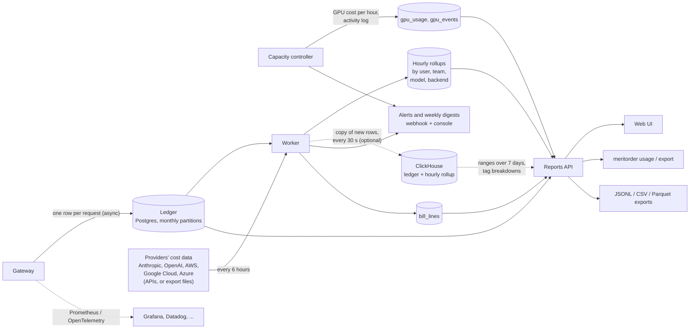

# 08 — Reporting

Merit Order exists to save money, so reporting is a core feature: what was spent, what was saved,
why, by whom, and when.

## Data flow



Reports never contain prompt or response content. The ledger holds metadata only.

## Savings numbers have to stand up to scrutiny

If finance finds one inflated number, they stop trusting the whole dashboard. So:

**1. A baseline per team.** "What you'd have done without Merit Order", set in config:

```yaml
baseline_model: claude-sonnet       # everyone's default: API price, no proxy-added caching
teams:
  platform:
    baseline_model: claude-opus     # a team that would have used Opus
```

**2. Savings broken down by cause, never one blended number.** Causes are computed in a fixed order,
each against the result of the previous step, so they add up exactly to the total with no double
counting:

| Order | Cause | How it's counted |
|---|---|---|
| 1 | **Routing** | Baseline model's API cost − served model's API cost, both without caching we added |
| 2 | **Prompt caching** | Discount from cache breakpoints *we added*, minus cache-write premiums we paid (1-hour writes at their own price). Caching the harness set up itself would have happened anyway and isn't counted. Neither is caching added to evals or judged labels: without Merit Order they wouldn't have run at all |
| 3 | **Self-hosting** | Served model's API cost − what the GPUs cost. Per request, the cost is its share of the GPU's time (chargeback: its tokens at the deployment's capacity); for the whole organization, the GPU time the controller accrued, idle and starting time included ([below](#gpu-time-in-spend)). It can be negative. For batch work on a GPU, its batch price − the share (the rest is the batch discount). That batch price is what a provider's batch API would have charged: the GPU request's fallback route's, else the model's API route's (its listed batch price, or that provider's own discount: Moonshot 40%, xAI 20%), else half the API price |
| 4 | **Batch discount** | Served model's API cost − the same tokens at its batch price, for requests sent through a provider's batch API ([02](02-request-flow.md#batches-work-that-can-wait)). Kept apart because a client could get it from the provider directly |
| 5 | **Compression (rules)** | What the tokens the rules removed from tool results would have cost on the served model: new tokens at the input price, older history at the cache-read price, at the price for the prompt they'd have made (a prompt that compression kept under a long-prompt tier is credited with the tier's difference too) |
| 6 | **Compression (model)** | The same for what model-based compression removed from what the rules left ([04](04-caching-and-sessions.md#model-based-llmlingua-2)). Each compressed request is also tagged `compression: rules` or `compression: model`, to filter by |
| 7 | **Response cache** | What the request cost the first time, for each one answered from the response cache. Not for evals or judged labels, as for caching |

**A refused attempt.** When a model refuses an `auto` request and another model answers it, the ledger has two rows:
the refusal (`error: refused`) and the answer. Without Merit Order the person would have sent the prompt to the baseline
model once, so only the answer's row carries the baseline. The refusal's row has a baseline of $0 and its whole cost as
a negative routing saving. Each row, and the request as a whole, still adds up: baseline − actual = the sum of the
causes.

**A baseline with no known price** (its model has no priced route) makes no routing claim: the baseline is the served
model's cost, rather than savings or losses measured against $0.

**3. GPUs at what they cost to run.** See [GPU time in spend](#gpu-time-in-spend): savings are counted after paying
for the GPUs, idle and starting time included, and shown below zero when the GPUs cost more than the API calls they
replaced.

**4. List price on every row.** The console's headline is savings caused by Merit Order. Each
ledger row also records `list_cost` (the served model at list price, no caching), so savings
against list price can be worked out from the API or an export; the console doesn't show it yet.

**5. Negotiated prices.** A `price:` on a route replaces the live list price, so costs match what
the organization actually pays. For 12% off Claude Sonnet's list price:
`price: {input: 1.76, output: 8.8, cache_read: 0.088, cache_write: 2.2, cache_write_1h: 3.52}`. Give the cache
prices too: left out, cache reads cost 10% of input, writes cost the input price, and 1-hour writes twice the input price.

**6. Checked against the bills.** The ledger's costs are computed from prices, except OpenRouter's, which are what
OpenRouter billed. The worker fetches each provider's own cost data and compares it with the ledger by provider,
model and day, and alerts when they drift apart. See [Checking costs against the bills](#checking-costs-against-the-bills).
So far only OpenRouter's recorded costs have been compared with a real bill (by hand: they matched for every request).
The other bill sources run only against mocks, and the prompt-caching savings Merit Order reports for Claude haven't yet
been checked against an Anthropic invoice.

### Estimated rows

A stream that breaks off still cost something: the provider bills the whole prompt and what it wrote before it noticed.
But OpenAI-format backends report usage only in the stream's last chunk, and Claude's first event counts one output
token, so a client that went away (status 499) or a stream that broke (502) would otherwise be recorded as nearly free.
For those rows the gateway fills in what the provider didn't say (`Gateway.broken_off_usage`):

- **The prompt**, when the provider sent no count for it: the request's estimate, calibrated for the model
  ([03](03-routing.md)), less what compression took out. All of it is counted as uncached input, since what the
  provider's cache held isn't known, so the estimate leans high.
- **The output**, when the provider sent no count for it: the text, reasoning and tool calls that streamed, counted.
  What the model wrote after the gateway stopped reading isn't seen, so this part leans low.

A count the provider did send is kept as it is, and the estimate never adds to it: it fills a missing count, it isn't
added on top. The row is tagged `usage: estimated`, and costs, savings, the spend counters and budgets all use the
estimate like any other row (Breakdown → Tag → `usage` shows how much spend is estimated). Estimates never calibrate
the token estimator, which learns only from successful replies.

## GPU time in spend

A self-hosted GPU bills for every hour its replicas run, busy or not. The ledger can't hold that: it has one row per
request. So spend is counted in two parts ([decision 64](09-decisions.md), `spend.py`):

- **Each request on a GPU** carries its share of the GPU's price in the ledger (`actual_cost`): its tokens at the
  deployment's `capacity_tokens_per_second`, at the hourly price. Its team and its person are charged that share, and
  their budgets count it.
- **The GPU's own cost** is the replica time the capacity controller accrues every cycle while replicas exist
  (`gpu_usage`), starting, idle and draining included, and the weights cache volumes. For the whole organization this
  replaces the requests' shares:

```
total spend      = the ledger + GPU idle
GPU idle         = GPU time accrued − the shares of the requests served on those GPUs
self-hosting     = (per request: API cost − share) − GPU idle
                 = API cost the GPU-served requests avoided − what the GPUs cost
```

"GPU idle, unallocated" is the GPU time no request paid for: starting up, waiting for traffic, draining, and capacity
the requests left unused. It belongs to no team (the controller decides when GPUs run, from everyone's demand), so
it shows only at organization level:

| Report | Where GPU idle goes |
|---|---|
| By day, hour or month, and the totals | into each period's spend, GPU column and self-hosting cause |
| By backend | into the GPU backend's row: its spend is what it cost to run |
| By team, person, model or tag | a row of its own, `GPU idle, unallocated` |
| A team lead's or a person's view, or any report filtered to a team or person | not shown: their requests' shares only |

Every summary row has `api_cost` and `gpu_cost` (`actual_cost` = the two together) and `gpu_idle_cost` (the part of
`gpu_cost` no request paid for). Savings by cause still add up to baseline − spend. The weekly digest has a message
for the organization as well as the teams' whenever GPUs ran.

Only backends with GPU time accrued in the period are set against it. A self-hosted backend no controller runs
(your own vLLM with a configured `gpu_cost_per_hour` and no `serve:`) accrues none, and its requests' shares are its
cost. If the requests' shares come to more than the GPU cost (capacity set below what the GPU really serves), GPU idle
is negative: the total is still the GPU's cost. A broken-off stream on a GPU ([estimated rows](#estimated-rows)) is
charged its estimated share like any other request: its team pays it, and the organization's total stays the GPU's
time, since the share only moves cost out of GPU idle.

The live run that showed the need: a GPU up for most of a day accrued $1.62 and served a few small requests whose
shares came to $0.0001. Dispatch said "Spend today $0.0001, without Merit Order $0.0022, −95%". Counted this way it
says $1.62 (APIs $0 · GPUs $1.62), saved −$1.62.

## What's tracked

| Area | Metrics |
|---|---|
| **Spend** | Actual cost by user, team, tag, model, backend, and hour, day, or month, split into APIs and GPUs, with GPU time no request paid for at organization level ([GPU time in spend](#gpu-time-in-spend)); every ledger row also has the key and session; month-end pace against budgets |
| **Savings** | Total and by cause (above), over time |
| **GPU fleet** | Where each replica runs (cloud, region, instance, spot; on Kubernetes the node, zone and node type), its load, which sessions sit on it and whether their cache is probably still warm there, uptime, burn rate, cost per run and per month (SkyPilot catalog prices, or a Kubernetes node type's configured price), replica-hours, utilization, demand at API prices vs GPU cost, every state change and admin action |
| **Routing** | Model mix, free upgrades per group, and for each request the model asked for, its quality floor, the model served, and why (`route_reason`: the rules that set the floor, any models ruled out by their context windows, and with cost per success the expected costs per success it compared) |
| **Caching** | Cached tokens read and written, cache hit rate by backend or model, caching savings. Sessions that switched backends and the rebuild cost they paid aren't tracked yet |
| **Operations** | Latency, time to first token, tokens/s, errors, and failovers per backend |
| **Budgets** | Team, org, and GPU spend against budgets with month-end pace, each counted as requests are admitted (the ledger, running batches' reservations shown on their own, and for the organization GPU time); each person's spend against their limit, across teams; alerts at 80% and 100%; refused requests by reason |
| **Bills** | Recorded cost against each provider's own cost data by provider, model and day, with token counts where the bill has them, and the batch tier's share on both sides; bill lines that matched no model and why; credits; GPU time against the cloud bills |
| **Batches** | Each batch through the providers' batch APIs and running GPUs: status, request counts (done, failed, cancelled, expired), how many requests went to each provider or GPU (GPUs marked), the estimate reserved against budgets against what the results cost, the batch discount, what GPUs took off the batch price, and other savings. For admins, where uploads and GPU work are held and the batch key's state. Every request is also a ledger row (`service_tier: batch`, `batch_id`) |

## Views (console pages)

| Page | Audience | Shows |
|---|---|---|
| **Dispatch** | Admins, finance, team leads | Spend today and this month (APIs · GPUs; a team lead sees the team's shares), against the cost without Merit Order, savings by cause in dollars (self-hosting after GPU cost, below zero when GPUs cost more), what running batches reserved. Live: the merit-order stack from real traffic (a chart and a table of each model's price, tokens per second, share and requests), the request feed (time, user and team, what was asked for and what served it, backend, level, cost, saved against the team's default model, latency; not for finance, which sees aggregates only: `/v1/console/feed` answers 403), backend health, GPU fleet, what needs attention |
| **Reports** | Everyone (scoped to their role) | Overview: spend vs baseline by day, savings by cause by day, spend by model, and (not for people who see only their own requests) the top teams and top users; breakdowns by team, person, model, backend, day, or tag; Requests (not for finance): the ledger a page at a time, filtered and sorted on the gateway, with a detail drawer and CSV ([below](#the-requests-view-reports--requests)); Levels: how `auto` gives a request its level (the rules in effect and Claude Code's side jobs) and, for each level, the models the person's team may use, cheapest first, and (admins, team leads) whether each level is too high or too low for the work, from exploration (below); Batches: each batch's status, providers, estimated and actual cost and savings (admins can cancel any, people their own); CSV; Bills (finance and admins): the ledger against each provider's own cost data; Learned router (admins, team leads): where it and the rules disagree, what each would cost, and the outcomes, with its model versions and training (admins), and judged labels: how many, what they cost, how far they agree with the outcome signals, and each team's month against its cap; which store answered each view |
| **GPUs** | Admins, finance, team leads | Each deployment: where it runs (each replica's cloud, resources, price, uptime, load, lease and status; a running deployment takes the full width), sessions per replica (and, for admins and team leads, which ones), uptime, burn rate, run and month cost, demand coverage; stop / pin / stop-all (admins); activity log; what-if for models you don't host yet |
| **Controls** | Admins, finance | Org (APIs · GPUs, and what running batches reserved), GPU, and team spend against budgets, the totals admission counts: a meter with what's spent, the projection to month end and a tick at the budget; the fleet's burn rate against its limit; safeguards and budgets (editable by admins; an edited budget is marked with what it was until saved) |
| **Backends** | Admins, team leads | Health, requests, errors, latency, time to first token, measured speed |
| **Models** | Admins | Routes, live prices (cache prices a route doesn't list shown at the defaults it's billed at) and where each came from, quality scores and their source, how each model's prompt tokens compare with the gateway's estimate, eval results (Evals tab) |
| **Teams** | Admins, finance, team leads | Each team's limits, policy, and spend this month |
| **People, Keys** | Admins, team leads | Who's in which team, their spend and limits; API keys |
| **Config** | Admins | Tabs for Teams, Models, Backends, Routing, Access (sign-in and group mappings) and Reporting (where reports come from: Postgres, and ClickHouse's health and how far its copy has got), plus the whole file as YAML; each save is a new version |
| **My usage** | Everyone | Own spend, models used, budget remaining |

### Is each level right for the work? (Reports → Levels)

Under the level rules and the models each level allows, admins and team leads (their team) see whether each level is
too high or too low for the work, from the organization's own traffic (decision 59). It's `GET
/v1/reports/levels/outcomes?days=30` (7, 30 or 90 on the console). It needs the learned router on (shadow mode is
enough: it records each task start and what followed), and teams that explore
([03](03-routing.md#your-own-traffic-as-the-benchmark)); until a team explores, only the served level is measured.

| Column | What it is |
|---|---|
| Level | Task type and level, e.g. `coding:3` |
| Traffic, Spend | The level's share of requests and of spend in the period, from the ledger (every request carries its level) |
| Served, One down, One up | Success rate by exploration arm, with its sample size: served at the level, explored one level down, explored one level up. A success is a task start without a failure signal (a correction in the next prompt, tests failing at the end, sent again, a raised floor, and the rest of [the labels](03-routing.md#what-it-learns-from), by their weights). Each task start counts 1 ÷ its arm's chance, so teams exploring at different shares pool fairly. A small glyph draws the 90% interval on a 50% to 100% scale; hover for the effective sample size. Dimmed (and the interval dashed) under 200 (`routing.benchmark.min_outcomes`) |
| Too high? | How well the level below does, as a share of the served level's rate; marked *too high* when it's at least 95% (`as_well`) at the low end of its 90% interval, with enough task starts on both sides |
| Too low? | How often the level above succeeds, as a share of the served level's; marked *too low* when the served level is clearly under 95% of it |

Below the table:

- **Recommendations** (admins), each on its own line under the level it's about: "coding level 3: level 2 does as well
  in 98% (n=412 explored, 9,870 served); consider lowering". *Apply* writes `routing.level_map` as a new configuration
  version (`POST /v1/admin/levels/apply`), and the line says *applied* from then on. *Dismiss* sets it aside (`POST
  /v1/admin/levels/dismiss`; *Undo* brings it back): it stays dismissed until its evidence changes, that is until it
  points another way or `routing.benchmark.min_outcomes` more task starts are explored on the level it compares with,
  and while it's dismissed nothing alerts on it or applies it. With `routing.benchmark.auto_apply`, the worker applies
  those the learned router agrees with. A new recommendation raises an alert once.
- **Canaries**: models newly cheapest or newly qualifying at a level, tried on a share of the level's task starts before
  they take the rest, with their outcomes so far.
- **Spend per day**, with the days the catalog or the scores changed marked (hover for what changed), and the latest of
  those changes listed: models added or removed, scores that moved, a new cheapest model, a canary done, a level moved.
  A change of catalog can move work between levels; the marks show where to look.

Team leads see their team's numbers without the recommendations, which change the whole organization's routing.

### The Requests view (Reports → Requests)

The ledger a page at a time, newest first. Every filter runs on the gateway, so it covers every row, not only the page
on screen. The filters, the sort, the page size and the page itself are in the URL (`#reports/requests?team=eng&status=error`),
so a view can be shared and survives a refresh. Typing in a filter waits for a pause before it asks again.

- **Pages** of 25, 50, 100 or 200, with Previous and Next, and how many rows match: exact up to 10,000, past that
  Postgres's estimate, shown as "about".
- **Sort** by time (the default), cost, savings or latency, highest or lowest first. The ledger's key is time, so a page by
  time costs the same on any range and at any depth. Nothing indexes cost, savings or latency, so those sort only within a
  time range of 7 days or less; the console says so and offers them only then.
- **A row** opens a drawer with its ledger fields: who sent it with which key and session, the model asked for and the
  one that served it, the level (`task:level`) and the recorded reason for it, the routes that failed before it, the cost
  (spent, the served model at API prices, without Merit Order, list price, tokens), savings by cause, its tags, status and
  latency. The session links to the view filtered to that session. There's no content: the ledger never stores any.
- **Download CSV** streams every row the filters match, in the view's order, with every ledger column and `savings_total`.

Scoping is the reports' own ([below](#who-sees-what)): a person sees their own requests, a team lead their team's, an admin
everyone's, and finance none (aggregates only). The role is applied after the filters and AND-ed with them, so no filter,
such as another person, team, key or session, can widen it: a person asking for someone else's key gets no rows.

**The API.** `GET /v1/reports/requests` (JSON) and `GET /v1/reports/requests.csv` take the same parameters, all optional
and all AND-ed:

| Parameter | Matches |
|---|---|
| `start`, `end` | `ts` from `start` (inclusive) to `end` (exclusive): `YYYY-MM-DD` (midnight UTC) or an ISO 8601 time. Default: no bound |
| `user`, `team`, `key`, `session` | `user_id`, `team`, `key_id`, `session_id`, exactly (clamped to the caller's role) |
| `requested_model`, `served_model`, `backend`, `format` | the model asked for (`auto`, a name, an alias), the one that served it, the backend, the client's API format (`client_format`) |
| `status` | `success` (below 400), `error` (400 or more, as summaries count errors), a code (`429`) or a class (`5xx`) |
| `task`, `level` | the level's task type and number, from `floor` (`coding:3`); a request for a named model has neither |
| `reason` | `route_reason` contains this, ignoring case |
| `tag` | `name=value`, or `name` alone for any value; repeat it and all must match. The gateway's own tags work the same: `explore`, `explore_from`, `escalation`, `escalated_from`, `judged_label`, `compaction`, `compression`, `usage`, and `eval` where clients set it |
| `min_cost`, `max_cost` | `actual_cost` in USD, inclusive |
| `min_savings`, `max_savings` | `savings_total` (the causes added up) in USD, inclusive |
| `savings_cause` | `routing`, `caching`, `self_hosting`, `batch`, `compression`, `compression_model` or `response_cache`: rows where that cause isn't zero |
| `min_latency`, `max_latency` | `latency_ms`, inclusive; rows without one don't match |
| `stream`, `batch`, `cache_hit`, `failover` | `true` or `false`: streamed; through a provider's batch API (`service_tier: batch`) or live; read the prompt cache (`cache_read_tokens` > 0) or came from the response cache; another route was tried first and failed (`failed_over`, recorded from schema migration 19 on) |
| `sort`, `order` | `time` (default), `cost`, `savings` or `latency`; `desc` (default) or `asc`. Other than time, `start` must be within 7 days of `end` (or of now) |
| `limit` | rows a page, 1 to 1,000 (default 50); JSON only |
| `cursor` | `next` or `prev` from a page; JSON only |

The JSON is `{rows, next, prev, limit, sort, order, total, total_exact, user, team, start, end, sort_range_days, answered_by}`.
`rows` are ledger rows with `savings_total`. `next` and `prev` are opaque cursors, `null` at either end. Paging is by keyset
on (sort value, `ts`, `id`), never by offset: a page after a cursor is the rows strictly after that row, so rows written
meanwhile (newer than any page you've seen) can't shift later pages, and no row shows twice or is skipped. Previous from
the second page gives the first page as it is now, new rows included. A bad cursor, or one from another sort, is a 400.
With no filters this is the list of recent requests it always was (`?limit=200`).

**Indexes.** A page by time reads the ledger's (`ts`, `id`) primary key, or with a team, person or served model the
indexes on (`team`, `ts`), (`user_id`, `ts`) and (`served_model`, `ts`); a key or session the indexes on (`key_id`, `ts`)
and (`session_id`, `ts`) (schema migration 19). Other filters are checked on the rows of the time range: give a range when
you filter by a tag or a reason on a large ledger. Building migration 19's two indexes on a large ledger takes a while,
and ledger writes wait meanwhile, so run `meritorder migrate` in a quiet hour. The view always reads Postgres (below).

## Who sees what

Roles come from Entra (or OIDC) group membership, or with Google from verified email addresses and
domains, with exceptions pinned on the People page.

| Role | Can see |
|---|---|
| User | Their own usage |
| Team lead | Their team's usage, per user |
| Finance | All spend and savings, no per-request detail |
| Admin | Everything |

## Ways to get reports

- **Web console** with the pages above.
- **Reports API.** The console is built on it, so anyone can build their own views. Every report says which store answered
  it, Postgres or ClickHouse: `answered_by` in the JSON and the `x-meritorder-answered-by` header (on CSV and JSON lines too).
- **CLI:** `meritorder usage` for a quick look at your own spend; `meritorder usage --bills` for the ledger against
  the bills (finance and admins); `meritorder router report` for the learned router's shadow report (admins, team
  leads).
- **Exports:** the ledger as JSONL, CSV, or Parquet, to a file or S3, for data warehouses and BI
  tools ([below](#exporting-the-ledger)).
- **Weekly digests** per team, to a webhook (Slack, Teams, or anything that accepts JSON).
- **Alerts** to the same webhook and the console: team, personal, org, and GPU budget thresholds,
  **spend spikes** (a person suddenly at 5× normal usually means an agent stuck in a loop), GPU
  state changes, every admin GPU action, provider outages and recoveries, changed live prices
  or quality scores, a day's bill that differs from the ledger, a bill that can't be fetched, a model that becomes the
  cheapest at a level, and a level recommendation from the outcome report.
- **Metrics:** Prometheus `/metrics` and OpenTelemetry traces, with a ready-made Grafana dashboard
  (below).

## Exporting the ledger

`meritorder export` downloads one row per request (metadata only) for a date range. Team leads get
their team's rows; admins get everyone's. Finance sees aggregates only, so it uses `summary.csv`.

In every CSV the gateway writes (`requests.csv`, `summary.csv`, `bills.csv`), a text cell that starts with `=`, `+`,
`-`, `@`, a tab or a carriage return gets a leading `'`, so a spreadsheet doesn't run it as a formula. Session ids
from headers keep to letters, digits and `._:/@+-` (others become `_`) before they reach the ledger.

```bash
meritorder export --out ledger.jsonl                                   # this month so far, JSON lines
meritorder export --format csv --start 2026-10-01 --end 2026-11-01 --out october.csv
meritorder export --format parquet --start 2026-10-01 --end 2026-11-01 --out s3://finance/meritorder/2026-10.parquet
```

`--start` is inclusive and `--end` exclusive (default: the first of this month to tomorrow). An
`s3://bucket/key` target is staged in the working directory and uploaded with the standard AWS
credentials (environment, profile, or instance role; `MERITORDER_S3_ENDPOINT` for an S3-compatible
store); a local file is written to `<out>.partial` beside it, which replaces the destination only
when the export is whole.
Rows are written as they arrive, so memory stays flat however long the range. An export that fails
part way deletes its `.partial` file and leaves whatever was at the destination (last month's export,
say) as it was.

**Parquet** needs the `parquet` extra (pyarrow): `uv sync --extra parquet` in the clone, or
`pip install '.[parquet]'` (Merit Order isn't on PyPI). Without it, the command says so before downloading anything. Columns are
typed as the ledger stores them:

| Columns | Parquet type |
|---|---|
| `id` | string (a UUID) |
| `ts` | timestamp, microseconds, UTC |
| `user_id`, `team`, `key_id`, `session_id`, `client_format`, `requested_model`, `floor`, `route_reason`, `served_model`, `upstream_model`, `backend`, `backend_kind`, `error`, `service_tier` (`batch` or empty), `batch_id`, `failed_over` (the routes tried first that failed, as `x-meritorder-failed-over` says; empty before schema migration 19) | string |
| `tags` | map of string to string (a value that isn't text is written as JSON) |
| `status`, `latency_ms`, `ttft_ms` | int32 |
| `input_tokens`, `cache_read_tokens`, `cache_write_tokens`, `output_tokens` | int64 |
| `stream`, `upgraded`, `proxy_cache` | boolean |
| `actual_cost`, `served_api_cost`, `baseline_cost`, `list_cost`, `savings_*` | double, USD |

The file has a row group per 100,000 rows and is Snappy-compressed. An empty range still gives a
valid file with every column. CSV writes `tags` as a JSON object in one column.

## Checking costs against the bills

Every ledger row has a computed cost: OpenRouter's is what OpenRouter billed with the response, and every other
provider's comes from the live price list or the route's `price:`. A price list can be wrong, a provider can count
tokens differently, and a discount, a 1-hour cache write or a long-context tier can cost something the price list
doesn't say. So the worker fetches each provider's own cost data and compares it with the ledger, by provider, model
and UTC day.

| Source | What it reads |
|---|---|
| `anthropic` | The Usage and Cost Analytics API (`/v1/organizations/analytics/cost` and `/usage`): cost and tokens per day by model, token type, service tier, context window, speed and product |
| `openai` | The organization Costs API (`/v1/organization/costs`) per day and line item (`gpt-6.1-terra, input_tokens`), with token quantities |
| `aws` | Cost Explorer (`GetCostAndUsage`): Bedrock by model and inference type, credits and other record types by model, and costs tagged with a GPU deployment. For days before September 2026, when Cost Explorer has no model breakdown, by service and usage type |
| `aws_cur` | AWS Data Exports' CUR 2.0 files in S3 (gzipped CSV or Parquet), read by manifest: Bedrock line items by usage type (input, output, cache read and write), model and batch feature, hourly or daily; models sold through the Marketplace by product name; credits, refunds, taxes, Savings Plan negations and fees; GPU instances by tag |
| `gcp` | The Cloud Billing export to BigQuery (standard usage cost table): cost and credits per day, service and SKU, converted to US dollars; GPU instances by label |
| `azure` | The Cost Management Query API: actual cost per day, service and meter at a scope; GPU instances by tag |
| `azure_export` | Cost Management's scheduled exports in Blob Storage (FOCUS, or actual or amortized cost; CSV, gzipped or not, or Parquet): cost per day, meter and resource for Foundry resources (Azure OpenAI, and Claude with its model and kind of token from the record's tags), purchases, credits and refunds; GPU VMs by tag |

`aws` and `aws_cur` read the same bill two ways, as do `azure` and `azure_export`, so use one of each pair for a
given account. The config refuses two that would both count a day: both enabled for the same backends, or both
fetching GPU costs while a SkyPilot deployment exists. Split them with `backends:` and `gpu_tag: null`, or by
`accounts` (AWS) or `scope` (Azure) that don't overlap. To move from an API to its export, set `enabled: false` on the
API source; its stored lines stay in the database but are no longer shown.

Which to use:

- **Cost Explorer (`aws`)** needs only an IAM permission, but charges $0.01 per request (about $5 a month at the
  default schedule), gives a day's total per model and kind of token, and has no model breakdown before September
  2026. **The CUR 2.0 export (`aws_cur`)** needs a Data Export to an S3 bucket set up once, then costs only S3 requests
  and, outside AWS, data transfer. It has every line item: hourly, per resource and tag, with each credit, refund and
  Savings Plan row. History starts when the export is created; AWS backfills up to 14 months through a support case.
  Use it when the account already exports CUR for finance, when there are many linked accounts or GPU instances to
  follow, or when Cost Explorer's per-request price adds up. Neither has per-request detail: that's the ledger.
- **The Query API (`azure`)** needs no storage, but is throttled and groups by two dimensions at a time. **Exports
  (`azure_export`)** need a storage account and a scheduled export, and have every row with its meter, resource and
  tags. Exports are the way to read Claude in Foundry by model, since its single Marketplace meter carries the model
  and the kind of token only in each record's tags, and the way to avoid throttling on large scopes.

### How a bill is compared

- **Fetching.** Every `refresh_hours` (6), the worker reads the last `lookback_days` (40) from each source and
  replaces what it stored for those days (the `bill_lines` table), because providers restate recent days (Anthropic
  until about the 7th of the next month). An export source reads only files that changed; see
  [Reading the export files](#reading-the-export-files). Admins can also fetch now from Reports → Bills. A source's
  lines are replaced under a lock, one fetch at a time, so a fetch from the console while the worker's runs (or two
  workers') both land.
- **Partial days.** Bills lag. A day is settled once it's `settle_days` old (Anthropic 1, OpenAI 1, AWS and its CUR
  export 2, Google Cloud 2, Azure and its exports 3) and, for Anthropic, also covered by the API's
  `data_refreshed_at`. For an export, the last day its files have usage for is partial too, so an export that stops
  being delivered shows as partial days, never as gaps. Younger days are shown as partial and never alerted on, and
  the totals at the top of the report count settled days only. Days before the first fetch count as partial too.
- **What's compared.** For each day, provider and model: *recorded* is the ledger's cost for the model on the
  source's backends; *billed* is the bill lines matched to the model. Batch-tier lines (Anthropic's `batch` service tier
  and Message Batches product, OpenAI's batch line items, the clouds' batch SKUs and usage types) match like any other, and
  the row also shows the batch tier's share of each side, so a batch price that's off can be told from a live one. The difference is billed minus recorded, and
  the percent is of recorded. Where the bill has token counts (Anthropic, OpenAI, and the exports where a line's unit
  is tokens), they're shown beside the ledger's, so a price that's off can be told apart from tokens counted
  differently.
- **Every bill line goes one of three ways**, and the report lists the last two with the reason:

| Line | Counts in billed? | Examples |
|---|---|---|
| Matched to a model | Yes, for that model | `claude-sonnet-5-5 · uncached_input_tokens`, `Claude Sonnet 5.5 · Input tokens`, `Vertex AI · Gemini 3.8 Flash Input Text Tokens` |
| Not matched | Yes, for the provider, not for a model | A model the gateway doesn't route through this source (other usage in the account), web search with no model on it, a name the matcher doesn't recognize |
| Left out | No | Credits, refunds, taxes and other adjustments (shown as a total); lines in `ignore`; lines in a currency other than US dollars |

- **Model names.** A bill names models its own way (`anthropic.claude-sonnet-5-5`, `Claude Sonnet 5.5 (Amazon
  Bedrock Edition)`, `gpt-6.1-terra-Inp-glbl`). Both sides are reduced to words, with dates, provider prefixes and
  Bedrock's `:0` versions dropped. A line matches a model when one of the model's route ids (or its `price_key`,
  `benchmark_name`, or an id the ledger saw) appears in it as a run of words that isn't followed by a version number
  or a variant word: "Claude Sonnet 5" doesn't take "Claude Sonnet 5.5", and "Gemini 3.8 Flash" doesn't take "Gemini
  3.8 Flash-Lite". The longest match wins. For a name it misses, map it: `models: {"*nova pro*": nova-pro}`.
- **Status of a row:** *matched*; *partial* (not settled); *not on the bill* (recorded, but no line matched: a name
  the matcher missed, or a bill that wasn't fetched); *not in the ledger* (billed, but nothing went through Merit
  Order: someone else uses the account). A row past the alert threshold is marked.
- **Alerts.** A settled day whose bill (matched plus not matched) and ledger differ by at least `alert_min_usd` ($1)
  and `alert_pct` (5%) of the ledger raises one alert per source, naming the day, the model with the biggest gap,
  and how much of the bill matched no model. Each day is alerted once. A source that can't be fetched alerts every 6
  hours; its last bill stays. They go to the same webhook and console list as the other alerts.
- **GPUs.** SkyPilot tags every instance it starts for a deployment with `meritorder-deployment: <backend name>` (an
  AWS tag, a GCP label). The `aws`, `aws_cur`, `gcp`, `azure` and `azure_export` sources fetch costs carrying that tag
  (usage only: a Savings Plan's negation or a credit on the instance is an adjustment), and the report compares
  them per deployment and day with the GPU time the controller recorded at SkyPilot's catalog prices (`gpu_usage`).
  A deployment that moved clouds is summed across them. Disks and egress count only where the cloud carries the tag
  to them. Clouds without a billing API here (Lambda, RunPod, ...) and static servers aren't checked.
- **Not checked.** The report lists ledger spend no source covers and why: OpenRouter (its cost is already what it
  billed), backends no source names, self-hosted GPUs (compared above), mock backends.

A bill only matches the ledger if what it covers is Merit Order's traffic. Give Merit Order its own Anthropic
workspace, OpenAI project, AWS account, GCP project or Azure resource group where you can, and filter on it (below).
Otherwise other usage of the same models shows up as gaps; the report marks sources that read the whole account.

### Reading the export files

Both providers rewrite a whole billing period on every refresh and list its files in a manifest, so the export
sources work by manifest (`src/meritorder/billing/exports.py`):

1. **Find the refreshes.** For each month the lookback reaches into, `aws_cur` lists
   `<export>/metadata/BILLING_PERIOD=YYYY-MM/` and takes the manifest there, which Data Exports keeps pointing at the
   period's newest refresh, in both "overwrite" and "create new" mode. `azure_export` lists the export's folder and
   finds every `manifest.json`, wherever the run folders are (the layout differs between API versions); each says
   which days its run covers (`runInfo.startDate` to `endDate`) and when it ran. Each day comes from the newest run
   that covers it: a month-to-date export's run of today replaces yesterday's, and the re-export of the previous month
   in the first days of a month replaces its last daily run.
2. **Read only what changed.** A manifest whose name and ETag are the same as at the last fetch is skipped, and so are
   its files. Otherwise every file it lists is read, and its lines replace what was stored for that run's days; days
   from unchanged runs keep their lines. What was read (manifests, ETags, the days each run won) is kept in the
   source's status, so a refresh with nothing new reads nothing but the listings.
3. **Stream each file.** A file downloads to a temporary file as it arrives (as stored: a `.csv.gz` stays gzipped),
   then is read row by row in a thread, so a large export never has to fit in memory: CSV, gzipped or not, or
   Parquet in batches of 50,000 rows (pyarrow, the `parquet` extra). Only rows in scope are kept, summed per UTC day
   and line. The temporary file needs as much disk as the export's largest file (each is under 1 GB uncompressed for
   Azure; AWS splits large exports into numbered chunks). An Azure manifest's row count is checked against the rows
   read, so a run rewritten mid-read is read again next time.

What each source keeps from the files:

| | `aws_cur` (CUR 2.0) | `azure_export` (FOCUS or actual cost) |
|---|---|---|
| Day | `line_item_usage_start_date` (UTC); hourly rows add up per day | `ChargePeriodStart` (FOCUS) or `date` (ISO or MM/DD/YYYY) |
| Cost | `line_item_unblended_cost` (`cost_column: line_item_net_unblended_cost` for after discounts, where the account has them) | `x_BilledCostInUsd` (FOCUS) or `costInUsd` (MCA); EA accounts have only `CostInBillingCurrency`, so lines in another currency are left out (export FOCUS instead) |
| Usage | Line item types `Usage`, `DiscountedUsage` and `SavingsPlanCoveredUsage`: a Savings Plan's usage is billed at the On-Demand rate and offset by a `SavingsPlanNegation` row, which is an adjustment | `ChargeCategory` or `chargeType` `Usage` |
| Adjustments (left out, shown) | Every other type: `Credit`, `Refund`, `Tax`, `Fee`, `RIFee`, `SavingsPlanNegation`, `SavingsPlan*Fee`, `Discount`, `BundledDiscount` | `Purchase`, `Credit`, `Adjustment`, `Tax`, `Refund`, `UnusedReservation`, `UnusedSavingsPlan` |
| Which rows | Product code, service code, product family or product name matching `services` (default `(?i)bedrock`: `AmazonBedrock`, `AmazonBedrockService`, and Marketplace models named "... (Amazon Bedrock Edition)"); `accounts` on `line_item_usage_account_id` | Resources of `resource_types` (from `x_ResourceType` or the resource id), under `scope` if set |
| Line | `<product name> · <usage type>`, with ` · batch` for the product map's `feature: Batch`; the model from the product map's `model` | `<meter category> · <meter name>`; Claude in Foundry's single meter adds the `model` and `usage_type` tags |
| GPUs | `resource_tags` key `user_meritorder_deployment` (CUR 2.0 normalizes tag keys), or the `tags` column's `resourceTags/meritorder-deployment` | The `Tags` JSON (or EA's form without braces) |

A month-long row in a daily or hourly export (a tax, a monthly charge) counts on its first day. An export whose usage
rows all span a month has monthly granularity and is refused: create it daily (or hourly, for AWS).

Versions followed (each provider's documentation as of November 2026): AWS Data Exports with the CUR 2.0 table
(`COST_AND_USAGE_REPORT`); AWS shows no example manifest, so the file list is read from `dataFiles` or any data file
path in it. Azure exports with manifest version 2024-04-01; FOCUS 1.0, 1.0r2 and 1.2-preview; actual and amortized
cost at dataset versions 2023-12-01-preview and 2026-10-01, EA and MCA; the Blob service REST API at x-ms-version
2026-04-06. Claude in Foundry's model and usage-type tags are from Microsoft's October 2026 billing change and were
not in a schema page yet. The tests read fixture files in these column layouts (`tests/fixtures/bills`).

### Setting it up

List sources under `billing:` in the config file. Credentials come from the environment or a secret file, like the
backends' (`auth: {value_env: ..., value_file: ...}`), and the cloud sources use the same credential chains as the
Bedrock, Vertex and Azure backends, so they run keyless on workload identity. The fetch runs in the worker; Reports
→ Bills → *Fetch bills now* runs it in the gateway, so both need the credentials.

```yaml
billing:
  refresh_hours: 6
  lookback_days: 40
  alert_pct: 5                  # percent of what the ledger recorded
  alert_min_usd: 1
  sources:
    anthropic: {type: anthropic, workspace_ids: [wrkspc_01...]}             # ANTHROPIC_ADMIN_KEY
    openai: {type: openai, project_ids: [proj_...]}                          # OPENAI_ADMIN_KEY
    aws: {type: aws, accounts: ["123456789012"], auth: {type: aws_sigv4, profile: billing}}
    gcp: {type: gcp, table: billing-proj.billing_export.gcp_billing_export_v1_0123AB_456789_ABCDEF, location: US}
    azure: {type: azure, scope: /subscriptions/<id>/resourceGroups/llm}
```

Or the exports, in place of `aws` and `azure` for the same accounts:

```yaml
    aws-cur: {type: aws_cur, export: s3://example-billing/cur/meritorder-cur, accounts: ["123456789012"],
              auth: {type: aws_sigv4, profile: billing, region: us-east-1}}      # the bucket's region
    azure-export: {type: azure_export, export: https://examplebilling.blob.core.windows.net/costs/exports/focus-daily,
                   scope: /subscriptions/<id>/resourceGroups/llm}
    # with a SAS token (read and list) instead of an Entra identity:
    #   auth: {type: api_key, value_env: AZURE_EXPORT_SAS}
```

Creating the exports, once:

- **AWS:** Billing and Cost Management → Data Exports → Create → Standard data export, table CUR 2.0. Turn on
  "Include resource IDs", choose hourly or daily granularity, gzipped CSV (works in the default image) or Parquet
  (needs the `parquet` extra), and "Overwrite existing data export file". The S3 path is `s3://<bucket>/<prefix>`
  and the export's name; `export:` is `s3://<bucket>/<prefix>/<name>`. If you pick columns, keep
  `line_item_usage_start_date`, `line_item_usage_end_date`, `line_item_line_item_type`, `line_item_product_code`,
  `line_item_usage_type`, `line_item_usage_account_id`, `line_item_unblended_cost`, `line_item_usage_amount`,
  `line_item_currency_code`, `pricing_unit`, `product`, `product_servicecode`, `product_product_family`,
  `resource_tags` and `tags`. The first refresh arrives within a day.
- **Azure:** Cost Management → Exports → Create, "Cost and usage details (FOCUS)" (or actual cost), daily,
  month-to-date, CSV with gzip or Parquet, to a container and directory in a storage account, with "Overwrite data"
  on. `export:` is `https://<account>.blob.core.windows.net/<container>/<directory>/<export name>`. A FOCUS export
  has US-dollar costs on every account type; an EA account's actual-cost export has only its billing currency.

Each source covers the backends of its type unless `backends:` names them: `anthropic` the ones at
api.anthropic.com, `openai` api.openai.com, `aws` and `aws_cur` Bedrock, `gcp` Vertex AI and the Gemini API (which
bills the key's Cloud project: list it in `project_ids` with the Vertex projects), `azure` and `azure_export` anything
at `*.azure.com`.

| Source | Credentials | Permissions | Filter to Merit Order's usage |
|---|---|---|---|
| `anthropic` | An Admin API key (`sk-ant-admin...`) in `ANTHROPIC_ADMIN_KEY` | An organization admin creates it in the Claude Console (Settings → Admin keys). Claude Console organizations only, not the claude.ai Team plan | `workspace_ids`, `api_key_ids` (`apikey_...`) |
| `openai` | An Admin key (`sk-admin...`) in `OPENAI_ADMIN_KEY` | An organization owner creates it (Settings → Organization → Admin keys); read access to usage is enough | `project_ids`, `api_key_ids` |
| `aws` | The AWS credential chain: environment, `auth: {profile: ...}`, an instance role, or IRSA on EKS. Cost Explorer's endpoint is in us-east-1 (`region: cn-northwest-1` for China) | `ce:GetCostAndUsage` and `ce:GetDimensionValues`, from the management account or one Cost Explorer is enabled for. For GPUs, activate `meritorder-deployment` as a cost allocation tag (Billing → Cost allocation tags); it applies from activation on and shows up within a day | `accounts` (linked accounts) |
| `gcp` | Application Default Credentials (workload identity on GKE, or `GOOGLE_APPLICATION_CREDENTIALS`) | Detailed billing export to BigQuery turned on for the billing account; `roles/bigquery.dataViewer` on the export dataset and `roles/bigquery.jobUser` on the project that runs the query (`query_project`, default the table's) | `project_ids` (default: the projects the Vertex backends call) |
| `azure` | `DefaultAzureCredential`: workload or managed identity, or `az login` locally (needs the `azure` extra; the Docker image has it) | Cost Management Reader (or Reader) on `scope` | `scope` (a subscription or resource group), `resource_types` |
| `aws_cur` | The AWS credential chain, as for `aws`, signing for S3 in `auth.region` (the bucket's; default us-east-1; a wrong one fails with the right one named). No extra for CSV; Parquet needs the `parquet` extra (pyarrow), which the Docker image doesn't have: build it with `--build-arg EXTRAS="--extra otel --extra gcp --extra azure --extra kv-events --extra parquet"`, or export CSV | `s3:ListBucket` on the bucket (it lists `<prefix>/<name>/metadata/`) and `s3:GetObject` on `<prefix>/<name>/*`, from any account the bucket policy lets in. For GPUs, the cost allocation tag as for `aws` | `accounts` (usage accounts) |
| `azure_export` | `DefaultAzureCredential` (the `azure` extra), with a token for `https://storage.azure.com/.default`; or a SAS token with read and list on the container, as `auth: {type: api_key, value_env: ...}` or `value_file` (no extra). Parquet needs the `parquet` extra, as above | Storage Blob Data Reader on the container (or the storage account). A SAS must be a user-delegation SAS where the account disallows shared keys | `scope` (only rows under it), `resource_types` |

What the calls cost: Cost Explorer charges $0.01 per request, about 4 per refresh, so roughly $5 a month at the
default schedule; BigQuery bills the bytes the query scans (it filters on `_PARTITIONTIME`, so about the lookback
window; set `partitioned: false` for a view); the export sources pay storage requests (a few listings per refresh,
fractions of a cent) and, when the worker runs outside the cloud or region, data transfer for the files of each new
refresh: about a refresh a day per month in the lookback; the others are free.

| Field | Meaning |
|---|---|
| `refresh_hours`, `lookback_days` | How often the worker fetches, and how many days back each fetch reads |
| `alert_pct`, `alert_min_usd` | A settled day alerts when it differs by both this much of the ledger and this many dollars |
| `type` | `anthropic`, `openai`, `aws`, `aws_cur`, `gcp`, `azure` or `azure_export` |
| `export` | `aws_cur`: `s3://<bucket>/<prefix>/<export name>`. `azure_export`: `https://<account>.blob.core.windows.net/<container>/<directory>/<export name>` (no SAS in the URL: put it in `auth`) |
| `backends` | The ledger backends the bill covers (default: every backend of the type) |
| `auth` | Credentials, as for backends (default: the type's, above) |
| `settle_days` | Days the provider takes to finish a day (defaults above) |
| `models` | Bill lines (glob on the line, case-insensitive) mapped to a model name, for names the matcher misses |
| `ignore` | Bill lines (globs) left out: other workloads in the same account |
| `workspace_ids`, `api_key_ids`, `project_ids`, `accounts` | Filters (see the table above) |
| `table`, `query_project`, `location`, `partitioned`, `services` | `gcp`: the export table (`project.dataset.table`), the project that runs the query, the dataset's location, whether to filter on `_PARTITIONTIME`, and a regular expression on `service.description` (default: Vertex AI, Claude, Anthropic, Gemini, Generative Language). `aws_cur`: `services` is a regular expression on the product code, service code, product family and product name (default `(?i)bedrock`) |
| `scope`, `resource_types`, `cost_column` | `azure`: where to query, which resource types (default: `microsoft.cognitiveservices/accounts`, Foundry and Azure OpenAI; `[]` for everything, for example Claude billed through the Marketplace), and the cost column (`Cost` is in the billing currency; use `CostUSD` where your account type has it). `azure_export`: the same, with `scope` optional (default: everything in the export) and `cost_column` defaulting to the US-dollar billed cost (`x_BilledCostInUsd` or `costInUsd`; `x_EffectiveCostInUsd` spreads commitments). `aws_cur`: `cost_column` is `line_item_unblended_cost` (default) or `line_item_net_unblended_cost` |
| `gpu_tag` | The tag or label on GPU instances (default `meritorder-deployment`); `null` skips GPU costs |
| `base_url` | `anthropic`, `openai`: the API's address, if not the public one |

### Reading it

- **Console:** Reports → Bills (finance and admins), for the period selected at the top: totals over settled days;
  each source with its type, when it was fetched, how far it's complete, any error, and notes (an export with no files
  yet says so); recorded against billed by day or month, provider and model (hover a model for the bill by kind of
  token, the token column for counts); the lines that matched no model and why; GPU time against the cloud bills;
  spend no bill covers. CSV download.
- **API:** `GET /v1/reports/bills?start=&end=&by=day|month` (finance and admins), `GET /v1/reports/bills.csv`,
  `POST /v1/reports/bills/refresh` (admins).
- **CLI:** `meritorder usage --bills [--start YYYY-MM-DD] [--end YYYY-MM-DD] [--by month]`: each source with its type
  (`aws_cur`, `azure_export`, ...), state, notes and totals, then the rows.

Things that commonly explain a gap: 1-hour cache writes from a platform that doesn't split writes by lifetime, in a
request whose markers mix an hour and 5 minutes (the ledger prices those at the 5-minute `cache_write`; see
[04](04-caching-and-sessions.md#how-long-claude-keeps-a-cache)), so look at the `cache_write` line; a negotiated
discount that isn't in the route's `price:`; long-context prices billed under their own lines; batch usage priced
differently from the published discount (compare the batch shares shown on the row); priority or provisioned-throughput
usage; usage a reservation covers, which costs $0 on the billed columns of CUR and of Azure's exports (the
reservation's fee or purchase is an adjustment); and other users of the same account.

## Prometheus and Grafana

`/metrics` (set `MERITORDER_METRICS_TOKEN` to require a bearer token):

| Metric | Type | Labels |
|---|---|---|
| `meritorder_requests_total` | counter | model, backend, status |
| `meritorder_rejected_requests_total` | counter | status, reason (refused before any backend: auth, budget, rate limit, routing) |
| `meritorder_failovers_total` | counter | backend, status (attempts that failed on a backend and moved on to the next route) |
| `meritorder_tokens_total` | counter | model, backend, kind (input, cache_read, cache_write, output) |
| `meritorder_cost_usd_total` | counter | model, backend, kind: `api`; `gpu_share`, a request's share of a GPU the controller runs (already in `meritorder_gpu_usd_per_hour`); `gpu`, a self-hosted backend no controller runs |
| `meritorder_baseline_usd_total` | counter | model, backend |
| `meritorder_savings_usd_total` | counter | cause |
| `meritorder_request_duration_seconds`, `meritorder_time_to_first_token_seconds` | histogram | model, backend |
| `meritorder_inflight_requests` | gauge | backend (this process) |
| `meritorder_backend_available` | gauge | backend |
| `meritorder_gpu_replicas`, `meritorder_gpu_usd_per_hour`, `meritorder_gpu_utilization`, `meritorder_gpu_waiting_requests` | gauge | backend |
| `meritorder_token_ratio` | gauge | model (prompt tokens its replies report per token the gateway estimated, this process) |
| `meritorder_token_calibration_samples_total` | counter | model (replies, exact counts and "too long" sizes that corrected the estimate) |
| `meritorder_learned_router_total` | counter | mode, outcome (used, agrees, shadow, unsure, stale, missing, failed; named: a request naming its model, recorded for training) |
| `meritorder_judged_labels_total` | counter | outcome: what came of each request sampled for a judged label (judged, dropped, skipped, capped) |
| `meritorder_compression_model_results_total` | counter | result: what model-based compression did with each tool result (compressed, kept, reused, old, late, failed, no_prose, store_error) |
| `meritorder_compressor_duration_seconds` | histogram | none (how long the compressor service took to answer) |
| `meritorder_gpu_cache_turns_total` | counter | backend, expected (warm, cold), result (hit: at least half the prompt read from the cache; miss) |
| `meritorder_gpu_replica_unreachable_total` | counter | backend (a gateway couldn't reach a GPU replica directly and used the deployment's endpoint) |
| `meritorder_stored_responses_total` | counter | event: Responses API turns in a team's stored mode (rebuilt, stored, provider_chain, failed) |

Counters are per gateway process: sum them across pods. GPU gauges come from the controller's
published state, so every gateway reports the same value: use `max`.

Batch requests are counted by whoever settles them into the ledger: the worker, on its own port
(`MERITORDER_WORKER_METRICS_PORT`, 9464 in Compose and the Helm chart, behind the same token), or without Postgres the
gateway. They're never in the counters above, so the two add up without counting a request twice; and each is counted by
the one call that settled it, however many workers there are or how often a job is read again:

| Metric | Type | Labels |
|---|---|---|
| `meritorder_batch_requests_total` | counter | model, backend, api (the batch API that ran it, or `gpu`), status |
| `meritorder_batch_tokens_total` | counter | model, backend, kind |
| `meritorder_batch_cost_usd_total` | counter | model, backend, kind (as `meritorder_cost_usd_total`) |
| `meritorder_batch_baseline_usd_total` | counter | model, backend |
| `meritorder_batch_savings_usd_total` | counter | cause (batch, self_hosting, routing, ...) |
| `meritorder_batch_gpu_requests_total` | counter | backend, result (ok, retry, handed_off) |
| `meritorder_batch_handoffs_total` | counter | backend (the GPU), why (deadline, stopped, failed) |
| `meritorder_batch_poll_errors_total` | counter | backend, status |

All spend per hour is the requests' cost without the GPU shares, plus what running GPUs cost:
`sum(rate(meritorder_cost_usd_total{kind!="gpu_share"}[5m]) + rate(meritorder_batch_cost_usd_total{kind!="gpu_share"}[5m])) * 3600
+ sum(max by (backend) (meritorder_gpu_usd_per_hour))`. A share is already in the GPU's burn, so adding both would
count it twice. The burn gauge leaves out the weights cache volumes, which the console's totals include.

The **Grafana dashboard** (`charts/meritorder/dashboards/meritorder.json`, generated by
`scripts/build_grafana_dashboard.py`) shows spend, what it would have cost, savings rate and causes,
traffic, errors and refusals by reason (spend and the saving with GPUs at their burn, and the GPU time no request
paid for as its own series under savings by cause), prompt-cache hit ratio, backend availability, latency and
time to first token, GPU replicas, burn, utilization, and queue, and batches (spend, savings by cause, where they ran
and what GPUs handed on). Import it by hand (Dashboards →
New → Import), or with Helm set `metrics.grafanaDashboard.enabled: true` for Grafana's dashboard
sidecar (kube-prometheus-stack picks up the `grafana_dashboard` label).

## Cost allocation tags

Requests can carry tags, and API keys can have default tags:

```
X-MeritOrder-Tags: project=checkout-rewrite,ticket=PLAT-1234
```

Tags flow into the ledger and every report can group by them. A tag set on the key wins over the
same tag in the header, so a client can add tags but can't move spend off a cost center an admin
assigned.

Eight tags are the gateway's own, and a client or key can't set them: `usage` (`estimated`, on a stream that broke off
before the provider said what it used, [above](#estimated-rows)), `compression` (`rules` or `model`, on requests whose
tool results were compressed), `compaction` (`responses`, on the summary the gateway writes for
`POST /v1/responses/compact`) and `judged_label` (`replay` or `judge`, on the replays and judging of
[judged labels](03-routing.md#judged-labels)). Breakdown → Tag → `judged_label` shows what judged labels cost; they're
never counted as savings. `explore` (`down`, `up` or `canary`) and `explore_from` (`coding:3`) mark every request of a task
that [exploration](03-routing.md#exploration) routed off its level: Breakdown → Tag → `explore` shows what exploring cost.
`escalation` (`1` or `2`) and `escalated_from` (the model it left) mark every request of a task that
[escalated](03-routing.md#escalation-inside-a-task) to a stronger model: Breakdown → Tag → `escalation` shows what
escalating cost. The first request of an escalation takes the failed attempt's baseline cost off its baseline and its
routing savings, so that row's routing savings can be negative: the attempt it replaces wouldn't have been made without
Merit Order.

## Storage and scale

- The ledger is a Postgres table partitioned by month.
- The worker keeps an hourly summary table (`usage_hourly`, by user, team, model, and backend)
  current. Report ranges longer than 7 days read it; shorter ranges and tag breakdowns read the
  ledger.
- Postgres comfortably handles the millions of requests per month a $100k+/month organization
  generates. For far more, ClickHouse can hold a copy of the ledger that the big reports read (below).
- We don't build a general-purpose BI tool. Ad-hoc analysis goes through the exports, or with ClickHouse set up, straight
  against its tables.

### ClickHouse for very large deployments

Optional and off by default. Postgres stays the record: the gateway writes every request there as it always does, budgets
and spend caps read it, and so does the Requests view. With `reporting.clickhouse` set, the worker also copies
the ledger to ClickHouse, and the reports that scan the most rows read the copy. Why it's built this way: decision 47 in
[09](09-decisions.md).

```yaml
reporting:
  clickhouse:
    url: ${MERITORDER_CLICKHOUSE_URL:-}        # ClickHouse's HTTP interface; empty: off (the shipped config reads this)
    database: meritorder                       # created if missing
    user: default
    auth: {value_env: MERITORDER_CLICKHOUSE_PASSWORD, value_file: /run/secrets/meritorder/MERITORDER_CLICKHOUSE_PASSWORD}
    reads: large                               # large, all, or none (copy only)
    # ttl_days: 400                            # drop ledger rows in ClickHouse after this many days (default: keep)
    # rollup_ttl_days: 1825                    # the same for the hourly rollup
```

**The copy.** Every `copy_seconds` (30), the worker compares the last 3 hours (and everything since the copy was last
complete) on both sides, minute by minute: Postgres's row count against ClickHouse's rows and distinct ids. It sends what's
missing in batches of `batch_rows` (50,000) per insert, in ClickHouse's binary row format (`RowBinary`, so every cost
arrives as the exact number Postgres holds), and a row that lands late is copied on the next pass. An hour that
holds a row twice (an insert that timed out but landed) or whose rollup disagrees with its rows is deleted in ClickHouse
and copied again whole. An hour where ClickHouse has rows Postgres no longer has is left alone and reported. Each hour is
copied under a Postgres lock on that hour, so two workers, or a worker and a backfill, never send the same rows. The
progress (`from`, `through`, the last error) is kept in Postgres. If ClickHouse is down, nothing is lost: the rows are in
Postgres, and the copy catches up a day at a time when it's back. A ClickHouse with no ledger table (a new server, another
`database`, or one that lost its data) holds none of what the progress says was copied, so the worker starts the progress
over there: reports read Postgres again until a backfill copies the older rows. After a cycle fails, the next one checks
the tables again, so tables lost while the worker runs are made again without a restart.

**Copying what's already there.** The worker copies new rows from when it's set up. Existing rows are copied by hand,
idempotently: run it again and only what's missing is copied.

```bash
meritorder clickhouse backfill                                   # from the ledger's first day to tomorrow
meritorder clickhouse backfill --start 2026-01-01 --end 2026-07-01
meritorder clickhouse status                                     # reachable? how far the copy has got, rows and size on disk
```

**Which store answers.** With `reads: large`, a report reads ClickHouse when it covers a range over 7 days or breaks
spend down by tag, and when ClickHouse holds that whole range and is caught up (its copy complete to within 5 minutes,
or 3 copy intervals if that's longer). Otherwise Postgres answers, and so it does for 30 seconds after a ClickHouse query
fails. The console shows which store answered each view, and the API says so in `answered_by`. ClickHouse holds the whole
range when its copy starts at or before the range, or when Postgres has no row before the copy's start: after a backfill
from the ledger's first day, on a ledger that had ClickHouse from the start, or once old partitions copied there were
dropped from Postgres. Then `meritorder clickhouse status` says "every row in the ledger", and a report from any date
reads ClickHouse.

| Report | Reads ClickHouse with `reads: large` |
|---|---|
| Summaries (`/v1/reports/summary`, `summary.csv`, `me`, console dashboards, alerts' monthly totals) | Ranges over 7 days (from its hourly rollup) and tag breakdowns (from its rows) |
| Ledger export (`export.jsonl`, `meritorder export`) | Ranges over 7 days, a day at a time in time order |
| GPU what-if and break-even (`/v1/reports/gpu/whatif`, `gpu/breakeven`) | Windows over 7 days |
| Bills (`/v1/reports/bills`): the ledger's side | Ranges over 7 days |
| The Requests view (`/v1/reports/requests`, `requests.csv`), budgets and spend caps, the controller's demand | Never: Postgres has every row the moment it's written |
| The learned router's shadow report (`/v1/reports/router`) and its training | Never: its request features and models aren't ledger rows, and they stay in Postgres only |

`reads: all` sends every report in the list above to ClickHouse whatever its range; `reads: none` keeps the copy going
for your own tools while Postgres answers everything.

**The same answers.** Every query has a twin in Postgres and returns the same numbers for the same rows: a missing model is
`NULL` on the rows and empty in the rollup, an empty tag value is a value, and summary rows and exports come back in the same
order (by key as text; by time, then id). Sums are added in a different order, so a total can differ in its last binary
digit, below the 6 decimals reports show. `tests/test_clickhouse_live.py` runs every report the API serves against both, on
real Postgres and ClickHouse servers (CI runs them as services); `tests/test_clickhouse_engine.py` runs the ClickHouse side
in-process with chdb (`uv run --with chdb python -m pytest tests/test_clickhouse_engine.py`).

**Tables.** Over ClickHouse's HTTP interface with httpx (no driver). Written for ClickHouse 24.8 or newer (the queries rely
on its analyzer and lightweight deletes); CI runs 26.3 LTS, and chdb runs 26.9.

| Table | Engine and keys |
|---|---|
| `requests` | MergeTree, a partition per month, ordered by day, team, user, model, backend and time; every ledger column typed as Postgres stores it (UUID, `DateTime64(6, 'UTC')`, nullable where Postgres is, names low-cardinality, `tags` as `Map(String, String)` with a value that isn't text as JSON, as in Parquet). A ledger column without a ClickHouse type fails the tests |
| `usage_hourly` | SummingMergeTree, a partition per month, ordered by hour, team, user, model and backend: the same rollup as Postgres's, kept by a materialized view on `requests` |

The worker creates the tables, adds columns the ledger gained, replaces the view when the rollup changes, and sets or
removes the TTLs. With `ttl_days`, ClickHouse drops a whole part once every row in it has expired, so rows can stay up to a
month longer; reports that need rows past the TTL read Postgres. Postgres keeps everything either way: to keep it small,
drop old monthly partitions yourself (`DROP TABLE requests_2025_01`) once `meritorder clickhouse status` shows ClickHouse
holds them; reports for those months then need `reads: all`.

**Turning it on.** Docker Compose: `docker compose --profile clickhouse up -d` with `MERITORDER_CLICKHOUSE_URL=http://clickhouse:8123`
in `.env`. Helm: `reporting.clickhouse.url` (no ClickHouse is bundled), the password as `MERITORDER_CLICKHOUSE_PASSWORD` in
the env Secret ([07](07-deployment.md)), never in the URL (a URL with one is refused: it shows on the console and in
errors). The user needs to create tables in its database and to insert, select and delete
there.

**Measured at scale** (2026-11-14, `scripts/bench_ledger.py`). A synthetic year of a large organization's ledger: 20
million requests over 365 days (55,000 a day on average, weekdays and office hours busier, traffic growing over the year),
2,000 people in 40 teams with a few heavy users, 11 model routes on 10 backends, two tags on two thirds of the rows, 2%
errors and 2% batches. The machine: an Apple M4 Max laptop running Docker Desktop, whose VM (4 vCPUs, 7.75 GB) was also
running about 30 other containers. Postgres 16.14 got 2 CPUs and 768 MB (`shared_buffers` 192 MB, `work_mem` 32 MB),
ClickHouse 26.10.3 2 CPUs and 1 GB; neither could keep its tables in memory, so every long report read the disk. Treat the
numbers as a floor: a server with the tables in RAM is faster on both sides.

| | Postgres | ClickHouse |
|---|---|---|
| Ledger on disk, per million rows | 600 MB (370 table, 230 indexes) | 104 MB (2.5× compression; real costs and ids repeat more than these random ones) |
| Hourly rollup | 14.1 million rows, 4.8 GB | 14.1 million rows, 0.87 GB |
| Memory while copying | 230 MB | 910 MB at the peak (merges up to 464 MB; each insert under 16 MB) |

**The copy.** `meritorder clickhouse backfill` copied the 20 million rows in 13 min 50 s: **24,000 rows/s** with the copier
on the laptop, one insert per hour of ledger (8,760 inserts, 20 ms each on average). Run in a container in the same
crowded VM, over 30 days (1.4 million rows), it managed 8,700 rows/s, and 10,600 after writing rows faster (below). Either
way a year copies in under an hour on one worker, and a day of a 50-requests-a-second organization (4.3 million rows) in
under ten minutes. In a Linux container the copier's memory stayed at 85 MB (on macOS its peak reached 830 MB: the
allocator keeps what it freed; Python itself never held more than 40 MB). ClickHouse kept up: merges left 7 or 8 parts per
month while it copied.

**Report latency**, in seconds, the median of three runs after a warm-up for ClickHouse and one run for Postgres (its
long reports take minutes, and three would not change the picture):

| Report | 7 days: PG / CH | 30 days: PG / CH | 365 days: PG / CH |
|---|---|---|---|
| Summary by team (Reports, dashboards) | 0.37 / 0.23 | 4.3 / 1.2 | 5.6 / 9.4 |
| Summary by model | 0.38 / 0.51 | 3.1 / 1.1 | 4.5 / 7.5 |
| Summary by person (2,000 rows) | 0.37 / 0.23 | 3.9 / 0.48 | 5.8 / 6.3 |
| Summary by day | 0.79 / 0.22 | 3.1 / 0.70 | 5.1 / 6.0 |
| A team lead's view (one team, by person) | 6.5 / 0.14 | 11.6 / 0.48 | 3.7 / 4.3 |
| Tag breakdown (`tag:project`) | 0.42 / 0.19 | 2.3 / 0.94 | 12.8 / 14.3 |
| Bills: the ledger's side | 0.75 / 0.12 | 3.5 / 0.68 | 29 / 5.4 |
| GPU what-if (demand by hour) | 0.71 / 0.29 | 6.2 / 1.5 | 44 / 16 |
| Export, one team (11,000 / 56,000 / 500,000 rows) | 4.9 / 0.38 | 28 / 3.1 | 250 / 45 |

What it shows:

- **ClickHouse is 3 to 10 times faster up to a month, and on anything filtered or exported.** A team lead's view and a team's
  export find their rows by the table's order (day, then team); Postgres reads them one at a time through an index.
- **Over a year, the summaries are about even, both reading the disk.** At this many people the hourly rollup barely
  aggregates: 0.7 rows per request, because few people use the same model on the same backend in the same hour. So a
  year's summary reads 14 million rollup rows on either side: about 1 GB from disk each time in ClickHouse, for 1.5 to 2 s
  of CPU. Give ClickHouse the memory to keep its rollup cached (0.87 GB per 20 million requests here, beyond its own
  needs). In Postgres a month's summaries from the rollup (3 to 4 s) took longer than a month's tag breakdown from the
  ledger itself (2 s). A coarser rollup (by day, or without the person) would cut that by an order of magnitude; it isn't
  built yet.
- **A small ClickHouse needs its caches capped.** At 1 GB with the default cache sizes, its caches held about 600 MB at
  rest, and a large `INSERT … SELECT` ran out of memory. The copier's own inserts (at most `batch_rows`, 50,000) never used
  more than 16 MB.
- **The tag breakdown over a year** reads every row's `tags` map (2.5 GB uncompressed for 20 million rows) and isn't
  helped by the order. Postgres's parallel scan was as fast here.
- **Postgres's full rollup** (`meritorder worker --backfill`, or the worker's first start after an upgrade with an empty
  `usage_hourly`) used to be one statement over the whole ledger: on 20 million rows it was still running after 17 minutes,
  spilling the aggregation to disk again and again. It now runs a month at a time: 4 min 45 s.
- **Writing rows** for ClickHouse took half the copier's CPU, a value at a time. Token counts and costs are now packed a run
  at a time, which makes it 1.8 times faster (the bytes are the same; a test compares them).

**At 60 million rows** (ClickHouse alone: the copied rows three times over, each with new ids and moved by up to half an
hour, so the rollup grew to 41 million rows; caches capped for the 1 GB container): 5.4 GB on disk (97 MB per million rows),
the rollup 2.3 GB. Seconds, median of three:

| Report | 7 days | 30 days | 365 days |
|---|---|---|---|
| Summary by team / model / person / day | 0.81 / 0.65 / 0.49 / 0.33 | 3.0 / 0.76 / 0.83 / 0.75 | 14 / 9.6 / 11 / 10 |
| A team lead's view | 0.17 | 0.52 | 9.5 |
| Tag breakdown | 0.68 | 3.4 | 28 |
| Bills: the ledger's side | 0.35 | 1.4 | 12 |
| GPU what-if | 0.49 | 2.4 | 32 |
| Export, one team (34,000 / 200,000 rows) | 1.5 | 7.5 | not run (about 27,000 rows/s) |

Up to a month, three times the rows cost ClickHouse little: the day-and-team order finds them. Over a year it reads three
times as much from disk, and the time grows with it.

## What's built and what isn't yet

| Piece | Status |
|---|---|
| Ledger, hourly rollups (`meritorder worker`, `--backfill`) | Built |
| Savings by cause, baseline per team, negotiated prices (`price:` per route) | Built |
| Reports API under `/v1/reports/` (`summary`, `summary.csv`, `me`, `requests`, `requests.csv`, `levels`, `batches`, `bills`, `bills.csv`, `export.jsonl`, `gpu`, `gpu/whatif`, `gpu/breakeven`, `gpu/candidates`, `router`) with role scoping | Built |
| The learned router's shadow report: Reports → Learned router, `/v1/reports/router`, `meritorder router report` ([03](03-routing.md#the-shadow-report)) | Built; not yet run on real traffic |
| Judged labels: their cost (ledger tag `judged_label`), verdicts and agreement in the router report ([03](03-routing.md#judged-labels)) | Built; tested only against mocks |
| Console at `/ui/` (Mantine): Dispatch (live), Reports, GPUs (with controls and what-if), Controls, Backends, Models (with Evals and GPU break-even), Teams, People, Keys, Config, My usage | Built |
| GPU cost per hour (`gpu_usage`) from SkyPilot catalog prices or Kubernetes node type prices, GPU activity log (`gpu_events`) | Built |
| Measured model quality (`meritorder eval`), shown on Models | Built |
| `meritorder usage` | Built |
| Prometheus `/metrics` (requests, refusals, failovers, tokens, cost, baseline, savings by cause, latency and time-to-first-token histograms, in-flight requests, backend availability, GPU replicas, burn, utilization, and queue, token calibration per model, the learned router and judged labels, model-based compression, GPU cache turns and unreachable replicas, stored responses) | Built |
| OpenTelemetry traces: a span per LLM call in GenAI conventions plus cost, savings, backend; joins the client's `traceparent` (set `OTEL_EXPORTER_OTLP_ENDPOINT`) | Built |
| Alerts (team/person/org/GPU budgets at 80%/100%, spend spikes, GPU state changes and admin actions) and Monday digests to a webhook | Built (`MERITORDER_ALERT_WEBHOOK_URL`) |
| Ledger export: `/v1/reports/export.jsonl`, `meritorder export --out file.jsonl` (or `--format csv` or `parquet`; or `--out s3://bucket/key`) | Built |
| Batches through the providers' batch APIs and running GPUs: Reports → Batches, `/v1/reports/batches`, ledger rows with `service_tier` and `batch_id`, the batch discount as a cause, the worker's `meritorder_batch_*` metrics | Built ([02](02-request-flow.md#batches-work-that-can-wait)); not yet run against live accounts |
| Ledger checked against bills: Anthropic and OpenAI admin APIs, AWS Cost Explorer, the GCP billing export in BigQuery, Azure Cost Management, and GPU instances by tag; partial days, alerts, Reports → Bills, `/v1/reports/bills`, `meritorder usage --bills` | Built (`billing.sources`); not yet run against live accounts |
| AWS Data Exports' CUR 2.0 files in S3 and Azure Cost Management exports in Blob Storage as bill sources: read by manifest and ETag, streamed, CSV or Parquet; one source of each bill per account | Built (`aws_cur`, `azure_export`); tested against fixture files in the documented layouts, not yet run against live exports |
| Grafana dashboard (`charts/meritorder/dashboards/meritorder.json`; Helm `metrics.grafanaDashboard.enabled`) | Built; its queries checked by hand against real Prometheus and Grafana |
| ClickHouse copy of the ledger for very large deployments: the worker copies new rows and repairs what differs, long ranges and tag breakdowns read it, `meritorder clickhouse backfill` and `status`, TTLs, Config → Reporting, `answered_by` on every report | Built (`reporting.clickhouse`); measured at 20 million rows on both stores and 60 million in ClickHouse on a small machine ("Measured at scale"), not yet at hundreds of millions or on ClickHouse Cloud |

The UI is a small React/TypeScript app (no charting library; hand-written SVG) built into the
Python package and served by the gateway. It signs in with a Merit Order API key and shows what
that key's role may see.
