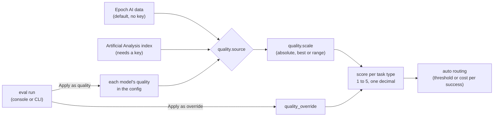
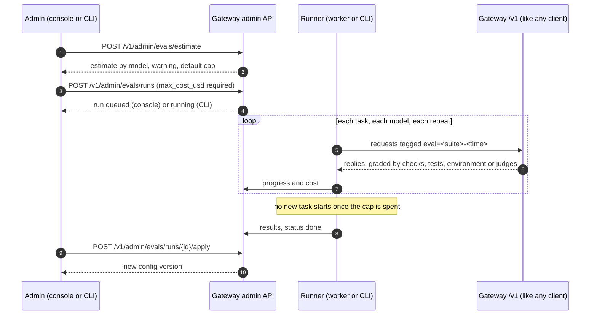
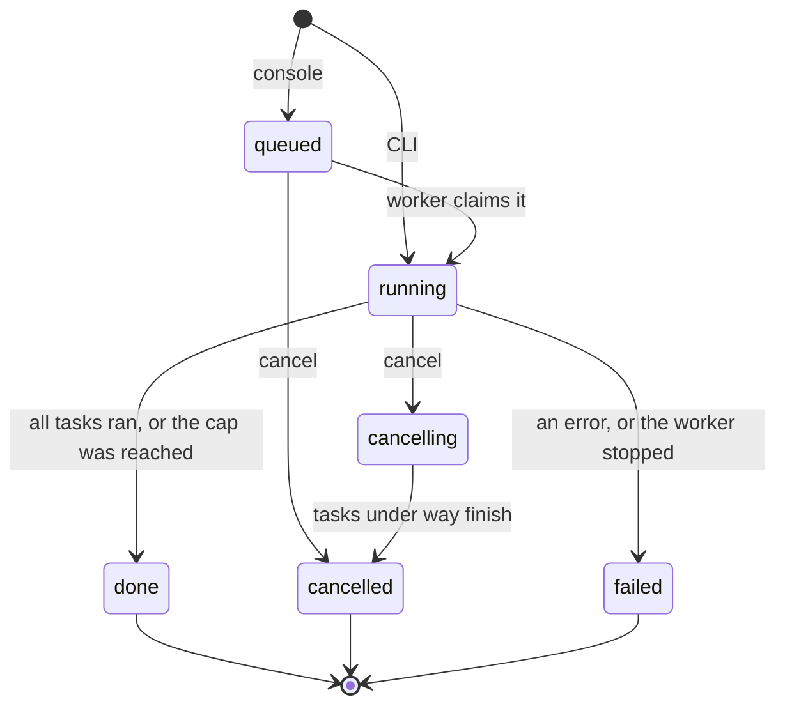
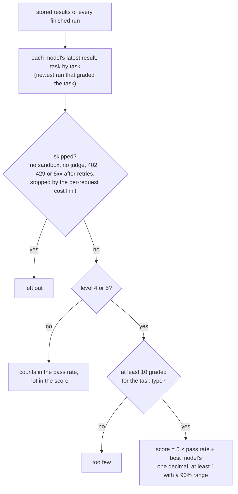

# 11 — Evals: measuring model quality

`auto` routing sends each request to the cheapest model good enough for it. "Good enough" comes from
each model's **quality scores**: 1–5 per task type (coding, general). The classifier gives every
request a floor from its work (coding:3 for ordinary coding, 2 for tests, renames and docstrings, +1 for hard
wording, 5 for the hardest such as system design; tools make it coding but never set the level; never from its length), and only models scoring at least that are considered. Scores
that are too high send hard work to models that can't do it; scores that are too low waste money.

Scores come from one of three sources, set by `quality.source`. A model's `quality_override` wins over all of them.
Your own eval runs feed the `config` source or the override, never the published scores.



**What's tested.** The runner, the grading of each task kind, the sandbox, retries, the cost estimate and cap,
scoring, and applying scores are tested in CI against mock gateways and canned replies (`tests/test_evals*.py`,
`tests/test_eval_harness.py`, `tests/test_codebase_suite.py`, `tests/evals/`). Measured scores on real models are
not yet a verified result: [docs/README.md](README.md#whats-verified-and-what-still-needs-live-accounts) lists them
under what still needs live accounts. The run figures quoted below (pass counts, costs) come from runs made by hand
during development.

## Quality scores from published benchmarks

By default the scores come from benchmarks run the same way for every model, not from this gateway's
own runs: a handful of tasks can't separate the strongest models, and published suites can. The worker
refreshes them every `quality.refresh_hours` (24) and the Models page shows, for each score, where it
came from and how it was worked out.

```yaml
quality:
  source: epoch          # epoch | artificial_analysis | config
  scale: absolute        # absolute | best | range
  anchor: {coding: 0.6994, general: 0.7685}   # absolute: the chance on the reference that scores 5
  reference: {coding: FrontierSWE, general: FrontierSWE}
  evidence: {coding: [FrontierSWE, FrontierCode]}
  fallback: {coding: [Terminal Bench, GSO-Bench, MirrorCode]}
```

- **`epoch`** (default, no key): [Epoch AI's benchmarking data](https://epoch.ai/benchmarks), CC BY 4.0.
  Epoch places every model on one ability scale (its Capabilities Index, fitted across about 40
  benchmarks) and every benchmark on the same scale by difficulty, so a model's chance of solving a
  benchmark's tasks follows from the two. A model's score for a task type is its chance of solving a task
  as hard as the **reference** benchmark (FrontierSWE: for coding, Claude Fable 5.2 solves about 70%,
  Haiku 5.5 about 44%). For coding, a model's own results on the **evidence** benchmarks (FrontierSWE,
  FrontierCode) set its ability where they exist, so coding strength counts, not just general ability;
  results at the effort `auto` uses for hard work are preferred. A score estimated from general ability
  alone is marked with a * on the Models page. A model with neither those results nor an index (some
  open models) gets its ability from the **fallback** benchmarks, older coding suites (Terminal Bench,
  GSO, MirrorCode). They come last because, checked against the 16 models that have both kinds of
  results, they predict FrontierSWE and FrontierCode results less well than the index does (they miss
  by about 2.6 points on the ability scale, the index by 2.2), and averaging the two gains about 0.1. WeirdML v3
  isn't usable from its file: the index is fitted on a rescaled score the file doesn't carry.
- **`artificial_analysis`**: the [Artificial Analysis](https://artificialanalysis.ai) Intelligence
  Index (a free key in `ARTIFICIAL_ANALYSIS_API_KEY`), for every task type: it no longer publishes a
  coding index.
- **`config`**: the scores written on each model, for example applied from your own eval runs.

The **scale** turns chances into 1–5 with one decimal. `absolute` (default): a 5 is a fixed chance, the **anchor**
(`quality.anchor`: 0.6994 for coding and 0.7685 for general, what Claude Fable 5.2 solved on 12 November 2026), and every
other model scores in proportion, at most 5; a new model, however strong, changes nobody else's score (decision 58).
`best`: the best model scores 5 and every other in proportion to how much it solves, so one that solves 60% as much
scores 3, and a stronger new model lowers everyone else's. `range`: the weakest model with data scores 1 and the best 5.
Scores never go below 1, so any model can take level-1 work.

A harder reference spreads models further apart, which sends more work to the top models: against
Remote Labor Index, which Fable solves about 37% of the time, Opus 5.5 would score 2.8 for general work,
and ordinary level-3 work would go only to Fable. FrontierSWE keeps level 3 within reach of models like
Sonnet while still reserving level-5 work for the best.

A model the source doesn't cover isn't picked by `auto` for that task type (its score shows as "–" on
the Models page): a score nobody measured would otherwise compete with measured ones, and since the
cheapest eligible model wins, an optimistic guess would win. Requests that name the model still work, and
`quality_override: {coding: 4.5}` puts it back in, winning over everything else too, for when your own
evals show a model does better or worse on your work than published benchmarks suggest.

Models are matched to names in the data in this order: `benchmark_name` if set, then their route ids
(without provider prefixes such as `anthropic/`), their Hugging Face repository name (`hf_id`: Epoch names
some open models that way, such as Qwen3-Coder-480B-A35B-Instruct), and aliases that aren't patterns. The
first that matches is used. For a model whose name in the data matches none of the others, set
`benchmark_name: "Claude Opus 5.5"`. Until a source has been fetched at all, the scores written on each
model stand.

## Offline vs live

Evals measure models. Routing is measured separately, in two places, and neither spends anything:

| | Offline: the routing simulator | Live: the outcome report |
|---|---|---|
| What it answers | Which strategy costs least per finished task, and fails how often, on a known population | Whether each level is right for *your* work |
| Where the work comes from | Simulated tasks with a known difficulty, calibrated to Epoch's FrontierSWE and SWE-bench Verified results ([03](03-routing.md#how-we-measure-routing)) | Your own task starts, a few explored a level down or up |
| What a model's success is | Drawn from its published ability against the task's difficulty | Outcome signals: tests failing, corrections, resends, raised floors |
| What runs for real | The router, classifier, learned-router path, `outcomes.py` and the pricing code | Everything |
| Cost | None: no model is called | Only the explored task starts' differences |
| When | Before a change merges (CI), or by hand | All the time, once a team explores |
| Command | `uv run python scripts/routing_sim.py run` | Reports → Levels, `GET /v1/reports/levels/outcomes` |

An eval run is how a model's score changes; the simulator then says what that score does to routing, and the outcome
report whether real work agrees. The simulator's **replay** mode joins the two: it reads explored task starts exported
from the gateway and scores other level policies on them, weighted by each arm's chance, without running them
(`routing_sim.py replay`, [03](03-routing.md#replay-real-task-starts)).

**The regression check.** CI runs `scripts/routing_sim.py check`: the default strategy (`auto` as the shipped
configuration routes it) and the threshold on the same 1,000 standard tasks (seed 7), with the prices and scores frozen in
`tests/fixtures/routing_eval_prices.json`. It fails when the total per finished task, counting failed
attempts (model spend plus failed attempts times a $15 price per failed attempt; a failed attempt costs someone time:
noticing it, asking again, waiting, cleaning up, and that price is an assumption you can change), is more than 5% above the stored
baseline (`tests/fixtures/routing_eval_baseline.json`), when the success rate is more than 2 points below
it, or when any task class with at least 20 tasks in the check spends more than 10% above the threshold per finished task
(model spend only; decision 67), so the default can't drift back to buying strong models for easy work. The baseline
file keeps both strategies' numbers per class. The same comparison runs in `tests/test_routing_eval.py`. Frozen prices keep a price refresh from failing someone
else's change; only code and the shipped configuration move the result.

To accept a change on purpose (a new default that costs more but fails less, a new strategy), run
`uv run python scripts/routing_sim.py check --update`, commit the new baseline with the change, and say in the pull
request why the numbers moved. To move the prices and scores the check uses, copy `config/prices.json` over the fixture
and update the baseline in the same commit.

## Running one

Only admins start, cancel and apply runs. A run goes through these steps, whether the console or the CLI starts it:



A run's status moves like this. Cancelling a queued run ends it at once; cancelling a running one lets the
tasks under way finish.



**From the console:** Models → **Evals** → *Run an eval…*. Pick models and suites (`starter,frontier` unless
you change it), read the estimated cost and its warning, set the spending cap (1.5 times the estimate unless
you change it), confirm you understand the cost, and start it (see [Cost](#cost)). The worker runs queued runs
one at a time, in the background, against the gateway like any client. Progress, cost, and every task's result
show on the page. When a run finishes, *Apply scores…* shows what would change and writes the measured scores
into the configuration as a new version, which you can roll back from Config → History. Applying needs
Postgres, where configuration versions live. Choose how they're written:

- **Write as quality** (the default): each model's `quality`, which routing uses only with
  `quality.source: config` (or before a benchmark source has ever been fetched). Under a benchmark
  source, routing keeps using the published scores, and the dialog says so. It also writes
  `quality.measured_best_rate`, the best measured model's pass rate on hard tasks for each task type: what a
  measured 5 means. That's what lets routing by cost per success turn measured scores into chances of
  success ([10, How it decides](10-how-it-decides.md#threshold-or-cost-per-success)); without it, the
  threshold decides.
- **Write as override**: each model's `quality_override`, which wins over every source, so routing uses
  it within seconds. Use it when your own results show a model does better or worse on your work than
  the benchmarks suggest; remove it in Config → Models to go back.

*Run again…* starts a new run with the same models, suites, repeat count and task filter. The estimate and
the cap are worked out again.

**From the command line** (on a machine with Docker, so code tasks run too). It needs an admin key
(`--key`, `MERITORDER_API_KEY`, or the key `meritorder login` saved) and the gateway's address (`--gateway`,
`MERITORDER_URL`, the saved one, else `http://localhost:8080`):

```bash
uv run meritorder eval --models claude-sonnet,claude-opus,claude-fable          # shows the estimate and cap, asks first
uv run meritorder eval --models ... --only 'c5-*,a5-*' --repeat 3               # just the level-5 code and agent tasks, 3 times each
uv run meritorder eval --models ... --apply                                      # also write the scores into the config
```

CLI runs are recorded on the gateway too, so they appear on the Evals page, and cancelling one there stops it.
`--apply` writes as quality, and only for a run the gateway recorded.

| Option | Default | |
|---|---|---|
| `--models` | every chat model with a live route | Comma-separated model names. Each needs a live route |
| `--suite` | `starter,frontier` | Built-in suites (`starter`, `frontier`, `codebase`), task directories or YAML files, comma-separated |
| `--only` | all tasks | Task id patterns, e.g. `c5-*,g4-*` |
| `--repeat` | 1 | Runs per task. More runs mean less luck in the scores, at proportional cost |
| `--concurrency` | 4 | Tasks running at once |
| `--judges` | `claude-opus,gpt-sol,gemini-carbon` | Models that grade open-ended tasks (those with a live route); each answer gets the two from other families |
| `--sandbox` | `docker` | `none` skips tasks that run model-written code |
| `--max-cost` | 1.5 × the estimate | The run's spending cap in USD: no new task starts once it has spent this |
| `--yes` | off | Don't ask first. The estimate, the warning and the cap still apply |
| `--apply` | off | Write the measured scores into the config as each model's `quality` |
| `--out` | none | Save the scores and every result as JSON |
| `--show-failures` | 3 | Failed tasks listed per model at the end |
| `--gateway`, `--key` | see above | Where the gateway is, and the admin key |

Eval traffic goes through the gateway with its usual budgets, rate limits and per-request cap, and is
tagged `eval=<suite>-<time>` in the ledger. Its spend counts like any other (for the person who ran it,
their team, the models, and the organization), and Reports → Breakdown → **Tag** → `eval` shows each
run's cost on its own line. It isn't counted as savings: a run on Haiku isn't money saved and one on
Fable isn't money lost, because you'd have run those models anyway, so its baseline is the model it
ran. The prompt caching the gateway adds to it isn't counted either, since the run wouldn't exist without
Merit Order. Agent tasks over Anthropic's Messages API ask for Claude's 5-minute cache themselves, as
Claude Code does: their turns come back to back, so a 1-hour cache would only cost more. Runs from the console use
a temporary key for the person who started them, revoked when the run ends (and expiring after 12 hours in any
case). Eval requests bypass the opt-in response cache (`X-MeritOrder-Cache: off`), so every reply is the model's own.

## How each model is run

A comparison is only fair if nothing but the model differs, so a run fixes everything else and records it:

- **No output limit.** Requests set no `max_tokens`, so each model may write as much as it can
  (`max_output_tokens`: 128,000 for current Claude and GPT models), thinking included. A reply that
  fills the model's own maximum fails and is marked *cut off*. The per-request cost limit on Controls
  still applies: if it stops a reply first, the result is *not graded* (left out of the scores) and
  says how many tokens it allowed, so you can raise the limit and run it again. At $40 per million
  output tokens, Fable's full 128,000 costs $5.12.
- **The same effort.** Each task runs at the reasoning effort `auto` uses for its level
  (`routing.effort_by_floor`: low for 1–2, medium for 3, high for 4–5), not at each model's own
  default, which differs (Claude Opus 5.5 and Haiku 5.5 default to medium, Fable and Sonnet to high).
  A model that doesn't take that effort runs at its default. A task can set its own (`effort: max`).
- **One route per model.** Each model runs on its first live route, which in the shipped config is
  its own provider's API for Claude, GPT and Gemini (OpenRouter for open models), rather than whichever
  reseller the router finds cheapest or fastest that minute. Judges too.
- **Each model in its own API.** Agent tasks talk to Claude over Anthropic's Messages API, the way
  Claude Code does, sending each reply back unchanged so Claude's thinking carries from one tool call
  to the next (Chat Completions has nowhere to put it, so it would be lost). Other models use Chat
  Completions; Gemini's reasoning details (on its native API, the thought signature on each tool call) go
  back with each turn's tool results.
- **Answers are kept.** Each result keeps what the model wrote (the first 60,000 characters), an
  agent's tool calls in order, and each judge's verdict and reason on every rubric point. Click a
  result on the Evals page to read them, for instance to see which judge was right when they
  disagree.

Long replies take a while: 100,000 tokens is 15–20 minutes on the largest models. The gateway streams
from the provider meanwhile, so nothing times out.

## The suites

| Suite | What's in it |
|---|---|
| `starter` | 24 short tasks, levels 1–5: facts, arithmetic, one tool call, small code questions. Cheap; strong models max it out |
| `frontier` | 32 hard tasks at levels 3–5, built so strong models separate from the very top: 12 code tasks with 14–48 hidden tests each (an interpreter with tail calls, a regex engine matching Python's, unified diffs, recurrence rules, cron, a streaming JSON tokenizer…), 6 multi-step tool tasks (fixing bugs in small repositories, a purchase with traps, revenue from a messy database, an incident's root cause), and 14 general tasks (multi-hop questions over documents of 6k–45k words, logic grids, exact combinatorics, writing under constraints, and 3 judged pieces of open-ended work) |
| `codebase` | 26 real changes to Merit Order itself, taken from its own history, at levels 4–5 (18 at 5), from 22 to 1,100 lines each: the model gets the repository as it was before the change (6,000–17,000 lines of Python and 50–630 tests, depending on the commit, plus the config and the docs) and an issue describing what to build, and works through file tools and pytest. Graded like SWE-bench: the change's own tests must pass, and so must every test that passed before. Not run by default: a run reads a lot of code (one model's run of the suite, about $10–$600; see [Cost](#cost)) |

The built-in suites live in `src/meritorder/evals/`: `starter.yaml`, and one directory per task under
`suites/frontier/` and `suites/codebase/`.

Levels mean what the classifier means by them: 2 is simple coding (tests, renames, docstrings) or general work; 3 is
ordinary coding or analysis; 4 is hard coding (concurrency, security, migrations, performance, multi-file changes); 5 is
the hardest (system design, proofs, codebase-wide refactors). An agent's many tools don't change the level (decision 61). A long context doesn't change the level. With the default rules
(`routing.levels`) the classifier gives general work level 3 at most; general requests reach 4 and 5 only
through `X-Route-Floor` or `X-Route-Hint: smart`.

### The codebase suite

`frontier`'s tasks are self-contained: a precise spec for one module, or a bug in a 300-line repository.
The strongest models solve nearly all of them, so they can't tell the very top apart. The `codebase`
suite asks for what real work asks: find where a change belongs in a large codebase someone else wrote,
fit it to the conventions there, and don't break anything.

Each task is one commit from this repository's history (`scripts/build_codebase_suite.py` builds them).
The model gets the repository as it stood before the commit and an issue that describes the behaviour
wanted and the names the tests call (the way SWE-bench Verified states an interface), never how the
commit did it. It works through `list_files`, `read_file` (400 lines at a time), `search`, `edit_file`,
`write_file`, `delete_file`, `apply_patch` (the patch format OpenAI's models are trained to write), `shell`
(a command in a throwaway read-only copy: `grep -rn`, `python -c`) and `run_tests` (pytest, with the tests
that need Redis or Postgres skipped). When it's done, `tests/` is replaced by the tests as the commit
left them, and two lists grade it, both found by running the tests in the same sandbox before and after
the commit:

- **fail_to_pass**: the tests the commit added or changed, which fail before it and pass after it;
- **pass_to_pass**: every other test that passed before and after it (50–630). Breaking any of them
  fails the task.

Tests that passed once and failed once after the commit are flaky and left out. The tasks were built
while the repository was private, from changes newer than every model's training data then, so no model
had seen them. The repository is public from release 0.0.1, so a model trained after that may have (see
*Public tasks leak* below). The console's Tasks tab shows, for each task, the files the commit changed, the tests that grade it, and the
commit's own change, which CI checks passes its tests.

**How the tasks were chosen.** 35 commits that change code and add tests were candidates. Each issue
was written from the commit's problem and its tests, by checking every assertion the tests make: a
strong engineer reading only the issue and the repository must be able to pass them, and the issue must
not say where or how to make the change, only the behaviour wanted and the names, strings and figures
the tests rely on. Nine candidates were dropped:

- the small ones that are easy to find, or that a test names directly (under about 15 lines);
- PRs that squash several unrelated features together;
- changes that are mostly UI;
- changes whose tests pin so much internal structure that a fair issue would dictate the code.

The rest range from 22 to 1,100 lines (median about 200), 18 at level 5. To add a task, put its commit
in `src/meritorder/evals/suites/codebase/<id>/task.yaml`, run
`uv run python scripts/build_codebase_suite.py <id>`, write the issue, and run
`scripts/review_codebase_tasks.py <id>`. The build reads the commit from git, so it needs a clone with that
history. The public repository starts at 0.0.1 without the private history, so the 26 tasks can't be rebuilt from
it: their snapshots are stored in `src/meritorder/evals/envs/fixtures/codebase/` (`blobs.json` holds each file's
text once). Those snapshots are the repository as it was before each commit.

**Where it comes from.** The tasks and their issues come from this repository's own history, and were drafted
with one model family, so their tests may encode that family's design choices. To keep a model from grading
work in its own style, the tools cover both styles of editing (Claude Code's exact-text edits and
OpenAI's patches, plus a shell), each issue states only what its tests need, and every issue is checked
against its tests by GPT-6.1 Sol (`scripts/review_codebase_tasks.py`), by default a reviewer from a different
family. Even so, read a lead by the drafting family on this suite with that in mind.

The tasks run in their own sandbox: an image with the repository's own pinned packages
(`python:3.12-slim` plus `uv.lock`'s, built locally the first time a task needs it, about a minute),
1 GB of memory, 1 CPU, 256 processes, 10 minutes per test run, 60 seconds per `shell` command, and a
256 MB `/tmp` that programs can run from (some tests write a stand-in CLI there). The container still has no network. A whole test run takes about 35
seconds. At most two run at once, however many tasks are running (`MERITORDER_EVAL_SANDBOXES` changes
that): Docker Desktop's VM is often small and shared, and a model's turns mostly wait on the model.

## Seeing the tasks

Models → Evals → **Tasks** lists every task in the built-in suites: what it tests and how it's graded.
Open one to read everything about it: the full prompt and the tools the model gets, then what only the
grader sees (the checks, the hidden tests with a reference solution and a plausible wrong one, an agent
task's repository and the grader's data, a judged task's rubric and reference answer), and how each
model did on it in the latest run that graded it.

## Four kinds of task

| Kind | The model gets | Graded by |
|---|---|---|
| `answer` | One prompt | Mechanical checks: an exact final answer (`Final answer: …`), a number, JSON fields, a tool call, or writing constraints (word count, bullets, required phrases) |
| `code` | A precise spec for a Python module | Hidden unit tests, run against its code in a sandbox. Every test must pass |
| `agent` | A goal and tools | A scripted environment answers the tools (a small repository, a booking API, a database, logs), then checks the end state: the right fix with stricter hidden tests, the right booking made once, the exact figure |
| `judged` | Open-ended work (a summary, a critique, a recommendation) | Two judge models from different families, against a rubric of concrete statements and a reference answer. Both must agree every point is met |

**The judges.** A model tends to rate answers like its own higher, and a weaker model misses what a
stronger one gets right or wrong. So there are three judges, one from each family at the same tier:
Claude Opus 5.5, GPT-6.1 Sol and Gemini 4 Carbon. Each answer is graded by the two whose family isn't
its model's: a Claude answer by Sol and Carbon, a GPT answer by Opus and Carbon, a Gemini answer by
Opus and Sol. The judges don't know which model wrote the answer, they work at high effort, every
criterion is a checkable statement ("states the outage lasted 47 minutes"), and the answer passes
only if both say every criterion is met. Each judge's verdict and reason on every point is kept with
the result. Everything else is graded mechanically, which is cheaper and repeatable. The learned router's judged
labels use the same panel and the same rule for choosing among it, one judge a pair, with the same cost warnings before
they're turned on ([03](03-routing.md#judged-labels)).

**The sandbox.** Model-written code runs in a throwaway Docker container (`python:3.12-slim`):
no network, a read-only filesystem apart from a small `/tmp`, an unprivileged user, no
capabilities, and limits on memory (512 MB), CPU (1), processes (64) and time (30 s for a code task's
tests unless the task sets `timeout`). Each hidden test also has its own CPU-time limit (10 s, a task's
`per_test_timeout`), so one runaway loop fails that test, not the whole task. A task can forbid
imports (the regex task forbids `re`); that's checked in the code's syntax tree, which keeps honest
solutions honest but wouldn't stop code written to get around it. Without Docker, those tasks are skipped
and the results say so. The worker in the Docker Compose stack has no Docker access by default, so
console runs skip code tasks there: run those with `meritorder eval` on a machine with Docker, and
their results land on the same page. (Giving a container the Docker socket gives it control of the
host, so it isn't on by default.)

## From results to scores

Measured scores use the same 1–5 scale, with one decimal, as the published ones routing uses, so the two can
be compared side by side. They are relative to the best measured model, like `quality.scale: best`; the
published scores' default is `absolute`, a fixed bar (decision 58). Applied scores also reach the learned router
([03](03-routing.md#the-learned-router)): it compares each request's difficulty with the score of the model that
served it. Eval traffic itself isn't recorded for the learned router, since a run repeats the same prompts in new
sessions, which would look like people giving up and asking again. For each task type:

- **Score**: 5 × (the model's pass rate on **hard tasks**, levels 4 and 5, ÷ the best measured
  model's), with one decimal and never below 1. The best model measured scores 5, and one that passes
  60% as many hard tasks scores 3. Easy tasks don't count: strong and weak models alike pass them, so
  they would only squeeze every score towards 5.
- **Range**: the 90% confidence range beside each score, from how many hard tasks it rests on. A model
  that passed 13 of 15 has a wide one (about 3.3–4.8 when the best passed all 15): `--repeat` narrows it.
- **Too few**: a score needs at least **10 graded hard tasks** for that task type. The `frontier`
  suite has 10 coding and 13 general ones; `starter` has 5 of each, so on its own it needs
  `--repeat 2`. Runs a provider stopped (below) don't count, so a model that hit rate limits for most
  of a run shows *too few* rather than a score from a handful of tasks.
- **Marked with a warning**: the score routing uses now is outside the measured range. Your own tasks say it's off;
  whether to act on that (*Apply scores…* as an override) is up to you.



Scores are worked out together for every model's latest result, so a run that measured only weak
models doesn't make the best of them a 5. A model's latest result is task by task: each task counts
from the newest finished run that graded it, so running only the tasks a run skipped (or only a few
tasks again) fills them in instead of replacing everything else; a full run replaces them all. A run's
own page shows its models scored that way too: what applying it would write. Scores are worked out
again from the stored results every time they're shown, so runs from before a change to scoring show
today's numbers.

How much a measured score tells you depends on the suite. The built-in suites can't yet separate the
strongest models on coding: on 11 November 2026, Opus 5.5 and Sonnet 5.5 passed 15 of 15 hard coding
tasks, Haiku 5.5 14 and Fable 5.2 13, all within each other's ranges, where published benchmarks put
Haiku well below Fable. That's why routing uses published benchmarks by default. Your own evals are
best at catching a model that does much worse on your kind of work than its benchmarks suggest.

Beside the scores, each model shows what its tasks took, because two models that pass the same tasks
can still differ a lot in time and money:

| | |
|---|---|
| **Median time** (and 90th percentile) | The model's own time to complete a task: every request it answered, without grading, judges or the environment's tools |
| **Turns / tools** | Average requests and tool calls per task. An agent that needs 20 turns where another needs 6 is slower and costs more even at the same price per token |
| **Output** | Average output tokens per task, thinking included |
| **Per solve** | Cost divided by tasks passed: what a solved task costs on this model, which is what matters when choosing one |
| **Cut off** | Replies that hit an output limit |

A rate limit or a busy provider (HTTP 429, 503 or 529) is waited out first: as long as the provider
asks (`Retry-After`), or with a growing back-off, for up to 10 minutes in all. A spending limit (an
organization, team, personal or session budget used up) also answers 429, but waiting won't clear it:
the gateway marks those `x-meritorder-limit: budget`, and the task is skipped at once. Other server errors
(HTTP 500, 502 or 504: a stream that broke off, a dropped connection upstream) and a lost connection to
the gateway are tried three times in all, 5 and then 10 seconds apart. Only the request that failed is
sent again, so an agent task carries on from where it was. Runs that say nothing about quality are
skipped and don't count: no sandbox, no judges, a judge that failed to give a verdict, a rate limit or
server error that outlasted the retries (HTTP 429 or 5xx), a lost connection, a provider account that
can't pay (HTTP 402), or a reply the per-request cost limit stopped. Run them again (`--only` with
their ids) to fill them in. Other errors (a reply that fills the model's maximum output or its context
window, a request the model rejects) count as fails. A wrong answer is never retried: that would
score a model's best of several tries. `--repeat` runs every task several times and counts every try.

## Writing your own tasks

The best suite is made from your own work: a model that's good at public puzzles may still be wrong
for your codebase. A suite is a directory of task directories (or a YAML file of `answer` tasks).

```yaml
# my-suite/c4-invoice-rounding/task.yaml
id: c4-invoice-rounding
task: coding          # or general
level: 4
kind: code            # answer | code | agent | judged
prompt_file: prompt.md
code: {tests: tests.py, timeout: 30, per_test_timeout: 10}   # hidden tests: top-level test_* functions; forbid: [re] bans imports
reference: reference.py                                       # a correct solution, never sent to models
```

- `answer`: `prompt` and `checks` (see `src/meritorder/evals/runner.py` → `grade`). Ask for
  `Final answer: …` on the last line and check it with `final`, `final_number` or `final_one_of`.
- `agent`: `env: module:Class`, `env_args`, `max_turns` (30 by default). Environments subclass
  `meritorder.evals.envs.Env`: tools, `call`, and `grade`.
- `judged`: `rubric` (concrete statements) and `reference_answer`.
- Generated prompts (long documents built from a seed): `generate: module:function` with
  `generate_args`.
- Optional on any task: `effort` (instead of the level's) and `max_tokens` (only if you want the
  task to have a limit; built-in tasks don't).

Run it with `meritorder eval --suite ./my-suite`, or alongside the built-in ones:
`--suite starter,frontier,./my-suite`. Task ids must be unique across the suites in one run. Check every
task offline before trusting it: the repository's `tests/evals/` shows how (reference solutions pass the hidden tests, deliberately wrong ones fail).

**Public tasks leak.** Anything in a public repository can end up in a model's training data, which
makes it easier than it looks. That now includes this repository's own suites, `codebase` among them. Keep
a private suite for the decisions that matter, and refresh it.

## Cost

**Evals spend real money, and nothing starts without saying how much.** Before every run, the console and
`meritorder eval` show the estimate, by model, with a warning that real runs have cost up to three times
as much, and what's left of the organization's monthly budget when the run could reach it.

- **Confirmation.** Starting a run estimated at $1 or more needs an explicit "I understand" in the console.
  The CLI asks `[y/N]`, and at $10 or more it wants `yes` typed out.
- **A spending cap on every run.** No new task starts once the run has spent its cap; tasks already running
  finish. The cap defaults to 1.5 times the estimate (rounded up to a dollar), and `--max-cost` or the
  console's "Spending cap" field changes it. A run stopped at its cap still counts, and says how many task
  runs didn't start.
- **The API requires a cap too.** `POST /v1/admin/evals/runs` refuses a run without `max_cost_usd` and
  says what it's estimated at, so even direct API users see the cost first. `POST /v1/admin/evals/estimate`
  returns the estimate, the default cap and the warning without starting anything.
- **The CLI's `--yes`** skips the question, not the warning or the cap.

The estimate before a run counts each task's prompt and a typical reply for every model, and
judging. Reasoning models often write several times more than that, and with no output limit a hard
task can run to tens of thousands of tokens, so treat it as a rough guide.
Long-document and agent tasks dominate: a level-5 document task sends about 60k tokens, and an agent
task resends its growing conversation every turn. The estimate follows an agent task turn by turn,
with the context growing each time, and prices each turn at its context size, since some providers
charge more for long contexts (Claude Haiku 5.5 five times as much above 100,000 tokens).

The `codebase` suite is by far the dearest. A big task runs 60–90 turns and reaches 300,000 tokens of
context, so one model's run of the whole suite is estimated at about $10 (DeepSeek V4.1 Flash), $19
(Haiku), $84 (Sonnet), $96 (GPT-6.1 Sol), $168 (Opus), $303 (Fable) and $587 (GPT-6 Astra).
Claude Haiku's first run cost about three times what the estimate said then, before it followed turns and counted
long-context prices. The current estimate puts the seven tasks that run finished at $4.81, against $3.80 spent: about
four fifths. Organization and personal budgets and the
per-request cap (Controls) apply to eval traffic like any other.
