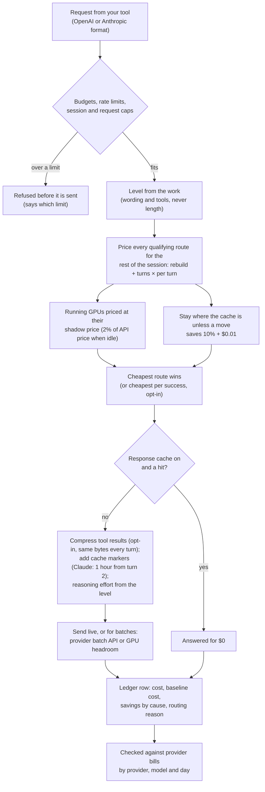
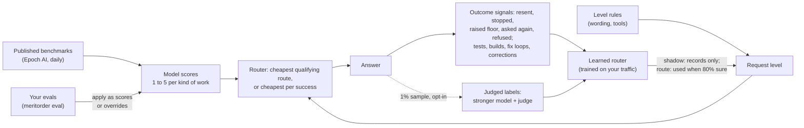

# Merit Order feature sheet

Merit Order is a self-hosted LLM gateway. Your tools keep their own API (OpenAI or Anthropic). For each request
sent with `model: "auto"`, Merit Order works out how demanding the work is, then sends it to the cheapest model and
backend that is good enough, counting what it would cost to rebuild the prompt cache somewhere else. It caches
prompts for you, keeps sessions where their cache is, sends work that can wait to batch prices or to your own idle
GPUs, starts and stops those GPUs at break-even, and records every request with what it cost, what it would have cost
without Merit Order, and why. It is open source under the AGPL-3.0.

> **Pre-production: version 0.0.1.** Everything below is built and tested in CI, but most of it only against
> mocks of each provider's API. What has been checked live is in [Honest limits](#honest-limits). Don't send it
> real traffic without an organization budget set.

Numbers on this page come from the shipped configuration (`config/meritorder.yaml`), its price list
(`config/prices.json`, refreshed 12 November 2026) and the worked examples in
[00 How it all works](00-how-it-all-works.md). Prices and scores refresh on their own, so yours will drift. Where a
number is an illustration rather than a measurement, it says so.

## How it saves money



### Routing to the cheapest qualifying model, counting cache rebuild cost

**What it does.** Every model has a 1 to 5 score for coding and for general work. A request gets a level for its
kind of work. Models scoring at least that level, with room in their context window for the conversation and allowed
for the team, qualify. Merit Order prices every route of every qualifying model (Anthropic, Bedrock, Vertex AI,
Foundry, OpenRouter, your GPUs, ...) for the rest of the session, not just this request:

```
cost of a route = rebuild + expected turns × cost per turn
```

`rebuild` is what it costs to get the conversation into that provider's cache: zero where it is already warm.
Expected turns are the turns so far, kept between 3 and 30 (`routing.min_expected_turns`, `max_expected_turns`).

**Why it saves.** Most requests don't need the strongest model. And a session's cache lives on one provider, so the
cheapest-looking route can be the dearest once you count the rebuild.

**Worked example** (router estimates, prices of 12 November 2026). A new coding session at level 3, 30,000 tokens in,
priced for three turns:

| Route | Score | Estimate for 3 turns |
|---|---|---|
| Claude Sonnet 5.5 on Anthropic (the shipped savings baseline, `baseline_model: claude-sonnet`) | 3.9 | $0.115 |
| Gemini 4 Argon (Vertex, OpenRouter) | 3.4 | $0.102 |
| GPT-6.1 Terra (Azure, OpenAI) | 4.2 | $0.051 |
| **Claude Haiku 5.5 on Anthropic, Bedrock, Vertex or Foundry (chosen)** | 3.0 | **$0.0060** |
| Claude Haiku 5.5 on OpenRouter | 3.0 | $0.0064 |

Every row is the router's own estimate (`Router.estimate`) on the shipped config and `config/prices.json`; for Sonnet:
input $2, cache read $0.10, 5-minute write $2.50, 1-hour write $4, output $10 per million tokens. The other rows are
also in [00, section 5](00-how-it-all-works.md#5-the-cheapest-qualifying-route-wins).
The estimates count a pause of 5 to 60 minutes on one later turn in ten (each team's own share once its sessions show one,
decision 60), which is why Haiku's 1-hour cache on the direct backends wins. Haiku is about 19 times cheaper than Sonnet
for this session. A level-4 agent task (hard wording, such as "fix the race condition") with 80,000 tokens goes to
GPT-6.1 Terra at $0.116 for three turns, against $0.499 on Claude Opus 5.5 through Anthropic, Bedrock, Vertex or Foundry.

A request that names a model (`claude-opus`) always gets that model. Merit Order then only picks the cheapest of its
routes.

### Sticky sessions and prompt caching

**What it does.** Merit Order adds Claude's cache markers when the client set none, sets OpenAI's `prompt_cache_key`
to the conversation, and never changes the early part of the prompt (no timestamps, stable tool order), so the
provider's cache keeps hitting. A session stays on its route unless moving saves at least 10% plus $0.01 over the rest
of the session (`routing.switch_margin_pct`, `switch_margin_usd`), and within a task (tool results coming back) it
keeps its model outright. On the four Claude backends of the shipped config (`cache_ttl_seconds: 3600`), the gateway
asks for a 5-minute cache on a session's first turn and a 1-hour cache from its second
([04](04-caching-and-sessions.md#how-long-claude-keeps-a-cache), decision 53). Subagents in a Claude Code session each
keep their own routing state, so they don't knock the main conversation off its cache.

**Why it saves.** Providers charge a tenth of the input price or less for cached tokens. A one-off request never
reads its cache back, so it gets the cheaper 5-minute write (1.25 times input instead of 2). A conversation that
comes back after a pause of 5 to 60 minutes reads its cache instead of writing it all again.

**Worked example** (arithmetic from Claude Sonnet 5.5's list prices). A 100,000-token conversation that adds 2,000
tokens a turn. The 1-hour cache costs $0.003 more per turn (2,000 tokens × $1.50 per million extra). If the person
steps away for 20 minutes, the next turn reads the prefix for $0.01 instead of writing it again for $0.25. Moving an
80,000-token Claude Opus 5.5 session, past its first turn, to another Claude backend whose cache is cold would cost
$0.61 to rebuild (at the 1-hour write price), against $0.044 a turn where it is (the router's estimate;
[00, section 5](00-how-it-all-works.md#5-the-cheapest-qualifying-route-wins)). The stickiness rule is what stops a
session bouncing between Bedrock and Anthropic.

Checked live: gateway-added Claude caching, with turns 2 and later at a tenth of the price. Not yet checked: the
caching savings against an Anthropic invoice.

### Cost per success (opt-in)

**What it does.** With `routing.model_choice: cost_per_success` (off by default; per team too), `auto` ranks models by
expected cost per solved task instead of "cheapest above the level". Each model's chance of solving work at the level
comes from its score. A failed try is still paid for, and the work is then redone on the model the threshold would
pick. A model with less than a 60% chance (`routing.min_success_chance`) is never picked.

**Why it saves.** The threshold treats a model just below the level as useless, though it solves nearly as much. A
much cheaper model that fails a little more often can still be cheaper per solved task.

**Worked example** ([00, section 5](00-how-it-all-works.md#5-the-cheapest-qualifying-route-wins)). The level-3
session above: DeepSeek V4.1 Flash (coding 2.4, a 62% chance) costs $0.0018 a try and $0.0051 per success, against
Claude Haiku's $0.0060 a try and $0.0086 per success (a 70% chance). DeepSeek wins. For level-5 coding (a 90,000-token
agent turn with the hardest wording, such as "design a plugin system"), Gemini 4 Carbon comes to $0.85 per success
against Claude Fable 5.2's $1.53.

The chances are read from benchmark scores, not yet measured against real outcomes.

### Expected total cost to finish the task (the default), with escalation (opt-in)

**What it does.** With `routing.model_choice: expected_cost` (the default; per team too), `auto` sends each task to
the model with the lowest expected cost to finish it: the try, plus its chance of failing times what a failure costs. A
failure costs the person's time it puts at stake and the next attempt, on the same model or a stronger one from a cold
cache. The person's cost (`human_cost_usd`, per team, $1 by default, shown on Config → Routing and Controls) is for a
failed level-5 agent task; each level below puts a third as much at stake, a request under 8,000 tokens less again, and
a correction the whole amount. So easy work (levels 1 and 2, questions, short chats) goes to the cheapest model that
meets its level, and a person's time counts where the work is hard. The chance comes from the benchmark at the
task's difficulty and, opt-in, a layer fitted to your own outcomes (each model's record, your team, repository and
project, the opening prompt), used only once it predicts outcomes better than the benchmark. With the cascade on
(off by default), inside a task, failing
tests, fix loops, error results and corrections lower the task model's chance, and the task escalates to a stronger
model when continuing would cost more: at the next human message, or after three failures in a row.

**Why it saves.** A cheap answer that has to be redone saves nothing, and the redo costs a person's time as well as
tokens. Counting both, and moving a struggling task up before more turns are spent on it, cuts the total cost of
getting work done. Escalations are charged against routing savings, so the savings numbers stay honest.

**Worked example** ([03](03-routing.md#expected-total-cost-to-finish-the-task)). A 30,000-token coding:3 task at
a $1 person's cost puts $0.11 at stake: Claude Haiku ($0.0060 a try, 70%) comes to ~$0.055 to finish, against GPT-6.1
Terra's ~$0.07 ($0.051 a try, 82%), so Haiku goes. A level-5 agent task goes to Gemini 4 Carbon ($0.26 a try) rather
than Claude Fable ($1.07). With the cascade on, if Haiku had the task, a test run failed and the person said "that's
wrong", its chance drops to 24%: continuing ~$1.00 against escalating to Terra ~$0.28, so it escalates. On the routing
simulator (2,000 tasks, a price of $15 per failed attempt) it costs $0.40 in model spend per finished task against the
threshold's $1.01, and no more than the threshold on any kind of work; it finishes 97.7% of tasks against 97.5%, at $3.08
against $3.63 per finished task in total, counting failed attempts ($0.40 model spend plus $2.67 time lost to failed
attempts; $3.40 for always-Sonnet). A failed attempt costs someone time: noticing it, asking again, waiting, cleaning
up; here that time has a price per failed attempt, an assumption you can change. The cascade finishes 0.1 points more at the same
$3.08 and a third more model spend, so it stays opt-in.

Every routing reason shows the chances and costs compared. Not yet checked against real traffic: whether the in-task
evidence predicts failure as the priors say, and what a failed attempt really costs a team. The recommendation is to run
the fitted layer in shadow mode until it beats the benchmark prior.

### Automatic reasoning effort

**What it does.** For `auto` requests, reasoning effort follows the level: low for levels 1 and 2, medium for 3,
high for 4 and 5 (`routing.effort_by_floor`). It is set once per session on a model, because changing it mid-session
would invalidate the prompt cache. A client's own effort setting always wins (Claude Code sends its own).

**Why it saves.** Reasoning tokens are billed as output, the most expensive kind of token. Models' own defaults differ
(Claude Opus 5.5 and Haiku 5.5 default to medium, most others to high), so a simple question would otherwise get high
effort on many models.

**Example** (arithmetic, not a measurement). At GPT-6.1 Terra's $5 per million output tokens, each 1,000 reasoning
tokens a level-1 question doesn't write saves $0.005. How many tokens low effort saves depends on the model and the
question; Merit Order doesn't report it as its own savings cause.

### Tool-output compression that keeps the cache valid

**What it does.** Two methods, both off by default and turned on per team, both touching tool results only:

- **The rules** (`compression: {enabled: true}`): strip terminal codes and trailing spaces, collapse repeated lines,
  and keep the first 60% and last 40% of anything over 24,000 characters (`max_chars`, `head_fraction`). Results
  under 4,000 characters (`min_chars`) are left alone.
- **Model-based** (`compression.model`, LLMLingua-2 in its own service): drops the least useful words from prose such
  as web pages and docs. Paths, numbers, identifiers, flags, quotes and error lines are protected.

The harness resends the original tool output every turn. If it were compressed differently each time, the prompt
prefix would change and the cache would miss. So the rules are deterministic, and the model's cut for each result is
decided once and stored (as character ranges, never text), so every later turn and every gateway sends the same bytes.

**Why it saves.** Fewer tokens on the turn a result arrives, and fewer cache reads on every turn after, without paying
to rebuild the cache.

**Worked example** (illustration from the rule settings). A 100,000-character test log becomes about 24,000
characters: roughly 25,000 fewer tokens at about 3 characters a token for code. On Claude Sonnet 5.5 that is $0.10
less on the turn it arrives (at the 1-hour write price) and $0.0025 less on every later turn (at the cache-read
price). Measured on the published LLMLingua-2 models, the model-based method removes 5 to 13% of a web page, docs or
search result at its default rate, and nearly nothing from code, logs and JSON
([04](04-caching-and-sessions.md#measured-on-the-published-models)). Whether agents still succeed on compressed
results hasn't been measured.

### Batch prices, and batch work in GPUs' spare capacity

**What it does.** Merit Order accepts OpenAI's Batch API and Anthropic's Message Batches. Each request in a batch is
routed like a live one, among routes whose provider has a batch API (at batch prices) and running GPU deployments (at
their shadow price). It splits the batch across providers and GPUs, reserves its estimated cost against budgets, and
joins the results back. GPU work runs at low priority in spare capacity only, never starts a GPU, and moves to a
provider's batch API if it hasn't run in 12 hours. Ten providers' batch APIs are supported.

**Why it saves.** Batch APIs cost about half the live price (Moonshot 40% off, xAI 20%). A GPU you are already paying
for costs almost nothing extra per token while it has room.

**Worked example** (illustration). 10,000 summaries of 5,000 tokens in and 500 out on Claude Sonnet 5.5 cost $150 live
($2 and $10 per million) and $75 at the batch price. The same work in a running GPU's headroom is charged only for the
GPU time it takes. The ledger records the batch discount as its own cause, because you could get it from the provider
directly.

Batch APIs are tested against mocks written from each provider's reference, not yet against the real ones.

### Self-hosted GPUs at break-even, with replica affinity

**What it does.** The GPU controller runs open-weight models on vLLM through SkyPilot (cloud GPUs), Kubernetes (KServe
or llm-d), or servers you run. With SkyPilot, each replica is a plain cluster of its own, on any cloud where SkyPilot
can run a Docker image and have the machine delete itself: AWS, GCP, Azure, Lambda, RunPod, Nebius, Kubernetes and
CoreWeave, Vast, Fluidstack, Paperspace, DigitalOcean, Mithril, Seeweb, and Slurm with Pyxis. A gate in front of vLLM
lets in only the deployment's key, and a replica whose lease the controller stops renewing shuts down and deletes its
machine, so a GPU doesn't keep billing after the controller is gone. Every minute it asks what the traffic a model could serve (requests at levels its
score covers) costs at API prices. It starts a replica when that spend exceeds the replica's hourly price plus 20%
(`serve.margin`) for 10 minutes straight, sizes replicas for 70% load, and drains when demand falls below break-even
for 10 minutes after at least 30 minutes of serving. While a GPU runs, the router prices it at 2% of the API price up
to 60% load (`routing.shadow_floor`, `shadow_knee`), rising to the full API price at 100%, so it wins the work it
qualifies for until it fills. Each session goes back to the replica that holds its KV cache, known from vLLM's KV
events where they're on, else estimated from vLLM's cache metrics.

**Why it saves.** Steady load is cheaper on your own GPU than per token; spikes are cheaper on APIs. The margins and
delays avoid paying for start-ups that don't last. Replica affinity avoids recomputing a long prefix on a cold replica.
The savings reported for it are counted after paying for the GPUs, idle and starting time included: a GPU that runs for
little traffic shows as a loss, and spend says how much of it was APIs and how much GPUs.

**Worked example** ([00, section 9](00-how-it-all-works.md#9-your-own-gpus-when-they-start-and-stop)). The shipped
`gpu-qwen-coder` deployment (Qwen3 Coder Next on four H100s, fallback price $16 an hour) starts once the work it could
do would cost more than $19.20 an hour at API prices for 10 minutes. Models → GPU break-even shows whether a model can
ever pay: on 11 November 2026 spot prices, only level-1 work could, for example gpt-oss-20b on one L4 ($0.12 an hour)
from about 72,000 tokens a minute. Today's cheap API models set a high bar, and the console says so.

Kubernetes is tested on a local kind cluster with a stand-in vLLM. SkyPilot is tested against a stand-in SDK, and
what it does on each cloud is read from SkyPilot 0.14.2's source; it hasn't run on a real cloud yet. Real vLLM replicas
are not yet checked.

### The response cache (opt-in)

**What it does.** An exact-match cache of responses, per team (`response_cache: {enabled: true, ttl_seconds: 3600}`)
or per request (`X-MeritOrder-Cache: on`). Keys include the team (or the user), so answers never cross that
boundary. Hits cost $0 and are recorded with the original cost as `savings_response_cache`.

**Why it saves.** Agent turns are almost never repeated, but chatbots, RAG, evals and pipelines often send the same
request again.

**Example** (illustration). A pipeline that sends the same $0.02 request 5,000 times a day, with a one-hour TTL,
pays for it about 24 times a day ($0.48) instead of 5,000 times ($100). It is one of the two places the gateway stores content, so it's off unless
a team turns it on.

### Budgets and runaway-agent caps

**What it does.** Monthly budgets for the organization, each team and each person (a request must fit all of them),
a GPU budget and fleet caps, requests- and tokens-per-minute limits, a per-session spend cap (`max_session_usd`), and
a per-request cost ceiling (`max_request_usd`, $25 in the shipped config). All are checked before a request is sent,
from the gateway's own counters, and a refusal says which limit it hit. Alerts go out at 80% and 100%.

**Why it saves.** Cloud budgets see spend hours later and only send email. A loop in an agent at 3 a.m. can spend a
lot before anyone reads it. Here the next request is refused.

**Example** (illustration from the shipped prices). A request that asks for 128,000 output tokens on Claude Fable 5.2
($40 per million) with 500,000 tokens of input ($8 per million) has a worst case of $9.12, under the shipped $25
ceiling. With the ceiling set to $5, cheaper candidates would be used instead, and if none fit, the request is refused
with what it would have cost. A team's `max_session_usd: 20` stops a looping agent session at $20, its subagents included.

### Savings measured per request, by cause, and checked against bills

**What it does.** Every request gets a ledger row (metadata, never content) with its actual cost, what the team's
baseline model (`baseline_model`) would have cost at API prices without caching Merit Order added, the list cost, and
savings split into seven causes: routing, prompt caching, self-hosting, batch discount, compression by the rules,
compression by the model, and the response cache. The causes are computed in a fixed order, each against the result
of the previous one, so they add up to the total with no double counting. Non-streamed replies carry
`x-meritorder-cost-usd`, `x-meritorder-baseline-usd` and `x-meritorder-savings-usd`.

The worker reads each provider's own cost data every 6 hours: Anthropic's and OpenAI's cost APIs, AWS Cost Explorer or
its CUR 2.0 export, the Google Cloud billing export, and Azure Cost Management or its exports. It compares them with the
ledger by provider, model and day, and alerts when a settled day differs by at least $1 and 5%. GPU time is compared
with the cloud bills by the deployment tag.

**Why it matters.** A savings number that finance can't check is a number finance won't trust. Prompt caching that
the harness set up itself isn't counted as a Merit Order saving, because it would have happened anyway.

**Example** ([06](06-auth-and-spend.md#the-savings-ledger)). A ledger row: requested `auto`, level `coding:3`, served
`qwen3-coder-next` on `gpu-qwen-coder`, 2,100 uncached tokens in, 118,000 read from cache, 640 out, with its cost as
GPU chargeback, its cost at the model's API price, and its cost on the baseline model.

So far only OpenRouter's recorded costs have been compared with a real bill (by hand: they matched for every request).
The other bill sources run against mocks.

## How it judges and routes



### Levels from the work, never from length

A request's level comes from rules on its wording and tools, with no model call, so it's instant and free. Plain text
is general 2; a short question on its own is general 1; analysis words make general 3; any tools or code make coding
3; five or more tools make coding 4; hard wording (race condition, security, migration, ...) adds one. Length never
raises a level: a long conversation only rules out models whose context window can't hold it. The rules are settings
(`routing.levels`), and everyone can see them on Reports → Levels. Clients can set the level (`X-Route-Floor`) or
nudge it (`X-Route-Hint: cheap` or `smart`). Claude Code's side requests (titles, summaries) are capped at level 1 and
its compaction summaries at level 3.

### Quality scores from benchmarks, refreshed daily

By default, scores come from [Epoch AI](https://epoch.ai/benchmarks)'s benchmark data (CC BY 4.0), which places
models and benchmarks on one ability scale. A model's score is its chance on a task as hard as FrontierSWE against a
fixed bar: a 5 is what the best model solved on 12 November 2026 (69.9% for coding), and one solving 60% as many such
tasks scores 3, so a new, stronger model changes nobody else's score (decision 58). The worker refreshes them every 24
hours (`quality.refresh_hours`). Artificial Analysis's index is the alternative source. A model the source doesn't
cover isn't picked by `auto`, because an unmeasured score would compete with measured ones and an optimistic guess
would win. On 12 November 2026, Claude Fable 5.2 scored 5.0 for coding, GPT-6.1 Terra 4.2, Claude Sonnet 5.5 3.9 and
Claude Haiku 5.5 3.0 (set by hand from evals; Epoch's refit had it at 2.9).

### Your own evals

`meritorder eval` (or Models → Evals in the console) runs graded tasks through the gateway: checks, tests in a sandbox,
agent environments, and judges only where nothing else works. A `codebase` suite replays real changes from a
repository's history, graded by its own tests. Results land on the same 1 to 5 scale and can be applied as scores or
as overrides. Every run shows its estimated cost first and has a spending cap; a run over $1 needs an explicit
confirmation ([11](11-evals.md#cost)).

### Outcome signals

With the learned router on (shadow or route), each task start records hashed features (never text) and what followed
its answer: a raised `X-Route-Floor` (weight 1.0), the same request sent again (0.6), a stream stopped by the client
(0.4), the same question asked again in a new session within 15 minutes (0.3), a refusal (0.2), and for coding agents
what their tool results show: a correction in the next prompt (0.7), tests failing at the end (0.5), a broken build
(0.4), a fix loop (0.3). Most answers get no
signal, and a missing signal isn't a success. The docs say so and weigh each signal accordingly
([03](03-routing.md#what-it-learns-from)).

### Judged labels (opt-in per team)

A small sample of a team's task starts (1% by default, only while the learned router is on) is replayed in the
background on a stronger model, and a judge from another model family says whether the answer the request got was
good enough. Unlike the outcome signals, a verdict says so either way. It sends those prompts and answers to two more
models, so the console says so and shows the expected monthly cost before it can be turned on, and a monthly cap
(`judged_labels.max_usd_month`) is required. Only the verdict is kept.

### The learned router, proven in shadow mode

The learned router (`routing.learned.mode`: `off` by default, `shadow` or `route`) corrects the rules' level from
your traffic's outcomes. It's an item response model, as Epoch places models and tasks on one scale, so it can judge
work on models it has seen little traffic on. A trained model is used only if it predicts held-out outcomes better
than the rules. In shadow mode it changes nothing: Reports → Learned router shows where it disagrees with the rules,
what each side's pick would cost, and the outcomes on each side. In route mode its level is used only when it is at
least 80% sure (`min_confidence`) and its model is under 30 days old (`max_age_days`); otherwise the rules decide, and
the routing reason says why. It never overrides a client's `X-Route-Floor`.

On synthetic traffic, the tests show that training recovers a known rule and that shadow mode never changes a
decision. How it does on real traffic is what the shadow report is for.

### Your own traffic as the benchmark

Built, and tested against mocks (decision 59, [03](03-routing.md#your-own-traffic-as-the-benchmark)):

- **Exploration** (opt-in per team, off by default; it needs the learned router on, in shadow mode at least).
  About 4% of a team's `auto` task starts are routed one level down or up, at random, at session start or a new task whose cache has gone cold, so no prompt cache is lost. Never for a
  named model or a client's `X-Route-Floor`, never outside the team's models, never up once a budget is 90% spent.
  Reports → Levels compares how often each arm succeeds, weighted by each arm's chance, and recommends a level change
  ("coding level 3: level 2 does as well in 98%; consider lowering") once each side has 200 task starts; an admin applies
  it, or the worker does when the learned router agrees. A model that becomes the cheapest at a level is tried first on
  20% of the level's task starts (a canary), and an alert says so.
- **Coding outcome signals.** From the tool results the gateway already sees, in Claude Code's, Codex's and pi's formats:
  tests failing after the last edit (weight 0.5), a broken build (0.4), fix loops (0.3), a "that's wrong" or "revert" in
  the next prompt (0.7), and turns and tokens to the end of a task. Only counts and flags are kept, and reading them adds
  about 0.06 ms of CPU to an agent turn.

## Works with your tools

- **Harnesses.** `meritorder setup claude-code`, `setup codex` (Codex CLI over the Responses API's WebSocket
  transport) and `setup pi` point each tool at the gateway with `model: auto` and the right context window. Codex's
  own tools (`apply_patch`, namespaced tools, tool search, local shell) work on every backend, and its web search on
  Claude; tested against mocks. Claude Code sessions have been run through the gateway on Claude Sonnet 5.5, GPT-5.6
  Terra and Kimi K3.1 by hand.
- **SDKs and apps.** OpenAI Chat Completions, OpenAI Responses (HTTP and WebSocket), Anthropic Messages (and
  `count_tokens`), embeddings, OpenAI's Batch API and Anthropic's Message Batches. Any OpenAI-compatible client needs
  only the base URL and a key.
- **Translation.** When a tool and the chosen model speak the same format, the request passes through untouched, so
  Claude's cache markers and thinking signatures survive. When they differ, Merit Order converts requests, replies and
  streams both ways: messages, tool calls, images, usage and stop reasons.
- **Providers.** Anthropic, Claude in Amazon Bedrock, Microsoft Foundry, Vertex AI (Claude and Gemini), the Gemini API,
  Azure OpenAI, OpenAI, xAI, OpenRouter, DeepSeek, Mistral, Moonshot, Z.ai, MiniMax, any OpenAI-compatible server (vLLM,
  SGLang, ...), and vLLM on your own GPUs. Failover moves a request to the next route on errors, rate limits and
  refusals, before anything reaches the client.

## Control and trust

- **Self-hosted.** Docker Compose or a Helm chart. Your keys, your network, your Postgres and Redis. The release workflow
  publishes signed multi-arch images when a version is tagged.
- **Keys, SSO and SCIM.** Virtual API keys; Entra ID, Google Workspace or any OIDC provider, with group-to-team and
  role mapping; SCIM provisioning; roles for users, team leads, finance and admins.
- **Content isn't stored by default.** The ledger and the session table hold metadata: hashes, timestamps, token
  counts, costs. The exceptions are opt-in or explicit: the response cache, the Responses API's stored mode (per team,
  sealed, with a retention the team chooses), and batch files, held sealed until a provider or GPU takes them.
- **AGPL-3.0 source.** You can read, change and run every line. If you change it and offer it to others over a
  network, you share your changes under the same license.
- **Every decision has a recorded reason.** Each ledger row keeps `route_reason`: the rule that set the level (and the
  word it matched, never the text around it), models ruled out by their context windows, the learned router's view,
  with cost per success the costs it compared, and with expected total cost both models' chances, the costs and any
  escalation's evidence. For example: `classified coding:4 (coding: 40 tools; hard wording
  (race condition): +1)`. Reports → Requests shows it for every request.

## How it compares

Checked on 15 November 2026 against each product's current public docs. "Partial" means the product does part of it,
or does it a different way; the numbered notes below the table say how, with sources. A ✓ for Merit Order means built
and tested in CI, which for most rows means against mocks ([Honest limits](#honest-limits)).

| Capability | Merit Order | LiteLLM proxy | OpenRouter Auto Router | Cloudflare AI Gateway | Portkey | Not Diamond | RouteLLM | Kong AI Gateway | Requesty | Helicone |
|---|---|---|---|---|---|---|---|---|---|---|
| Quality-floor routing from the work | ✓ | partial (1) | ✓ (2) | ✓, beta (3) | ✗ (4) | ✓ (5) | partial (6) | partial (7) | partial (8) | ✗ (9) |
| Cache-aware routing | ✓ | partial (1) | ✓ (2) | ✓ (3) | ✗ | ✗ | ✗ | partial (7) | partial (8) | ✗ |
| Cost per success | ✓, opt-in | ✗ | ✗ | partial (3) | ✗ | ✗ | ✗ | ✗ | ✗ | ✗ |
| Learned router from your outcomes | ✓, opt-in (10) | partial (1) | ✗ (2) | ✗ | ✗ | ✓ (5) | partial (6) | ✗ | ✗ | ✗ |
| Self-hosted GPU autoscaling at break-even | ✓ (11) | ✗ | ✗ | ✗ | ✗ | ✗ | ✗ | ✗ | ✗ | ✗ |
| Bill reconciliation | ✓ (12) | partial (13) | n/a: it is the bill | ✗ | ✗ | n/a | ✗ | ✗ | ✗ | ✗ |
| Savings attribution by cause | ✓ | partial (13) | ✗ | ✗ | ✗ | ✗ | ✗ | ✗ | ✗ | ✗ |
| Self-hostable | ✓ | ✓ | ✗ | ✗ | ✓ | partial (5) | ✓ | ✓ | ✗ | ✓ |
| Open source | ✓ AGPL-3.0 | ✓ MIT core (14) | ✗ | ✗ | ✓ MIT (4) | ✗ | ✓ | partial (7) | ✗ | ✓ (9) |

Martian isn't in the table: its documentation now lists a gateway and other products, and its router pages return 404
([docs.withmartian.com](https://docs.withmartian.com/)). We couldn't confirm with Martian whether the router is still
offered.

**Notes**

1. LiteLLM's Auto Routing (beta since v1.94.0) puts each request in one of four tiers with a heuristic scorer whose
   dimensions include prompt length, or with an LLM classifier, keyword rules or a plugin. Tiers map to models you
   choose; there are no quality scores per model. Session affinity (off by default) and a prompt-caching check keep a
   session or a cached prefix on one deployment, but a move's rebuild cost isn't priced. With `adaptive: true` it
   learns within a tier's pool by Thompson sampling, crediting feedback to the model that served
   ([auto routing](https://docs.litellm.ai/docs/proxy/auto_routing)).
2. A decision model rates each request on eleven aspects, and the policy "weighs that rating against live prices, cache
   status, and benchmark performance" within a `cost_tier`. "Switching models costs extra while the new model rebuilds
   the prompt cache, so the router is restrained about it", and it also picks a reasoning effort per request. It
   learns from OpenRouter's aggregate usage, not from your outcomes
   ([Auto Router](https://openrouter.ai/docs/guides/routing/routers/auto-router)).
3. A classifier estimates the task's type and difficulty; a scoring step ranks models by expected quality against
   cost, and it "switches models only when the expected benefit outweighs the cost of losing the cache". Its launch
   benchmark reports cost per success, but that's a published result, not a routing objective you can set
   ([Auto Router docs](https://developers.cloudflare.com/ai-gateway/features/auto-router/),
   [launch post](https://blog.cloudflare.com/auto-router/)).
4. Conditional routing matches metadata, request parameters and the URL path with operators such as `$eq` and
   `$regex`, not the prompt's content. The gateway is MIT; semantic caching is in the hosted and enterprise versions.
   Palo Alto Networks acquired Portkey in 2026
   ([conditional routing](https://portkey.ai/docs/product/ai-gateway/conditional-routing),
   [GitHub](https://github.com/Portkey-AI/gateway)).
5. Pre-trained routers for chat and code, and custom routers trained on your prompts, responses and scores. A router,
   not a gateway. VPC deployment on enterprise tiers. Shadow mode isn't documented
   ([docs](https://docs.notdiamond.ai/docs), [router training](https://docs.notdiamond.ai/docs/router-training-quickstart),
   [pricing](https://www.notdiamond.ai/pricing)).
6. A research framework: learned routers between one strong and one weak model, trained on Chatbot Arena preference
   data, which you can retrain yourself ([GitHub](https://github.com/lm-sys/RouteLLM)).
7. The `semantic` algorithm matches prompt embeddings to model descriptions you write; consistent hashing gives
   header-based stickiness. AI Proxy Advanced is part of the enterprise offering, though Kong Gateway itself is open
   source ([AI Proxy Advanced](https://developer.konghq.com/plugins/ai-proxy-advanced/)).
8. An LLM you choose classifies the first user message against route labels you write, with a confidence threshold.
   A conversation's route is pinned for 60 minutes so prompt caches keep working; a switch's cost isn't priced
   ([auto routing](https://docs.requesty.ai/features/auto-routing)).
9. Latency-based, weighted and cheapest-option load balancing; no routing on the work. Mintlify acquired Helicone in
   March 2026, and the gateway is in maintenance mode. The repository is open source; its README and repository
   metadata name different licenses ([GitHub](https://github.com/Helicone/ai-gateway),
   [announcement](https://www.mintlify.com/blog/mintlify-acquires-helicone)).
10. Shown on synthetic traffic only; how it does on real traffic is what its shadow report is for.
11. Tested on a local kind cluster with a stand-in vLLM, not yet on real GPUs.
12. Seven bill sources. Only OpenRouter's costs have been compared with a real bill; the others run against mocks.
13. "Spend capture rate" compares tracked spend with OpenAI's Organization Costs API; other providers are compared by
    hand ([spend capture rate](https://docs.litellm.ai/docs/proxy/spend_capture_rate)). Its auto-routing benchmark
    reports savings against a baseline, cache reads and writes included for supported Anthropic requests, as one
    figure rather than split by cause.
14. MIT core with a commercial enterprise license for some features ([GitHub](https://github.com/BerriAI/litellm)).

**What this shows.** Of the tools we checked on 15 November 2026, none combines most of these rows. But several rows
aren't unique to Merit Order:

- **Cache-aware, task-aware routing already exists.** OpenRouter's Auto Router and Cloudflare's Auto Router (beta) both
  read the request to judge the task, and both weigh the cost of losing a prompt cache before switching models.
  OpenRouter also chooses reasoning effort per request. Both are hosted services you can't run yourself.
- **Not Diamond trains routers on your own data** as a product, with more history than Merit Order's learned router.
  LiteLLM's adaptive mode learns from feedback within a tier.
- **Cloud platforms have learned routers too.** Azure's Foundry model router picks among Azure models with a trained
  model, in balanced, cost and quality modes; its session affinity doesn't read cache signals
  ([how it works](https://learn.microsoft.com/en-us/azure/foundry/openai/concepts/model-router-how-it-works)). AWS
  Bedrock's Intelligent Prompt Routing switches between two models of one family when the predicted quality gain
  passes a threshold, and its docs say it can't adjust to your application's own performance data
  ([docs](https://docs.aws.amazon.com/bedrock/latest/userguide/prompt-routing.html)). The open-source
  [vLLM Semantic Router](https://github.com/vllm-project/semantic-router) combines classifier signals with rules and a
  semantic cache.

What we found nowhere else: starting and stopping your own GPUs from what the traffic would cost at API prices,
savings split by cause so they add up, and checking costs against several providers' bills (LiteLLM does OpenAI's).
Cost per success as a routing objective appears only in Merit Order; Cloudflare reports it as a benchmark result.

**Where others are ahead.**

- **A hosted service.** OpenRouter and Cloudflare run at very large scale, with nothing to deploy. Merit Order is
  something you operate: Postgres, Redis, a worker, and optionally a GPU controller.
- **Maturity and production use.** LiteLLM, Kong, Portkey and OpenRouter are used in production by many organizations.
  Merit Order is 0.0.1, and most of it has been tested only against mocks.
- **Provider breadth.** LiteLLM covers over 100 providers and OpenRouter hundreds of models. Merit Order has 14
  provider APIs plus any OpenAI-compatible server.
- **Enterprise features.** Kong and Portkey (now part of Palo Alto Networks) have guardrails, API management and
  security features Merit Order doesn't try to have.

## Honest limits

Merit Order is 0.0.1. About 1,820 tests run in CI (95% line coverage floor), each gateway, storage and state test
against both in-memory stores and real Redis and Postgres. But most provider behaviour is tested against mocks written
from the providers' docs.

**Checked live so far:** OpenRouter, Anthropic and OpenAI (smoke tests, `auto` routing, prompt caching in real
sessions, OpenRouter's recorded costs against its bill), Claude Code sessions through the gateway, the Docker Compose
stack, GPUs on Kubernetes on a local kind cluster with a stand-in vLLM, model-based compression on a laptop, and
ClickHouse reports at 20 million rows.

**Tested only against mocks, needing live accounts:**

- every other provider's smoke test (Bedrock, Foundry, Vertex AI, the Gemini API, Azure OpenAI, xAI, DeepSeek, Mistral,
  Moonshot, Z.ai, MiniMax);
- every provider's real batch API, and every bill source except OpenRouter's;
- Anthropic prompt-caching savings against an invoice;
- a real GPU cycle on SkyPilot on any cloud, real vLLM replicas (replica affinity, KV events), and Kubernetes on real
  GPUs;
- Entra and Google sign-in, Google Groups and SCIM from real tenants;
- cost-per-success chances, the learned router's signals (the coding ones too) and judged labels against real outcomes,
  exploration's recommendations on real traffic, the session pause share, and measured eval
  scores on real models;
- whether agents still succeed on compressed tool results;
- a real Codex CLI session (and `apply_patch` on Claude or Kimi), Claude's web search, and a real pi session.

**Known gaps in the design:** the level rules are word lists, so a listed word raises a task whatever it's about
("security" in "update the security page's footer" makes it level 5). Some scores are estimated from general ability.
Token counts are estimates corrected per model by its replies. Sessions that switched backends and the rebuild cost
they paid aren't reported yet, and neither is what lower reasoning effort saved.

The full list is in [what's verified](README.md#whats-verified-and-what-still-needs-live-accounts). What 0.1.0 waits
for is in [ROADMAP.md](../ROADMAP.md).
